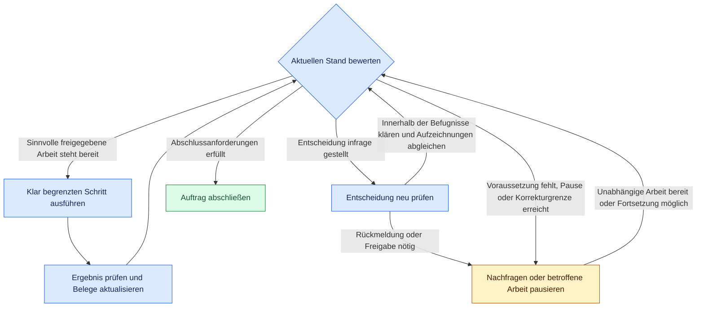

# Lusona Skills

[English](README.md) | [Español](README.es.md) | [Deutsch](README.de.md) | [简体中文](README.zh-CN.md) | [日本語](README.ja.md)

Lusona verbindet Skills für Programmieragenten durch einen gemeinsamen Arbeitszyklus:

- **Auswählen, ausführen, prüfen, wiederholen.** Das Ziel und die aktuellen Belege bestimmen
  den nächsten Schritt. Bei Bedarf geht es zurück zur Erkundung, Untersuchung, zum Entwurf,
  zur Implementierung oder zum Review. Eine feste Reihenfolge der Skills gibt es nicht.
- **Entscheidungen bei neuen Erkenntnissen überarbeiten.** Stellen Belege eine frühere
  Entscheidung infrage, wird sie im Rahmen der vereinbarten Befugnisse neu geprüft.
  Betroffene Aufzeichnungen werden aktualisiert, damit die weitere Arbeit der neuen Entscheidung folgt.
- **Im Rahmen der Freigabe weiterarbeiten.** Übliche Detailfragen klärt der Agent selbst und
  arbeitet ohne wiederholte Freigabe weiter. Geht eine Entscheidung über seine bisherigen
  Befugnisse hinaus, fragt er nach.
- **Den Abschluss prüfen.** Der vereinbarte Umfang, erforderliche Prüfungen und Reviews sowie
  eine verlangte Abnahme oder Auslieferung müssen erfüllt sein. Ist der Abschluss blockiert,
  nennt der Agent die verbleibende Arbeit.

Für Claude Code, Codex, [Cursor](INSTALL.md#cursor), [Programmieragenten in Xcode 27](INSTALL.md#xcode) und [Google Antigravity App, CLI und IDE](INSTALL.md#antigravity) · Version des Quellcodes in dieser Arbeitskopie: **1.4.0**

> [!WARNING]
> Installiere Lusona nicht mit Vercel Skills (`npx skills@latest`); nutze die [Installation als natives Plugin](#installation).

Warum wir Lusona Skills entwickelt haben: [When the workflow became another job](https://blog.lusona.com/blog/when-the-workflow-became-another-job/) (auf Englisch).

Diese README beschreibt den Stand dieser Arbeitskopie. Bei der Installation über GitHub
wird der Stand verwendet, der per Commit gespeichert und ins Remote-Repository gepusht wurde.
Lokale Änderungen sind damit noch nicht veröffentlicht.

<a id="index"></a>
## Inhalt

- [Wo anfangen?](#where-to-start)
- [Einen Befehl wählen](#choose-a-command)
- [Installation](#installation)
- [Wie die Arbeit weitergeht](#how-the-work-continues)
- [Fragen und Belege](#questions-and-evidence)
- [Wiederherstellung und Fortsetzung](#recovery-and-resumption)
- [Ergebnisse und Übergaben](#results-and-handoffs)
- [Referenzen](#reference)
- [Mitwirken](#contributing)
- [Lizenz](#license)
- [Entwicklung](#development)

<a id="where-to-start"></a>
## Wo anfangen?

Beginne mit **status**, wenn du in ein Projekt einsteigst, Arbeit wieder aufnimmst oder
entscheiden möchtest, was als Nächstes ansteht. Der Skill bewertet die vorhandenen
Aufzeichnungen und Belege, erklärt, was noch offen ist, und empfiehlt den nächsten Schritt.
Das funktioniert auch, wenn es im Projekt noch keine Lusona-Aufzeichnungen gibt. Eine
Statusabfrage erteilt keine Freigabe für neue Implementierungsarbeit.

Bei einer neuen Idee hilft **explore**, Möglichkeiten und ihre Vor- und Nachteile zu
untersuchen; **frame-product** klärt Nutzer, Problem und Produktausrichtung. Sobald diese
Ausrichtung klarer wird, ermittelt **map-capabilities**, welche Funktionen das Produkt
braucht und in welcher Reihenfolge sie sinnvoll umgesetzt werden können. **specify** und
**architect** klären die nötigen Verhaltens- und Designentscheidungen für eine Änderung;
**implement** setzt eine freigegebene Änderung um und prüft das Ergebnis.

Das sind typische Verläufe, keine vorgeschriebenen Phasen. Beginne mit dem Aufgabenbereich,
der zum aktuellen Bedarf passt, überspringe geklärte Fragen und kehre bei neuen Belegen zu
jedem Bereich zurück. Eine Untersuchung kann vor einer Spezifikation nötig sein oder eine
Implementierung unterbrechen; ein Review kann Anlass geben, einen Entwurf zu überarbeiten.

| Aufgabenbereich | Skills und Aufgaben |
| --- | --- |
| Orientierung gewinnen | [status](plugins/lusona/skills/status/SKILL.md): Fortschritt, offene Arbeit und den nächsten sinnvollen Schritt bewerten |
| Ausrichtung entwickeln | [explore](plugins/lusona/skills/explore/SKILL.md): Möglichkeiten und ihre Vor- und Nachteile untersuchen<br/>[frame-product](plugins/lusona/skills/frame-product/SKILL.md): Nutzer, gewünschte Ergebnisse und Grenzen festlegen<br />[map-capabilities](plugins/lusona/skills/map-capabilities/SKILL.md): Funktionsumfang, Abhängigkeiten und Reihenfolge der Umsetzung erfassen |
| Eine Änderung definieren | [specify](plugins/lusona/skills/specify/SKILL.md): Verhalten, Akzeptanzkriterien und TDD-Vorgaben vereinbaren |
| Umsetzen und beurteilen | [implement](plugins/lusona/skills/implement/SKILL.md): eine Verhaltensänderung oder Fehlerkorrektur planen und umsetzen<br />[review](plugins/lusona/skills/review/SKILL.md): einen Diff auf Fehler und fehlende Prüfungen untersuchen<br />[refactor](plugins/lusona/skills/refactor/SKILL.md): die Struktur verbessern und dabei das Verhalten erhalten |
| Belege gewinnen | [investigate](plugins/lusona/skills/investigate/SKILL.md): Ursachen oder Machbarkeit klären<br />[measure](plugins/lusona/skills/measure/SKILL.md): Größen, Qualität, Kosten oder Veränderungen feststellen<br />[experiment](plugins/lusona/skills/experiment/SKILL.md): eine gezielte Maßnahme oder Alternativen erproben |
| Ausgewählte Arbeit koordinieren | [batch](plugins/lusona/skills/batch/SKILL.md): mehrere ausgewählte Ziele mit ausdrücklicher Erlaubnis zur unbeaufsichtigten Ausführung koordinieren |

Übliche Designentscheidungen gehören zur Implementierung oder zum Refactoring. Wenn du eine
Implementierung oder ein Refactoring eindeutig beauftragst, kann der Agent ohne gesonderten
`specify`-Befehl beginnen, sobald Umfang, Vorgaben für testgetriebene Entwicklung (TDD) und
Voraussetzungen geklärt sind.

<a id="choose-a-command"></a>
## Einen Befehl wählen

Rufe den Skill auf, der zum aktuellen Bedarf passt. Der Agent nutzt bei Bedarf weitere
Skills im Rahmen deiner Freigabe; du musst nicht jeden Übergang selbst anweisen.

In Claude Code rufst du `/lusona:<command>` auf. In Codex wählst du den Lusona-Skill in der
Skill-Oberfläche aus. In Cursor gibst du `/` im Agent-Chat ein und wählst den Skill. In Xcode
gibst du `/` in einer Agentenunterhaltung ein und wählst den installierten Skill.
In Antigravity App/CLI nutzt du `/<skill-name>`; in der eigenständigen IDE prüfst du
**Customizations** und nennst den Lusona-Skill in deiner Anfrage.
[Installiere Lusona](#installation), bevor du diese Befehle nutzt.

Nenne die Frage oder das Ziel und die Grenzen der Befugnisse des Agenten. Zum Beispiel:

> **status:** Bewerte dieses Projekt anhand der vorhandenen Aufzeichnungen und des
> Arbeitsverzeichnisses. Nenne die verbleibende Arbeit und empfiehl, wo ich anfangen sollte.

> **explore:** Hilf mir, Einladungslinks mit Einladungen ausschließlich per E-Mail
> zu vergleichen. Erkläre die Folgen für unser Supportteam, bevor wir uns entscheiden.
> Führe dieses Gespräch im Chat; speichere keine Dateien.

> **implement:** Lass Einladungen nach sieben Tagen ablaufen. Lass bereits angenommene
> Einladungen unverändert. Fertig bedeutet: Einladungen, die älter als sieben Tage sind,
> werden abgelehnt, angenommene Einladungen bleiben unverändert, und alle Tests sind
> erfolgreich. Nutze gezieltes TDD für den Ablaufzeitpunkt. Prüfe lokal; führe kein Deployment durch.

Für eine reine Planung bitte `implement` um ein Vorgehen und einen Prüfplan, ohne
Implementierung oder Abhängigkeiten zu bearbeiten. Ein Gespräch, eine Spezifikation, ein
Plan, eine Architekturentscheidung oder ein Review erteilt keine Freigabe zur Implementierung.

Lege die TDD-Vorgaben vor einer Implementierung oder einem Refactoring ausdrücklich in deiner
Anfrage oder als dauerhafte Einstellung fest:

- `none`: Prüfungen bleiben erforderlich; Tests müssen aber nicht vor der Implementierung entstehen.
- `targeted`: Für die angegebenen Verhaltensweisen schreibt der Agent zuerst die Tests.
- `strict`: Für jedes geänderte, testbare Verhalten schreibt der Agent zuerst die Tests.

Hinterlege eine dauerhafte Einstellung in der `docs/lusona/README.md` des Projekts oder in den
Agentenanweisungen (`CLAUDE.md` oder `AGENTS.md`), zum Beispiel
`TDD: targeted for changed behavior`. Ohne ausdrückliche Auswahl kann der Agent untersuchen
und planen; vor der Implementierung fragt er nach.

<a id="installation"></a>
## Installation

Wähle deine Anwendung. Installiere über HTTPS aus dem öffentlichen Repository
[lusona/ai-skills](https://github.com/lusona/ai-skills); für den Download brauchst du keine
GitHub-Zugangsdaten.

<a id="antigravity"></a>
### Antigravity

Installiere direkt von GitHub:

```bash
agy plugin install https://github.com/lusona/ai-skills.git
```

Die URL installiert Lusona über das Manifest im Repository-Stamm. Prüfe für App und
eigenständige IDE nach dieser globalen CLI-Installation **Customizations**.
Rufe in App/CLI `/status` auf; bitte in der IDE um den Lusona-Skill `status`.
Die [Antigravity-Installationsanleitung](INSTALL.md#antigravity) beschreibt lokale Arbeitskopien,
portable Pakete, Updates, Deinstallation und die Grenzen der Prüfung. Die GitHub-Installation
wurde mit CLI 1.4.12 unter Linux geprüft; das interaktive Verhalten in App/IDE wurde nicht getestet.

<a id="claude-code"></a>
### Claude Code

```bash
claude plugin marketplace add https://github.com/lusona/ai-skills.git
claude plugin install lusona@lusona-ai-skills --scope user
```

<a id="codex"></a>
### Codex

```bash
codex plugin marketplace add https://github.com/lusona/ai-skills.git
codex plugin add lusona@lusona-ai-skills
```

<a id="cursor"></a>
### Cursor

Öffne **Customize > From GitHub Repository**, gib `https://github.com/lusona/ai-skills` ein
und installiere **Lusona Skills** für dein Projekt oder deinen Nutzer. Gib im Agent-Chat `/`
ein, um die Lusona-Skills zu finden. Die [Cursor-Anleitung](INSTALL.md#cursor) verlinkt die
aktuelle Cursor-Dokumentation und nennt den Teststatus.

<a id="xcode"></a>
### Xcode

Öffne in Xcode 27 **Settings > Intelligence > Agents > Plug-ins > Add Plug-in**.
Wähle **Add from URL**, gib `https://github.com/lusona/ai-skills` ein und wähle die Lusona-Skills,
die du installieren möchtest. Die [Installationsschritte für Xcode](INSTALL.md#xcode)
beschreiben Einrichtung, lokale Importe und Versionsdetails.

Starte nach der Installation eine neue Sitzung in deinem Projekt. Angaben zur Installation
aus einer lokalen Arbeitskopie, zu portablen Paketen, Updates und zur Deinstallation findest
du in der [Installationsanleitung](INSTALL.md). Wähle eine Katalogquelle:
lokale Arbeitskopie oder GitHub.

<a id="how-the-work-continues"></a>
## Wie die Arbeit weitergeht

Derselbe Arbeitszyklus gilt für alle Aufgabenbereiche. Je nach aktueller Frage und den
vorliegenden Belegen kann als Nächstes ein Gespräch, ein Experiment, eine Codeänderung oder
ein Review nötig sein. Wo eine Reihenfolge erforderlich ist, bestimmen weiterhin
Abhängigkeiten, gemeinsam genutzter Zustand, ausdrückliche Nutzerentscheidungen und die
gewählten TDD-Vorgaben den Ablauf.

Planung gehört zur Implementierung und passt sich dem Verlauf der Arbeit an. Für kleine,
klare Änderungen reichen ein Ziel und die nötigen Prüfungen; Abhängigkeiten, Unsicherheit,
Koordination oder die Wiederaufnahme unterbrochener Arbeit können einen ausdrücklichen
Plan erfordern. Du kannst auch einen Plan anfordern, ohne die Ausführung freizugeben.



Das Diagramm zeigt den [gemeinsamen Arbeitszyklus](plugins/lusona/README.md#work-loop), keine
Reihenfolge von Skills. Warten und Pausieren betreffen jeweils die betroffene Arbeit;
unabhängige Aufgaben können innerhalb der bestehenden Freigabe weitergehen. Für den
Arbeitszyklus gelten vier Regeln:

- **Fortsetzen**, solange sinnvolle freigegebene Arbeit übrig ist, ohne dich zum Aufruf des
  nächsten Skills aufzufordern.
- **Nachfragen**, wenn eine Entscheidung oder Erlaubnis fehlt. Währenddessen unabhängige
  freigegebene Arbeit fortsetzen; Schweigen gilt weder als Antwort noch als Erlaubnis.
- **Pausieren**, wenn du es verlangst, eine Voraussetzung fehlt oder die Korrekturgrenze
  erreicht ist. Nennen, was zur Fortsetzung nötig ist. Nach einer von dir angeforderten
  Pause musst du die Fortsetzung veranlassen.
- **Abschließen** erst dann, wenn der gesamte freigegebene Umfang, erforderliche Prüfungen
  und Reviews sowie eine verlangte Abnahme oder Auslieferung erfüllt sind. Fehlgeschlagene
  oder noch ausstehende Pflichtprüfungen verhindern den Abschluss.

Stellen Belege eine akzeptierte Entscheidung infrage, benennt der Agent den Widerspruch und
prüft die Entscheidung innerhalb seiner bestehenden Befugnisse neu. Geht eine Änderung
darüber hinaus, fragt er dich. Er gleicht betroffene Aufzeichnungen und Aufgaben ab,
bewahrt weiterhin nützliche frühere Begründungen und setzt die Arbeit auf Grundlage der
neuen Vereinbarung fort. Veraltete Aufzeichnungen dürfen überholte Entscheidungen nicht
wieder in Kraft setzen.

Bei wiederholten Fehlern gelten [Korrekturgrenzen](plugins/lusona/references/corrections.md);
für Batches gilt ein vereinbartes Budget für Korrekturversuche. Hält eine solche Grenze die
betroffene Arbeit an, nennt der Agent die Belege und die Bedingungen für die Fortsetzung.

Der Hauptagent koordiniert Fragen, Aufgabenverteilung, Integration und Prüfung und delegiert
wesentliche Produkt- und Entwicklungsarbeit an Spezialisten. Gespräche zur Erkundung und zum
Status kann er selbst führen. Unabhängige Reviews sind nach den Regeln des Nutzers oder
Repositorys erforderlich sowie bei Sicherheitsgrenzen, persistenten Daten, gemeinsam
genutzten technischen Verträgen oder wenn mehrere Beteiligte ihre Änderungen aufeinander
abstimmen müssen. Ist Delegation nicht verfügbar oder verboten, kann freigegebene Arbeit
lokal weitergehen; ein erforderliches unabhängiges Review braucht weiterhin einen anderen
Reviewer. Siehe [Delegation](plugins/lusona/references/delegation.md).

<a id="questions-and-evidence"></a>
## Fragen und Belege

Die Fragen richten sich nach den offenen Entscheidungen der Arbeit. Der Agent nutzt bereits
geklärte Antworten, prüft ermittelbare Fakten und fragt dich nach deiner Absicht und
folgenreichen Abwägungen. Er erklärt Optionen so ausführlich, wie du es brauchst; eine
Erkundung kann mit besserem Verständnis statt mit einer Entscheidung enden. Siehe
[Gespräche zur Klärung der Absicht](plugins/lusona/references/interviews.md).

Untersuchungen, Messungen und Experimente können in jedem Aufgabenbereich hilfreich sein.
Weitere Arbeit muss eine sinnvolle Frage innerhalb des freigegebenen Umfangs und des
geltenden Budgets beantworten. Die Ergebnisse unterscheiden zwischen Belegen, Annahmen und
Unsicherheit; ein vorgeschlagener Folgeschritt erteilt keine Freigabe für dessen Umsetzung.

Diagramme und visuelle Alternativen kommen zum Einsatz, wenn sie bei einer Entscheidung
helfen. Akzeptierte visuelle Referenzen bleiben unter `docs/lusona/visuals/` erhalten;
ihre verbindlichen Vorgaben werden bei Implementierung und Review geprüft.
Siehe [visuelle Darstellungen](plugins/lusona/references/visuals.md).

Entscheidungsrelevante Messungen und Experimente liegen in `docs/lusona/evidence/` des
Projekts, das Lusona nutzt. Spezifikationen, Notizen und Verlauf verlinken die genauen Läufe,
auf denen sie beruhen; bestehende Aufzeichnungen bleiben an ihrem Ort.

<a id="recovery-and-resumption"></a>
## Wiederherstellung und Fortsetzung

Der Agent speichert wesentliche Entscheidungen, Erkenntnisse und Prüfbelege ohne gesonderte
Aufforderung in den Projektaufzeichnungen, auch bei kleinen Aufgaben. Wenn möglich,
aktualisiert er bestehende Aufzeichnungen; gewöhnliche Gespräche und kurze Statusauskünfte
brauchen keine Datei. Vorgaben zu reinem Lesezugriff, Speicherverboten und Ablageorten haben Vorrang.

Die Aufzeichnungen halten das Ziel, die Befugnisse, die TDD-Vorgaben, aktuelle Entscheidungen,
nützliche Belege, offene Fragen und den nächsten Schritt fest, bei Bedarf auch
Zuständigkeiten und die Zahl der Korrekturen. Folgenreiche Architekturentscheidungen
benötigen ADRs. Eine Spezifikation erfordert einen Eintrag in `docs/lusona/work.md`; Arbeit
ohne Spezifikation kann allein mit Notizen auskommen. Der Status eines Eintrags beschreibt
den Fortschritt, legt aber weder den nächsten Skill fest noch erteilt er eine Freigabe zur
Ausführung. Siehe [Aufzeichnungen und Aufbewahrung](plugins/lusona/references/retention.md)
und [Regeln für die Warteschlange](plugins/lusona/references/queue.md).

Bei der Fortsetzung gleicht der Agent erhaltene Aufzeichnungen mit dem Arbeitsverzeichnis
ab und fragt nur nach wesentlichen Informationen, die er nicht wiederherstellen kann.
Bestehende Freigaben gelten weiter. Mit **status** lässt sich die verbleibende Arbeit
bewerten; alternativ kannst du die Arbeit nennen, die fortgesetzt werden soll:

> Setze die Untersuchung zum Ablauf von Einladungen anhand der gespeicherten Erkenntnisse
> fort. Prüfe den festgehaltenen Reproduktionsfall mit dem aktuellen Build.
> Ändere das Verhalten des Produktionscodes nicht.

Eine plötzliche Unterbrechung kann das Speichern verhindern. Können Aufzeichnungen nicht
gespeichert werden, erklärt der Agent die Einschränkung für eine spätere Fortsetzung und
stellt die Erkenntnisse im Gespräch bereit.

<a id="results-and-handoffs"></a>
## Ergebnisse und Übergaben

Ausführliche Berichte nennen das Ergebnis, die Belege dafür und einen gegebenenfalls nötigen
nächsten Schritt. Sie unterscheiden zwischen abgeschlossener Arbeit, laufender Arbeit,
fehlenden Informationen und pausierter Arbeit. Der Abschluss bezieht sich auf die
freigegebene Anfrage: Eine abgeschlossene Diagnose bedeutet nicht, dass der Fehler behoben ist.

Beispiel einer Übergabe, kein Nachweis geleisteter Arbeit:

> **✅ Abgeschlossen · Ergebnis:** Diagnose abgeschlossen; die Reproduktion bestätigt, dass
> die Ablaufprüfung den falschen Zeitstempel verwendet. Die Korrektur im Produktionscode
> ist noch nicht freigegeben.
>
> **Belege:** Der festgehaltene Fall und die gezielte Prüfung stimmen überein.
> Plattformübergreifendes Verhalten wurde noch nicht getestet.
>
> **Nächste Aktion:** Du kannst die Korrektur des Zeitstempels freigeben und die TDD-Vorgaben
> festlegen; anschließend kann der Agent diese klar begrenzte Korrektur umsetzen und prüfen.

Bleibt Arbeit übrig, nennt der nächste Schritt die zuständige Person oder den zuständigen
Agenten, die nötigen Informationen und noch fehlende Freigaben. Gewöhnliche Gespräche
brauchen kein Berichtsformat. Das gezeigte Format wird erprobt; dein gewünschtes Format
und die Einschränkungen der Anwendung haben Vorrang. Wie es sich in den verschiedenen
Anwendungen verhält, ist noch nicht überprüft. Siehe
[Review und Kommunikation](plugins/lusona/README.md#review-and-communication).

<a id="reference"></a>
## Referenzen

- [Installation und Deinstallation](INSTALL.md)
- [Datenschutzerklärung](PRIVACY.md)
- [Nutzungsbedingungen](TERMS.md)
- [Workflow-Regeln und Arbeitszyklus](plugins/lusona/README.md#work-loop)
- [Skill-Auswahl und Begriffe](plugins/lusona/references/workflow-guide.md)
- [TDD-Vorgaben und Reihenfolge](plugins/lusona/references/tdd.md)
- [Batch-Ausführung und Wiederherstellung](plugins/lusona/references/batch-execution.md)
- [Aufzeichnungen und Aufbewahrung](plugins/lusona/references/retention.md)
- [Abschluss und Wiederaufnahme](plugins/lusona/references/closeout.md)
- [Delegation und Modellzuordnung](plugins/lusona/references/delegation.md)

<a id="contributing"></a>
## Mitwirken

[CONTRIBUTING.md](CONTRIBUTING.md) beschreibt den Umfang von Beiträgen, lokale Prüfungen und Pull
Requests. Nutze die [Formulare für Fehler und Funktionswünsche](https://github.com/lusona/ai-skills/issues/new/choose),
um Probleme zu melden oder Verbesserungen vorzuschlagen. Das Team `@lusona/core` ist für die
Reviews im Repository zuständig.

<a id="license"></a>
## Lizenz

Skills, Vorlagen, Dokumentation und Skripte stehen unter der [MIT-Lizenz](LICENSE).

<a id="development"></a>
## Entwicklung

Die maßgeblichen Workflow-Quellen liegen in `plugins/lusona/`. Projektdaten gehören in
`docs/lusona/` des Projekts, das Lusona nutzt. Die Vorlage für eine leere Warteschlange liegt
in `templates/work.md`.

Die Hilfsskripte für Projektaufzeichnungen verwenden Bash oder PowerShell; siehe
[Laufzeitanforderungen](INSTALL.md#requirements). Python 3 wird weiterhin für die Paketerstellung
und Python-Evaluationen benötigt, jedoch nicht für die normale Plugin-Nutzung.

```bash
claude plugin validate plugins/lusona
claude plugin validate .claude-plugin/marketplace.json
python3 scripts/package.py
```

Der Paketgenerator prüft Identität und Version der nativen Manifeste, Links, Katalogpfade und
die Dateiauswahl. Er schreibt nach `tmp/lusona-package/` innerhalb des Repositorys; für einen
weiteren Build nutzt du `--output tmp/<new-directory>`. Alle nativen Manifeste müssen dieselbe
Version verwenden. Die Installation über GitHub nutzt Quellen, die per Commit erfasst und
gepusht wurden; eine lokale Arbeitskopie kannst du vor der Veröffentlichung verwenden.
Weder bei der Installation noch beim Erstellen der Pakete werden Projektaufzeichnungen angelegt.

Weniger Quelltext allein belegt keine Einsparungen beim Tokenverbrauch oder bei der Latenz.
Dafür braucht es Messungen, die den Koordinator und sämtliche ausführenden Agenten einschließen.
