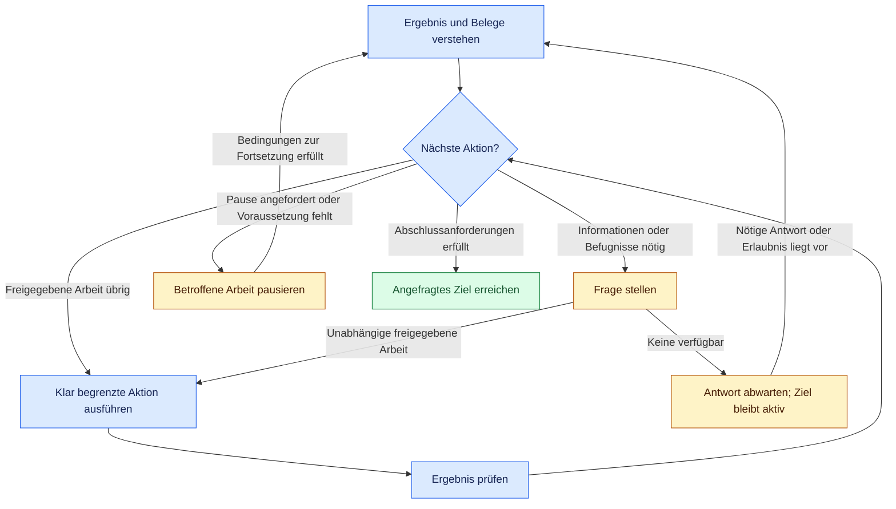

# Lusona Skills

[English](README.md) | [Español](README.es.md) | [Deutsch](README.de.md) | [简体中文](README.zh-CN.md) | [日本語](README.ja.md)

Lusona hilft einem KI-Agenten, deine Anfrage zu verstehen, umzusetzen und das Ergebnis zu
prüfen. Du bestimmst das Ziel, die Vorgaben und die Befugnisse. Anhand der vorliegenden Belege
wählt der Agent den nächsten sinnvollen Schritt und setzt die freigegebene Arbeit fort.
Wenn er Informationen oder eine Erlaubnis von dir braucht, fragt er nach.

Für Claude Code, Codex, [Cursor](INSTALL.md#cursor) und [Programmieragenten in Xcode 27](INSTALL.md#xcode) · Version des Quellcodes in dieser Arbeitskopie: **1.1.0**

> [!WARNING]
> Installiere Lusona nicht mit Vercel Skills (`npx skills@latest`); nutze die [Installation als natives Plugin](#installation).

Warum wir Lusona Skills entwickelt haben: [When the workflow became another job](https://blog.lusona.com/blog/when-the-workflow-became-another-job/) (auf Englisch).

Diese README beschreibt den Stand dieser Arbeitskopie. Bei der Installation über GitHub
wird der Stand verwendet, der per Commit gespeichert und ins Remote-Repository gepusht wurde.
Lokale Änderungen sind damit noch nicht veröffentlicht.

<a id="index"></a>
## Inhalt

- [Mit einem Ziel beginnen](#start-with-an-outcome)
- [Einen Befehl wählen](#choose-a-command)
- [Installation](#installation)
- [Wie die Arbeit weitergeht](#how-the-work-continues)
- [Fragen und Belege](#questions-and-evidence)
- [Wiederherstellung und Fortsetzung](#recovery-and-resumption)
- [Ergebnisse und Übergaben](#results-and-handoffs)
- [Referenzen](#reference)
- [Mitwirken](#contributing)
- [Lizenz](#license)
- [Entwicklung](#development)

<a id="start-with-an-outcome"></a>
## Mit einem Ziel beginnen

Für eine klar umrissene Änderung nutzt du `/lusona:implement` in Claude Code oder wählst
`implement` in Codex. Gib in deiner Anfrage die Vorgaben für testgetriebene Entwicklung
(Test-driven Development, TDD) an:

> Lass Einladungen nach sieben Tagen ablaufen. Lass bereits angenommene Einladungen unverändert.
> Fertig bedeutet: Einladungen, die älter als sieben Tage sind, werden abgelehnt, angenommene
> Einladungen bleiben unverändert, und alle Tests sind erfolgreich. Nutze gezieltes TDD (`targeted`)
> für den Ablaufzeitpunkt. Prüfe lokal; führe kein Deployment durch. Frage nach, falls eine
> folgenreiche Entscheidung die Änderung blockiert.

Beschreibe das Ziel, die Abschlusskriterien und was der Agent tun darf. Er übernimmt die
nötige Planung und führt die freigegebenen Schritte ohne weiteren Befehl aus. Anschließend
berichtet er das Ergebnis, die durchgeführten Prüfungen und ihre Ergebnisse sowie offene
Entscheidungen oder Einschränkungen.

Lege die TDD-Vorgaben ausdrücklich in deiner Anfrage oder als dauerhafte Einstellung fest:

- `none`: Prüfungen bleiben erforderlich; Tests müssen aber nicht vor der Implementierung entstehen.
- `targeted`: Für die angegebenen Verhaltensweisen schreibt der Agent zuerst die Tests.
- `strict`: Für jedes geänderte, testbare Verhalten schreibt der Agent zuerst die Tests.

Hinterlege eine dauerhafte Einstellung in der `docs/lusona/README.md` des Projekts oder in den
Agentenanweisungen (`CLAUDE.md` oder `AGENTS.md`), zum Beispiel
`TDD: targeted for changed behavior`. Ohne ausdrückliche Auswahl kann der Agent untersuchen
und planen; vor der Implementierung fragt er nach.

Weitere Einstiegsmöglichkeiten:

> **explore:** Hilf mir, Einladungslinks mit Einladungen ausschließlich per E-Mail
> zu vergleichen. Erkläre die Folgen für unser Supportteam, bevor wir uns entscheiden. Führe
> dieses Gespräch im Chat; speichere keine Dateien.

> **investigate:** Finde heraus, warum abgelaufene Einladungen in diesem reproduzierbaren Beispiel
> noch funktionieren. Führe Experimente durch, die zwischen möglichen Ursachen unterscheiden,
> und dokumentiere die Belege. Ändere das Verhalten des Produktionscodes nicht.

> **implement, nur Planung:** Schlage vor, wie wir eine Ablauffrist für Einladungen umsetzen
> und prüfen können. Bearbeite weder Implementierung noch Abhängigkeiten.

> **status:** Bewerte die Arbeit an den Einladungen anhand der aktuellen Aufzeichnungen und
> des Arbeitsverzeichnisses. Nenne die verbleibenden Aufgaben und den nächsten klar abgegrenzten Schritt.

Mit einem Gespräch, einer Spezifikation, einem Plan, einer Architekturentscheidung oder einem
Review erteilst du noch keine Erlaubnis zur Implementierung. Wenn du die Implementierung oder
ein Refactoring ausdrücklich beauftragst, kann der Agent ohne gesonderten `specify`-Befehl
beginnen, sobald Umfang, TDD-Vorgaben und Voraussetzungen geklärt sind.

<a id="choose-a-command"></a>
## Einen Befehl wählen

Wähle den Befehl, der zu deiner Anfrage passt. Der Agent übernimmt vereinbarte Entscheidungen
und nutzt bei Bedarf weitere Skills im Rahmen der Befugnisse, die du ihm erteilst.
Eine feste Reihenfolge gibt es nicht.

In Claude Code rufst du `/lusona:<command>` auf. In Codex wählst du den Lusona-Skill in der
Skill-Oberfläche aus. In Xcode gibst du `/` in einer Agentenunterhaltung ein und wählst den
installierten Skill. [Installiere Lusona](#installation), bevor du diese Befehle nutzt.

| Befehl | Aufgabe |
| --- | --- |
| [explore](plugins/lusona/skills/explore/SKILL.md) | Im Gespräch Verständnis vertiefen, Möglichkeiten erkunden und Präferenzen klären |
| [status](plugins/lusona/skills/status/SKILL.md) | Den Fortschritt und alle bekannten offenen Aufgaben bewerten und den nächsten Schritt bestimmen |
| [frame-product](plugins/lusona/skills/frame-product/SKILL.md) | Nutzer, Problem, gewünschte Ergebnisse und Produktgrenzen festlegen |
| [map-capabilities](plugins/lusona/skills/map-capabilities/SKILL.md) | Produktfunktionen, Abhängigkeiten und die Reihenfolge der Umsetzung erfassen |
| [specify](plugins/lusona/skills/specify/SKILL.md) | Verhalten, Vorgaben, Akzeptanzkriterien und TDD-Vorgaben für eine Änderung vereinbaren |
| [architect](plugins/lusona/skills/architect/SKILL.md) | Weitreichende Entscheidungen zu Design, technischen Verträgen und Zuständigkeiten treffen |
| [investigate](plugins/lusona/skills/investigate/SKILL.md) | Ursachen, Fakten oder Machbarkeit anhand von Belegen und Experimenten feststellen |
| [implement](plugins/lusona/skills/implement/SKILL.md) | Eine freigegebene Verhaltensänderung oder Fehlerbehebung planen und umsetzen |
| [review](plugins/lusona/skills/review/SKILL.md) | Einen konkreten Diff auf Fehler und fehlende Prüfungen untersuchen |
| [refactor](plugins/lusona/skills/refactor/SKILL.md) | Die Struktur bestehenden Codes verbessern und dabei Verhalten und Kompatibilität erhalten |
| [batch](plugins/lusona/skills/batch/SKILL.md) | Die Arbeit an mehreren ausgewählten Zielen mit ausdrücklicher Erlaubnis zur unbeaufsichtigten Ausführung koordinieren |

Nutze **investigate**, um festzustellen, was passiert und warum. Mit **architect** entscheidest
du über technische Grenzen und Abwägungen mit weitreichenden Folgen. Nutze **refactor** für ein
konkretes Strukturproblem bei unverändertem Verhalten und **implement** für geändertes
Verhalten oder eine Fehlerkorrektur. Übliche Designentscheidungen gehören zur Implementierung
oder zum Refactoring.

<a id="installation"></a>
## Installation

Wähle deine Anwendung. Installiere über HTTPS aus dem öffentlichen Repository
[lusona/ai-skills](https://github.com/lusona/ai-skills); für den Download brauchst du keine
GitHub-Zugangsdaten.

<a id="claude-code"></a>
### Claude Code

```bash
claude plugin marketplace add https://github.com/lusona/ai-skills.git
claude plugin install lusona@lusona-ai-skills --scope user
```

<a id="codex"></a>
### Codex

```bash
codex plugin marketplace add https://github.com/lusona/ai-skills.git
codex plugin add lusona@lusona-ai-skills
```

<a id="xcode"></a>
### Cursor

Öffne **Customize > From GitHub Repository**, gib `https://github.com/lusona/ai-skills` ein und installiere **Lusona Skills**. Die [Cursor-Anleitung](INSTALL.md#cursor) verlinkt die aktuelle Cursor-Dokumentation und nennt den Teststatus.

### Xcode

Öffne in Xcode 27 **Settings > Intelligence > Agents > Plug-ins > Add Plug-in**.
Wähle **Add from URL**, gib `https://github.com/lusona/ai-skills` ein und wähle die Lusona-Skills,
die du installieren möchtest. Die [Installationsschritte für Xcode](INSTALL.md#xcode)
beschreiben Einrichtung, lokale Importe und Versionsdetails.

Starte nach der Installation eine neue Sitzung in deinem Projekt. Angaben zur Installation
aus einer lokalen Arbeitskopie, zu portablen Paketen, Updates und zur Deinstallation findest
du in der [Installationsanleitung](INSTALL.md). Wähle eine Katalogquelle:
lokale Arbeitskopie oder GitHub.

<a id="how-the-work-continues"></a>
## Wie die Arbeit weitergeht

Der Agent berücksichtigt das Ziel, vereinbarte Entscheidungen, aktuelle Belege und noch
offene Kriterien. Er wählt einen klar abgegrenzten Schritt, führt ihn im Rahmen seiner
Befugnisse aus und prüft das Ergebnis. Diesen Ablauf wiederholt er, solange sinnvolle,
freigegebene Arbeit übrig ist. Die Skills legen dabei die Aufgaben fest und liefern Fachwissen.



Das Diagramm fasst den [gemeinsamen Arbeitsablauf](plugins/lusona/README.md#work-loop) zusammen.
Die Einschränkungen gelten für die jeweils betroffene Arbeit. Andere freigegebene Aufgaben
können weitergehen, sofern sie nicht davon abhängen.

- **Fortsetzen:** Den nächsten sinnvollen, freigegebenen Schritt ausführen. Eine Empfehlung oder
  Aufforderung zum Fortsetzen ersetzt keine Arbeit, die der aktuelle Agent selbst leisten kann.
- **Fragen und abwarten:** Die fehlende Entscheidung oder Erlaubnis mit einem zulässigen
  integrierten Fragetool der Anwendung oder mit einer kurzen Nachricht erfragen. Unabhängige Arbeit
  fortsetzen; sobald keine mehr übrig ist, die Antwort abwarten. Die Anfrage bleibt währenddessen
  offen. Schweigen gilt weder als Entscheidung noch als Erlaubnis.
- **Pausieren:** Betroffene Arbeit anhalten, wenn du eine Pause anforderst, nötige Informationen
  oder Fähigkeiten fehlen, die Erlaubnis fehlt oder die zulässige Zahl von Korrekturen erreicht ist. Die genauen
  Bedingungen zur Fortsetzung nennen. Wenn du eine Pause anforderst, wartet der Agent auf deine
  Aufforderung zur Fortsetzung. Andere Pausen enden, sobald die genannte Voraussetzung erfüllt
  ist oder die nötigen Belege oder Befugnisse vorliegen. Ein gespeicherter Checkpoint erfüllt
  diese Bedingungen nicht.
- **Abschließen:** Den gesamten freigegebenen Umfang und die Akzeptanzkriterien erfüllen,
  erforderliche Prüfungen und die vorgeschriebenen unabhängigen Reviews durchführen sowie eine verlangte menschliche
  Abnahme oder Übergabe abschließen. Bestandene Tests allein belegen keinen Abschluss. Wenn
  eine Pflichtprüfung fehlschlägt oder noch aussteht, darf der Agent die Arbeit nicht als abgeschlossen melden.

Fragen und Pausieren können zusammenfallen: Der Agent kann nach dem fragen, was er zum
Fortsetzen pausierter Arbeit braucht. In beiden Fällen nennt er, was fehlt, und setzt
freigegebene Aufgaben fort, die er unabhängig davon erledigen kann.

Du bestimmst den Umfang und triffst folgenreiche Entscheidungen. Der Agent klärt übliche
Details innerhalb deiner Vorgaben und fragt nach, bevor er vereinbarte Ergebnisse ändert oder
destruktive Aktionen außerhalb seiner Befugnisse ausführt. Unabhängige Reviews sind nach den
Regeln des Nutzers oder Repositorys erforderlich sowie bei Sicherheitsgrenzen, persistenten
Daten, gemeinsam genutzten technischen Verträgen oder wenn mehrere Beteiligte ihre Änderungen
aufeinander abstimmen müssen.

Der Agent passt sein Vorgehen an die gewonnenen Belege an und hält dabei den vereinbarten
Umfang und die Kriterien ein. Bringen Korrekturen keinen Fortschritt mehr, nennt er die
Belege und die Bedingungen für die Fortsetzung. Die zulässige Zahl von Korrekturen bestimmt, wann er deine
Entscheidung einholen muss; für Batches gilt der vereinbarte Rahmen für Korrekturversuche. Siehe die
[Korrekturregeln](plugins/lusona/README.md#work-loop).

Der Hauptagent koordiniert Fragen, Aufgabenverteilung, Integration und Prüfung. Er
delegiert wesentliche Produkt- und Entwicklungsarbeit an Spezialisten mit geeigneten Rollen
und Modellen; Gespräche zur Erkundung und zum Status kann er selbst führen. Ist Delegation
verboten oder nicht verfügbar, kann er freigegebene Arbeit selbst erledigen. Ein erforderliches
unabhängiges Review braucht weiterhin einen anderen Reviewer. Unter
[Delegation](plugins/lusona/references/delegation.md) findest du Angaben zu Zuständigkeiten und Übergaben.

<a id="questions-and-evidence"></a>
## Fragen und Belege

Der Agent passt Fragen, Erklärungen, Beispiele und Experimente an deinen erkennbaren Kenntnisstand
an. Er beantwortet direkte Fragen zuerst, nutzt bereits geklärte Antworten und fragt bei
folgenreichen Unsicherheiten nach. Deine Fachkenntnisse bestimmen, wie ausführlich er etwas erklärt;
die Anforderungen an Belege und Entscheidungen gelten weiterhin.

Bei der Erkundung hilft dir der Agent mit konkreten Szenarien und Abwägungen, deine Optionen
zu verstehen, ohne eine Entscheidung zu verlangen. Er setzt das Gespräch fort, solange ein
weiterer Austausch dein Verständnis verbessern oder die nächste Aktion ändern könnte.
Bei einer Untersuchung führt er weitere Experimente durch, wenn sie zwischen möglichen
Ursachen unterscheiden könnten. Blockieren fehlende Belege den Fortschritt, nennt er,
was er braucht.

Ein erfahrener Maintainer, der Kompatibilitätsvorgaben genannt hat, muss sie zum Beispiel nicht
erneut angeben. Kennst du eine Migrationsoption noch nicht, erklärt der Agent ihre Folgen,
bevor er dich fragt, welche Option du bevorzugst. Siehe
[Gespräche zur Klärung der Absicht](plugins/lusona/references/interviews.md).

<a id="recovery-and-resumption"></a>
## Wiederherstellung und Fortsetzung

Zur freigegebenen Arbeit gehört auch, knappe lokale Notizen anzulegen, wenn der Agent sie
braucht, um die Arbeit sicher fortzusetzen oder Zuständigkeiten abzustimmen. Dabei hält er
sich an die Schreibrechte und deine Einschränkungen. Muss der Gesprächskontext nicht erhalten
bleiben, speichert er keine Datei. Andernfalls aktualisiert er die vorhandene Dokumentation
zur Aufgabe oder hält das Nötige in Notizen oder einem Änderungsdokument fest. Neue oder
geänderte Fakten speichert er an sinnvollen Zwischenständen und vor einer Übergabe.

In diesen Notizen hält der Agent das Ziel fest, worauf seine Befugnisse und die TDD-Vorgaben
beruhen, sowie vereinbarte Entscheidungen, nützliche Belege, wichtige offene Fragen,
Zuständigkeiten, gegebenenfalls die Zahl der Korrekturen und den nächsten Schritt. Bei der
Erkundung lassen sich Entscheidungen und Fragen ohne Spezifikation oder Warteschlange festhalten. `implement` und
`refactor` können bei Bedarf ein Änderungsdokument anlegen; keiner der beiden Skills erfordert
einen gesonderten `specify`-Befehl. Mit dem Speichern solcher Notizen nimmt der Agent
keine Arbeit in die Warteschlange auf.

Vorgaben zu reinem Lesezugriff, Speicherverboten und Ablageorten haben Vorrang. Darf oder kann
der Agent nichts speichern, stellt er die Informationen zur Übergabe im Gespräch bereit und
erklärt, welche Einschränkung sich daraus für eine spätere Fortsetzung ergibt. Bei einer
plötzlichen Unterbrechung kann der letzte Zwischenstand ungespeichert bleiben. Bei der Fortsetzung prüft der Agent erhaltene Aufzeichnungen und Belege im Arbeitsverzeichnis. Er fragt
dann nur nach wesentlichen Fakten oder Befugnissen, die er nicht wiederherstellen kann. Siehe
[Aufzeichnungen und Aufbewahrung](plugins/lusona/references/retention.md).

Für eine andere Sitzung könnte eine Anweisung zur Fortsetzung so lauten:

> Setze die Untersuchung zum Ablauf von Einladungen anhand der dafür maßgeblichen Aufzeichnung fort.
> Reproduziere den festgehaltenen Fall mit dem bereitgestellten Build, bevor du eine Korrektur
> vorschlägst. Behalte den dokumentierten Diagnoseumfang bei; Änderungen am Produktionscode
> sind weiterhin nicht freigegeben.

Eine solche Anweisung unterstützt eine tatsächliche Übergabe. Der aktuelle Agent setzt die
Arbeit fort, die er innerhalb seiner Befugnisse leisten kann.

<a id="results-and-handoffs"></a>
## Ergebnisse und Übergaben

Lusona erprobt ein gemeinsames Format für ausführliche Bewertungen und Übergaben:
**Ergebnis**, **Belege** und **Nächste Aktion**. Verbinde das Ergebnis mit **✅ Abgeschlossen**,
**🔄 In Bearbeitung**, **❓ Rückmeldung nötig** oder **⏸ Pausiert**. Verwende die Wörter zusammen
mit den Symbolen, damit der Status verständlich bleibt. Fehlt eine Antwort oder Freigabe,
die zum Weiterarbeiten nötig ist, beginne mit der entsprechenden Frage oder Bitte. Für normale
Gespräche, Fragen und kurze Zwischenmeldungen ist kein festes Format nötig.

Beispiel einer Übergabe, kein Nachweis geleisteter Arbeit:

> **✅ Abgeschlossen · Ergebnis:** Diagnose abgeschlossen; die Reproduktion bestätigt, dass
> die Ablaufprüfung den falschen Zeitstempel verwendet. Die Korrektur im Produktionscode
> ist noch nicht freigegeben.
>
> **Belege:** Der festgehaltene Fall und die gezielte Prüfung stimmen überein.
> Plattformübergreifendes Verhalten wurde noch nicht getestet.
>
> **Nächste Aktion:** Du kannst die Korrektur des Zeitstempels freigeben und die TDD-Vorgaben
> festlegen; anschließend kann der Agent diese klar begrenzte Korrektur umsetzen und prüfen.

Bei einer Übergabe steht unter „Nächste Aktion“, wer sie ausführt, welche Informationen dafür
nötig sind und welche Freigaben noch fehlen. Ist die Anfrage abgeschlossen, kann dort
**Keine für diese Anfrage** stehen.

Dein gewünschtes Format und die Einschränkungen der Anwendung haben Vorrang. Dieses
Format wird noch erprobt. Wie es sich in den verschiedenen Anwendungen bewährt, ist noch
nicht überprüft. Einzelheiten zur Formatierung findest du unter
[Review und Kommunikation](plugins/lusona/README.md#review-and-communication).

<a id="reference"></a>
## Referenzen

- [Installation und Deinstallation](INSTALL.md)
- [Workflow-Regeln und Arbeitsablauf](plugins/lusona/README.md#work-loop)
- [Skill-Auswahl und Begriffe](plugins/lusona/references/workflow-guide.md)
- [TDD-Vorgaben und Reihenfolge](plugins/lusona/references/tdd.md)
- [Batch-Ausführung und Wiederherstellung](plugins/lusona/references/batch-execution.md)
- [Aufzeichnungen und Aufbewahrung](plugins/lusona/references/retention.md)
- [Abschluss und Wiederaufnahme](plugins/lusona/references/closeout.md)
- [Delegation und Modellzuordnung](plugins/lusona/references/delegation.md)

<a id="contributing"></a>
## Mitwirken

[CONTRIBUTING.md](CONTRIBUTING.md) beschreibt den Umfang von Beiträgen, lokale Prüfungen und Pull
Requests. Nutze die [Formulare für Fehler und Funktionswünsche](https://github.com/lusona/ai-skills/issues/new/choose),
um Probleme zu melden oder Verbesserungen vorzuschlagen. Das Team `@lusona/core` ist für die
Reviews im Repository zuständig.

<a id="license"></a>
## Lizenz

Skills, Vorlagen, Dokumentation und Skripte stehen unter der [MIT-Lizenz](LICENSE).

<a id="development"></a>
## Entwicklung

Die maßgeblichen Workflow-Quellen liegen in `plugins/lusona/`. Projektdaten gehören in
`docs/lusona/` des Projekts, das Lusona nutzt. Die Vorlage für eine leere Warteschlange liegt
in `templates/work.md`.

Die Hilfsskripte für Projektdokumente verwenden Bash oder PowerShell; siehe [Laufzeitanforderungen](INSTALL.md#requirements). Python 3 wird weiterhin für die Paketerstellung und Python-Evaluationen benötigt, jedoch nicht für die normale Plugin-Nutzung.

```bash
claude plugin validate plugins/lusona
claude plugin validate .claude-plugin/marketplace.json
python3 scripts/package.py
```

Der Paketgenerator prüft Identität und Version der nativen Manifeste, Links, Katalogpfade und
die Dateiauswahl. Er schreibt nach `tmp/lusona-package/` innerhalb des Repositorys; für einen
weiteren Build nutzt du `--output tmp/<new-directory>`. Alle drei Manifeste müssen dieselbe Version
verwenden. Die Installation über GitHub nutzt Quellen, die per Commit erfasst und gepusht
wurden; eine lokale Arbeitskopie kannst du vor der Veröffentlichung verwenden. Weder bei der
Installation noch beim Erstellen der Pakete werden Projektdokumente angelegt.

Weniger Quelltext allein belegt keine Einsparungen beim Tokenverbrauch oder bei der Latenz. Dafür braucht es Messungen,
die den Koordinator und sämtliche ausführenden Agenten einschließen.
