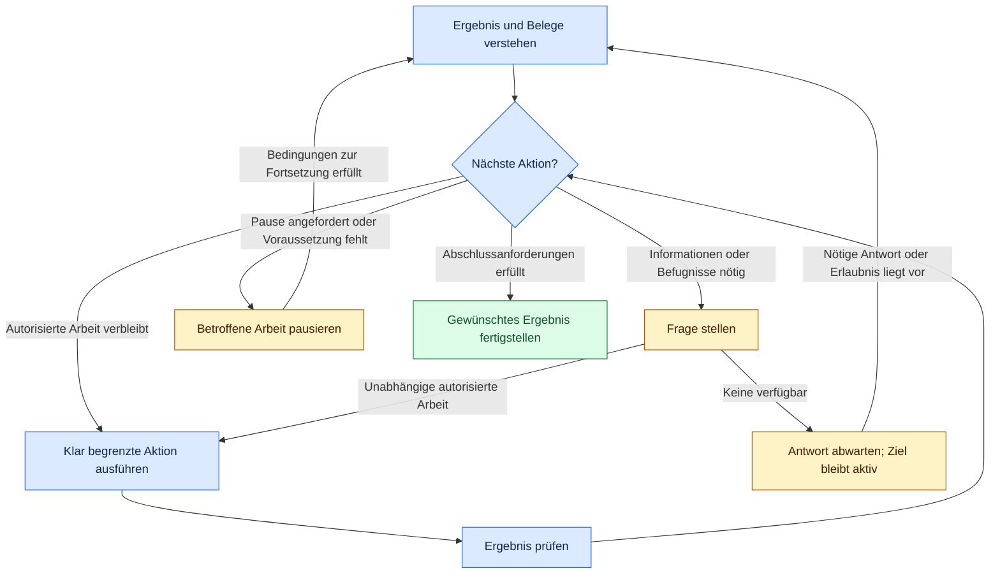

# Lusona AI Skills

[English](README.md) | [Español](README.es.md) | [Deutsch](README.de.md) | [简体中文](README.zh-CN.md) | [日本語](README.ja.md)

> [!WARNING]
> Installiere Lusona nicht mit Vercel Skills (`npx skills@latest`); nutze die [Installation als natives Plugin](#installation).

Lusona hilft einem KI-Agenten, ein gewünschtes Ergebnis zu verstehen, umzusetzen und zu
überprüfen. Du legst das Ergebnis, die Vorgaben und die Befugnisse fest. Der Agent wählt anhand
der vorliegenden Befunde die nächste sinnvolle Aktion, setzt autorisierte Arbeit fort und
fragt nach, wenn er Informationen oder eine Erlaubnis von dir braucht.

Für Claude Code, Codex und [Programmieragenten in Xcode 27](plugins/lusona/INSTALL.md#xcode) · Quellversion in dieser Arbeitskopie: **1.0.0**

Diese README beschreibt die Quellen in dieser Arbeitskopie. Die Installation über GitHub
verwendet Quellen, die per Commit erfasst und ins Remote-Repository gepusht wurden; lokale
Änderungen begründen keine veröffentlichte Version.

<a id="index"></a>
## Inhalt

- [Einen Befehl wählen](#choose-a-command)
- [Mit einem Ergebnis beginnen](#start-with-an-outcome)
- [Installation](#installation)
- [Wie die Arbeit weitergeht](#how-the-work-continues)
- [Fragen und Belege](#questions-and-evidence)
- [Wiederherstellung und Fortsetzung](#recovery-and-resumption)
- [Ergebnisse und Übergaben](#results-and-handoffs)
- [Referenzen](#reference)
- [Mitwirken](#contributing)
- [Lizenz](#license)
- [Entwicklung](#development)

<a id="choose-a-command"></a>
## Einen Befehl wählen

Wähle die Aufgabe, für die du Unterstützung brauchst. Du kannst mit jedem Befehl beginnen,
dessen Umfang zu deiner Anfrage passt. Der Agent übernimmt akzeptierte Entscheidungen und
nutzt bei Bedarf weitere Zuständigkeiten innerhalb seiner Befugnisse. Eine feste Reihenfolge
gibt es nicht.

In Claude Code rufst du `/lusona:<command>` auf. In Codex wählst du den Lusona-Skill in der
Skill-Oberfläche aus. In Xcode gibst du `/` in einer Agentenunterhaltung ein und wählst den
installierten Skill. [Installiere Lusona](#installation), bevor du diese Befehle nutzt.

| Befehl | Aufgabe |
| --- | --- |
| [explore](plugins/lusona/skills/explore/SKILL.md) | Im Gespräch Verständnis, Möglichkeiten und Präferenzen entwickeln |
| [status](plugins/lusona/skills/status/SKILL.md) | Den aktuellen Fortschritt, alle bekannten Restarbeiten und die nächste Aktion einschätzen |
| [frame-product](plugins/lusona/skills/frame-product/SKILL.md) | Nutzer, Problem, gewünschte Ergebnisse und Produktgrenzen festlegen |
| [map-capabilities](plugins/lusona/skills/map-capabilities/SKILL.md) | Fähigkeiten, Abhängigkeiten und die Reihenfolge der Umsetzung erfassen |
| [specify](plugins/lusona/skills/specify/SKILL.md) | Verhalten, Vorgaben, Akzeptanzkriterien und TDD-Regelung für eine Änderung vereinbaren |
| [architect](plugins/lusona/skills/architect/SKILL.md) | Folgenschwere Entscheidungen zu Design, Verträgen und Zuständigkeiten klären |
| [investigate](plugins/lusona/skills/investigate/SKILL.md) | Ursachen, Fakten oder Machbarkeit anhand von Belegen und Experimenten feststellen |
| [implement](plugins/lusona/skills/implement/SKILL.md) | Eine autorisierte Verhaltensänderung oder Fehlerbehebung planen und umsetzen |
| [review](plugins/lusona/skills/review/SKILL.md) | Einen konkreten Diff auf Fehler und Lücken in der Verifikation prüfen |
| [refactor](plugins/lusona/skills/refactor/SKILL.md) | Die Struktur bestehenden Codes verbessern und dabei Verhalten und Kompatibilität erhalten |
| [batch](plugins/lusona/skills/batch/SKILL.md) | Mehrere ausgewählte Ergebnisse mit ausdrücklicher Erlaubnis zur unbeaufsichtigten Arbeit koordinieren |

Nutze **investigate**, um festzustellen, was passiert und warum. Mit **architect** entscheidest
du über technische Grenzen und Abwägungen mit weitreichenden Folgen. Nutze **refactor** für ein
konkretes Strukturproblem bei unverändertem Verhalten und **implement** für geändertes
Verhalten oder eine Fehlerkorrektur. Übliche Designentscheidungen gehören zur Implementierung
oder zum Refactoring. Eine abgeschlossene Untersuchung oder Designentscheidung erteilt keine
Erlaubnis, den Produktionscode zu ändern.

<a id="start-with-an-outcome"></a>
## Mit einem Ergebnis beginnen

Für eine klar umrissene Änderung nutzt du `/lusona:implement` in Claude Code oder wählst
`implement` in Codex:

> Lass Einladungen nach sieben Tagen ablaufen. Behalte bereits angenommene Einladungen bei.
> Fertig bedeutet: Einladungen, die älter als sieben Tage sind, werden abgelehnt, angenommene
> Einladungen bleiben unverändert, und alle Tests sind erfolgreich. Nutze gezieltes TDD (`targeted`)
> für die Ablaufgrenze. Prüfe lokal; führe kein Deployment durch. Frage nach, falls eine
> folgenreiche Entscheidung die Änderung blockiert.

Nenne das Ergebnis, die Bedingungen für den Abschluss und die Grenzen der Befugnisse des
Agenten. Der Agent übernimmt die nötige Planung und arbeitet ohne weiteren Befehl geeignete
Teilschritte ab. Du erhältst das Ergebnis, Belege für die Verifikation sowie offene
Entscheidungen oder Einschränkungen.

Wähle TDD ausdrücklich in deiner Anfrage oder als dauerhafte Präferenz:

- `none`: Verifikation bleibt erforderlich, ohne vorgegebene Reihenfolge von Tests und Implementierung.
- `targeted`: Für benannte Verhaltensweisen werden die Tests zuerst geschrieben.
- `strict`: Für jedes geänderte testbare Verhalten werden die Tests zuerst geschrieben.

Hinterlege eine dauerhafte Präferenz in der `docs/lusona/README.md` des Projekts oder in den
Agentenanweisungen (`CLAUDE.md` oder `AGENTS.md`), zum Beispiel
`TDD: targeted for changed behavior`. Ohne ausdrückliche Auswahl kann der Agent untersuchen
und planen; vor der Implementierung fragt er nach.

Weitere Einstiegsmöglichkeiten:

> **explore:** Hilf mir, Einladungslinks mit Einladungen zu vergleichen, die nur per E-Mail
> funktionieren. Erkläre die Folgen für unser Supportteam, bevor wir uns entscheiden. Führe
> dieses Gespräch im Chat; speichere keine Dateien.

> **investigate:** Finde heraus, warum abgelaufene Einladungen in diesem Reproduktionsfall
> noch funktionieren. Führe sinnvolle Experimente durch, die mögliche Ursachen unterscheiden,
> und berichte die Befunde. Ändere das Verhalten des Produktionscodes nicht.

> **implement, nur Planung:** Schlage ein Vorgehen für das Ablaufen von Einladungen und die
> Verifikation vor. Bearbeite weder Implementierung noch Abhängigkeiten.

> **status:** Bewerte die Arbeit an den Einladungen anhand der aktuellen Aufzeichnungen und
> des Arbeitsverzeichnisses. Nenne die Restarbeiten und die nächste klar begrenzte Aktion.

Gespräche, Spezifikationen, Pläne, Architekturentscheidungen und Reviews erteilen keine
Erlaubnis zur Implementierung. Eine klare Anfrage zur Implementierung oder zum Refactoring
kann ohne gesonderten `specify`-Befehl beginnen, sobald Umfang, TDD-Regelung und Voraussetzungen
geklärt sind.

<a id="installation"></a>
## Installation

Wähle deine Anwendung. Installiere über HTTPS aus dem öffentlichen Repository
[lusona/ai-skills](https://github.com/lusona/ai-skills); für den Download brauchst du keine
GitHub-Zugangsdaten.

<a id="claude-code"></a>
### Claude Code

```bash
claude plugin marketplace add https://github.com/lusona/ai-skills.git
claude plugin install lusona@lusona-ai-skills --scope user
```

<a id="codex"></a>
### Codex

```bash
codex plugin marketplace add https://github.com/lusona/ai-skills.git
codex plugin add lusona@lusona-ai-skills
```

<a id="xcode"></a>
### Xcode

Öffne in Xcode 27 **Settings > Intelligence > Agents > Plug-ins > Add Plug-in**.
Wähle **Add from URL**, gib `https://github.com/lusona/ai-skills` ein und wähle die Lusona-Skills,
die du installieren möchtest. Die [Installationsschritte für Xcode](plugins/lusona/INSTALL.md#xcode)
beschreiben Einrichtung, lokale Importe und Versionsdetails.

Starte nach der Installation eine neue Sitzung in deinem Projekt. Angaben zur Installation
aus einer lokalen Arbeitskopie, zu portablen Paketen, Updates und zur Deinstallation findest
du in der [Installationsanleitung](plugins/lusona/INSTALL.md). Wähle eine Katalogquelle:
lokale Arbeitskopie oder GitHub.

<a id="how-the-work-continues"></a>
## Wie die Arbeit weitergeht

Der Agent liest das gewünschte Ergebnis, akzeptierte Entscheidungen, aktuelle Belege und
offene Kriterien. Er wählt eine klar begrenzte Aktion, handelt innerhalb seiner Befugnisse
und prüft das Ergebnis. Diesen Ablauf wiederholt er, solange sinnvolle autorisierte Arbeit
verbleibt. Die Skills liefern dabei Zuständigkeiten und Fachwissen.



Das Diagramm fasst den [gemeinsamen Arbeitsablauf](plugins/lusona/README.md#work-loop) zusammen.
Seine Grenzen gelten für die betroffene Arbeit; unabhängige autorisierte Arbeit kann
weitergehen, während ein anderer Teil wartet.

- **Fortsetzen:** Die nächste sinnvolle autorisierte Aktion ausführen. Eine Empfehlung oder
  Aufforderung zum Fortsetzen ersetzt keine Arbeit, die der aktuelle Agent selbst leisten kann.
- **Fragen und abwarten:** Die fehlende Entscheidung oder Erlaubnis mit einem zulässigen
  nativen Fragetool oder knappem Text erfragen. Unabhängige Arbeit fortsetzen; den Zug abgeben,
  wenn keine mehr verbleibt. Während der Agent auf eine Antwort wartet, bleibt das Ziel aktiv.
  Schweigen liefert weder eine Entscheidung noch eine Erlaubnis.
- **Pausieren:** Betroffene Arbeit anhalten, wenn du eine Pause anforderst, nötige Informationen
  oder Fähigkeiten fehlen, die Erlaubnis fehlt oder eine Korrekturgrenze greift. Die genauen
  Bedingungen zur Fortsetzung nennen. Eine von dir angeforderte Pause erfordert deine
  Aufforderung zur Fortsetzung; bei anderen Pausen müssen die fehlenden Voraussetzungen,
  Belege oder Befugnisse vorliegen, die die geltende Grenze verlangt. Ein Checkpoint allein
  liefert nichts davon.
- **Abschließen:** Den gesamten autorisierten Umfang und die Akzeptanzkriterien erfüllen,
  erforderliche Prüfungen und unabhängige Reviews durchführen sowie eine verlangte menschliche
  Abnahme oder Übergabe abschließen. Bestandene Tests allein belegen keinen Abschluss. Eine
  fehlgeschlagene oder nicht ausgeführte Pflichtprüfung verhindert die Aussage, die Arbeit sei fertig.

Du bestimmst den Umfang und triffst folgenreiche Entscheidungen. Der Agent klärt übliche
Details innerhalb deiner Vorgaben und fragt nach, bevor er akzeptierte Ergebnisse ändert oder
destruktive Aktionen außerhalb seiner Befugnisse ausführt. Unabhängige Reviews sind nach den
Regeln des Nutzers oder Repositorys erforderlich sowie bei Sicherheitsgrenzen, persistenten
Daten, gemeinsamen Verträgen oder mehreren koordiniert schreibenden Beteiligten.

Ein Untersuchungsagent führt zum Beispiel ein weiteres Experiment aus, wenn es verbleibende
Ursachen unterscheiden kann. Braucht er deinen Build zur Reproduktion, fragt er danach und
setzt unabhängige Prüfungen fort. Sobald keine sinnvolle unabhängige Arbeit mehr verbleibt,
wartet er auf diesen Build. Eine bestätigte Ursache kann die Diagnose abschließen; für eine
Korrektur im Produktionscode sind weiterhin Implementierungsbefugnis und eine TDD-Regelung nötig.

Der Agent passt übliche Vorgehensweisen anhand der Belege an und erhält dabei den akzeptierten
Umfang und die Kriterien. Außerhalb eines Batches beendet er nach zwei aufeinanderfolgenden
Korrekturrunden ohne wesentlichen Fortschritt die Wiederholung der betroffenen Korrekturen und
berichtet die Befunde. Solange es insgesamt weniger als vier Runden gab, kann er innerhalb
seiner Befugnisse einen wesentlich anderen Ansatz verfolgen, wenn neue Belege oder eine
geänderte Voraussetzung ihn stützen. Nach insgesamt vier Runden erfordern weitere Korrekturen
deine Entscheidung. Batches nutzen ihr dokumentiertes Reparaturbudget. Die
[Korrekturregeln](plugins/lusona/README.md#work-loop) beschreiben Zählweise und Fortsetzung.

Der Hauptagent koordiniert Fragen, Aufgabenverteilung, Integration und Verifikation. Er
delegiert wesentliche Produkt- und Entwicklungsarbeit an Spezialisten mit geeigneten Rollen
und Modellen; Gespräche zur Erkundung und zum Status kann er selbst führen. Ist Delegation
verboten oder nicht verfügbar, kann er autorisierte Arbeit selbst erledigen. Ein erforderliches
unabhängiges Review braucht weiterhin einen anderen Reviewer. Unter
[Delegation](plugins/lusona/references/delegation.md) findest du Angaben zu Zuständigkeiten und Übergaben.

<a id="questions-and-evidence"></a>
## Fragen und Belege

Der Agent passt Fragen, Erklärungen, Beispiele und Experimente an dein erkennbares Verständnis
an. Er beantwortet direkte Fragen zuerst, nutzt bereits geklärte Antworten und fragt bei
folgenreichen Unsicherheiten nach. Deine Fachkenntnisse bestimmen die Erklärungstiefe;
die Anforderungen an Belege und Entscheidungen gelten weiterhin.

Bei der Erkundung kannst du Verständnis oder Präferenzen entwickeln, ohne eine Richtung zu
wählen. Der Agent verwendet konkrete Szenarien und Abwägungen, solange ein weiterer Austausch
das gewünschte Verständnis oder die nächste Aktion verändern kann. Bei einer Untersuchung
prüft er Hypothesen, solange ein weiteres Experiment Ursachen unterscheiden kann. Er beendet
die Klärung, wenn weitere Gespräche oder Experimente weder das gewünschte Ergebnis noch die
begründete nächste Aktion ändern würden. Blockieren fehlende Belege den Fortschritt, benennt
er diese, statt Gewissheit zu behaupten.

Ein erfahrener Maintainer, der Kompatibilitätsvorgaben genannt hat, muss sie zum Beispiel nicht
erneut angeben. Kennst du eine Migrationsoption noch nicht, erklärt der Agent ihre Folgen,
bevor er dich nach einer Präferenz fragt. Siehe
[Gespräche zur Klärung der Absicht](plugins/lusona/references/interviews.md).

<a id="recovery-and-resumption"></a>
## Wiederherstellung und Fortsetzung

Zur autorisierten Arbeit gehören minimale lokale Aufzeichnungen zur Wiederherstellung, wenn
eine sichere Fortsetzung oder die Abstimmung von Zuständigkeiten sie erfordert. Dabei gelten
die erlaubten Schreibzugriffe und deine Einschränkungen. Ein Gespräch, das du nicht aufbewahren
musst, braucht keine Datei. Der Agent nutzt eine vorhandene maßgebliche Aufzeichnung oder
möglichst knappe geeignete Notizen beziehungsweise ein Änderungsdokument. Geänderte Fakten hält
er an sinnvollen Arbeitsgrenzen und vor einer geplanten Übergabe fest.

Eine Wiederherstellungsaufzeichnung enthält das gewünschte Ergebnis, die Quelle der Befugnisse
und der TDD-Regelung, akzeptierte Entscheidungen, nützliche Belege, wesentliche offene Fragen,
Zuständigkeiten, gegebenenfalls Korrekturzähler und die nächste Aktion. Bei der Erkundung lassen
sich Entscheidungen und Fragen ohne Spezifikation oder Warteschlange festhalten. `implement` und
`refactor` können bei Bedarf ein Änderungsdokument anlegen; beide erfordern keinen Umweg über
`specify`. Das Festhalten von Kontext wählt keine TDD-Regelung, autorisiert keine Implementierung,
reiht keine Arbeit in eine Warteschlange ein und schließt das gewünschte Ergebnis nicht ab.

Vorgaben zu reinem Lesezugriff, Speicherverboten und Ablageorten haben Vorrang. Darf oder kann
der Agent nichts speichern, liefert er eine Übergabe im Gespräch und nennt die Einschränkung
bei der Wiederherstellung. Eine abrupte Unterbrechung kann einen Checkpoint verhindern. Bei der
Fortsetzung prüft der Agent erhaltene Aufzeichnungen und Belege im Arbeitsverzeichnis. Er fragt
dann nur nach wesentlichen Fakten oder Befugnissen, die er nicht wiederherstellen kann. Siehe
[Aufzeichnungen und Aufbewahrung](plugins/lusona/references/retention.md).

Für eine andere Sitzung könnte eine brauchbare Anweisung zur Fortsetzung so lauten:

> Setze die Untersuchung zum Ablauf von Einladungen anhand der dafür maßgeblichen Aufzeichnung fort.
> Reproduziere den festgehaltenen Fall mit dem bereitgestellten Build, bevor du eine Korrektur
> vorschlägst. Behalte den dokumentierten Diagnoseumfang bei; Änderungen am Produktionscode
> bleiben unautorisiert.

Eine solche Anweisung unterstützt eine tatsächliche Übergabe. Der aktuelle Agent setzt die
Arbeit fort, die er innerhalb seiner Befugnisse leisten kann.

<a id="results-and-handoffs"></a>
## Ergebnisse und Übergaben

Lusona erprobt ein gemeinsames Format für substanzielle Bewertungen und Übergaben:
**Ergebnis**, **Belege** und **Nächste Aktion**. Verbinde das Ergebnis mit **✅ Abgeschlossen**,
**🔄 In Bearbeitung**, **❓ Eingabe nötig** oder **⏸ Pausiert**; die Wörter erhalten die Bedeutung.
Steht eine blockierende Frage oder Freigabe aus, beginne damit. Normale Gespräche, Fragen und
kurze Zwischenmeldungen bleiben natürlich.

Beispiel einer Übergabe, kein Nachweis geleisteter Arbeit:

> **✅ Abgeschlossen · Ergebnis:** Diagnose abgeschlossen; die Reproduktion bestätigt, dass
> die Ablaufprüfung den falschen Zeitstempel verwendet. Die Korrektur im Produktionscode
> bleibt unautorisiert.
>
> **Belege:** Der festgehaltene Fall und die gezielte Prüfung stimmen überein.
> Plattformübergreifendes Verhalten wurde noch nicht getestet.
>
> **Nächste Aktion:** Du kannst die Zeitstempelkorrektur autorisieren und ihre TDD-Regelung
> wählen; anschließend kann der Agent diese klar begrenzte Korrektur umsetzen und prüfen.

Der Status beschreibt die Antwort oder das autorisierte Ergebnis: Eine abgeschlossene
Diagnose schließt die vorgeschlagene Korrektur nicht ab. Bei einer Übergabe nennt die nächste
Aktion den Verantwortlichen, benötigte Informationen und noch nötige Befugnisse. Bei einem
Abschluss kann sie **Keine für diese Anfrage** lauten.

Statustabellen verwenden **Ergebnis | Status | Restarbeiten** und behalten Blockaden und
Abhängigkeiten bei. Vergleichstabellen nutzen sinnvolle Spalten wie **Option | Nutzen | Abwägung**.
Fachtabellen und Schemata gespeicherter Aufzeichnungen behalten ihren Zweck. Dein gewünschtes
Format und die Einschränkungen der Anwendung haben Vorrang; unterstützter Text und
Formatierungen erhalten die Bedeutung, wenn Symbole oder Tabellen ungeeignet sind. Diese
Darstellungskonvention ist ein vorläufiger Versuch; ihr Verhalten über verschiedene
Anwendungen hinweg ist noch nicht belegt. Siehe
[Review und Kommunikation](plugins/lusona/README.md#review-and-communication).

<a id="reference"></a>
## Referenzen

- [Installation und Deinstallation](plugins/lusona/INSTALL.md)
- [Workflow-Vertrag und Arbeitsablauf](plugins/lusona/README.md#work-loop)
- [Skill-Auswahl und Begriffe](plugins/lusona/references/workflow-guide.md)
- [TDD-Regelung und Reihenfolge](plugins/lusona/references/tdd.md)
- [Batch-Ausführung und Wiederherstellung](plugins/lusona/references/batch-execution.md)
- [Aufzeichnungen und Aufbewahrung](plugins/lusona/references/retention.md)
- [Abschluss und Wiederaufnahme](plugins/lusona/references/closeout.md)
- [Delegation und Modellzuordnung](plugins/lusona/references/delegation.md)

<a id="contributing"></a>
## Mitwirken

[CONTRIBUTING.md](CONTRIBUTING.md) beschreibt den Umfang von Beiträgen, lokale Prüfungen und Pull
Requests. Nutze die [Formulare für Fehler und Funktionswünsche](https://github.com/lusona/ai-skills/issues/new/choose),
um Probleme zu melden oder Verbesserungen vorzuschlagen. Das Team `@lusona/core` ist für die
Reviews im Repository zuständig.

<a id="license"></a>
## Lizenz

Skills, Vorlagen, Dokumentation und Skripte stehen unter der [MIT-Lizenz](LICENSE).

<a id="development"></a>
## Entwicklung

Die maßgeblichen Workflow-Quellen liegen in `plugins/lusona/`. Daten eines nutzenden Projekts
gehören in dessen `docs/lusona/`; die leere Warteschlangenstruktur liegt in `templates/work.md`.

```bash
claude plugin validate plugins/lusona
claude plugin validate .claude-plugin/marketplace.json
python3 scripts/package.py
```

Der Paketgenerator prüft Identität und Version der nativen Manifeste, Links, Katalogpfade und
die Dateiauswahl. Er schreibt nach `tmp/lusona-package/` innerhalb des Repositorys; für einen
weiteren Build nutzt du `--output tmp/<new-directory>`. Beide Manifeste müssen dieselbe Version
verwenden. Die Installation über GitHub nutzt Quellen, die per Commit erfasst und gepusht
wurden; eine lokale Arbeitskopie kannst du vor der Veröffentlichung verwenden. Weder
Installation noch Paketbau initialisieren Projektaufzeichnungen.

Weniger Quelltext belegt keine Einsparung bei Tokens oder Latenz; dafür braucht es Messungen,
die den Koordinator und sämtliche ausführenden Agenten einschließen.
