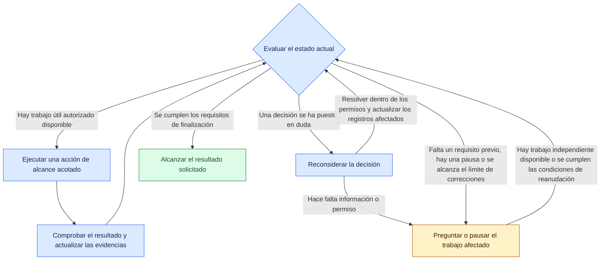

# Lusona Skills

[English](README.md) | [Español](README.es.md) | [Deutsch](README.de.md) | [简体中文](README.zh-CN.md) | [日本語](README.ja.md)

Lusona organiza las habilidades de los agentes de programación en torno a un ciclo de trabajo compartido:

- **Elegir, actuar, comprobar y repetir.** Elegir la siguiente acción según el resultado solicitado y
  las evidencias disponibles. Volver a explorar, investigar, diseñar, implementar o revisar cuando
  haga falta. No hay una secuencia fija de habilidades.
- **Reconsiderar las decisiones con nueva información.** Si las evidencias cuestionan una decisión
  anterior, reconsiderarla dentro de los permisos acordados. Actualizar los registros afectados para
  que el trabajo posterior siga la decisión revisada.
- **Continuar dentro de los permisos concedidos.** Tomar las decisiones habituales y seguir trabajando
  sin pedir aprobación repetidamente. Preguntar cuando una decisión exceda los permisos existentes.
- **Verificar que el trabajo esté completo.** Completar el alcance acordado, las comprobaciones y la revisión
  obligatorias, y cualquier aceptación o entrega requerida. Indicar qué queda pendiente si algo impide terminar.

Para Claude Code, Codex, [Cursor](INSTALL.md#cursor), [agentes de programación de Xcode 27](INSTALL.md#xcode) y [Google Antigravity App, CLI e IDE](INSTALL.md#antigravity) · Versión del código en esta copia de trabajo: **2.0.1**

> [!WARNING]
> No instales Lusona mediante Vercel Skills (`npx skills@latest`); usa la [instalación nativa del plugin](#installation).

Lee por qué creamos Lusona Skills: [Why we built Lusona Skills](https://blog.lusona.com/blog/why-we-built-lusona-skills/) (en inglés).

Este README describe el código de esta copia de trabajo. La instalación desde GitHub usa código
incluido en commits y enviado al repositorio remoto; los cambios locales no constituyen una versión publicada.

## Índice

- [Por dónde empezar](#where-to-start)
- [Elegir un comando](#choose-a-command)
- [Instalación](#installation)
- [Cómo continúa el trabajo](#how-the-work-continues)
- [Preguntas y evidencias](#questions-and-evidence)
- [Recuperación y reanudación](#recovery-and-resumption)
- [Resultados y traspasos](#results-and-handoffs)
- [Referencias](#reference)
- [Contribuir](#contributing)
- [Licencia](#license)
- [Desarrollo](#development)

<a id="where-to-start"></a>
## Por dónde empezar

Empieza con **status** al incorporarte a un proyecto, retomar el trabajo o decidir qué necesita atención.
Evalúa los registros y las evidencias disponibles, explica lo que queda pendiente y recomienda una
siguiente acción. También funciona si el proyecto aún no tiene registros de Lusona. Pedir una evaluación
con status no autoriza nuevas tareas de implementación.

Para una idea nueva, **explore** ayuda a examinar posibilidades y valorar sus ventajas e inconvenientes;
**frame-product** ayuda a definir los usuarios, el problema y la dirección del producto. A medida que esa
dirección se concreta, **map-capabilities** identifica qué debe permitir el producto y un orden de entrega
útil. **specify** aclara el comportamiento y los criterios de aceptación; **architect** resuelve
decisiones técnicas importantes sobre límites, contratos y responsabilidades. **design** se centra
en maquetas de interfaz, flujos de pantallas y diagramas; puedes pedirlo directamente sin pasar por
otra etapa. **implement** ejecuta y verifica un cambio autorizado.

Estas son formas habituales de desarrollar el trabajo, no etapas obligatorias. Empieza por el grupo
que responda a la necesidad actual, omite las cuestiones resueltas y vuelve a cualquier grupo cuando las
evidencias lo aconsejen. Una investigación puede preceder a una especificación o interrumpir una
implementación; una revisión puede revelar motivos para reconsiderar un diseño.

| Grupo de acciones | Habilidades y responsabilidades |
| --- | --- |
| Orientarse | [status](plugins/lusona/skills/status/SKILL.md): evaluar el progreso, el trabajo pendiente y la siguiente acción útil |
| Definir la dirección | [explore](plugins/lusona/skills/explore/SKILL.md): examinar posibilidades y valorar sus ventajas e inconvenientes<br/>[frame-product](plugins/lusona/skills/frame-product/SKILL.md): definir usuarios, resultados y límites<br />[map-capabilities](plugins/lusona/skills/map-capabilities/SKILL.md): organizar la cobertura de capacidades, las dependencias y el orden de entrega |
| Definir un cambio | [specify](plugins/lusona/skills/specify/SKILL.md): acordar el comportamiento, los criterios de aceptación y la política de TDD<br />[architect](plugins/lusona/skills/architect/SKILL.md): resolver decisiones técnicas importantes sobre límites, contratos y responsabilidades |
| Diseñar visualmente | [design](plugins/lusona/skills/design/SKILL.md): crear maquetas de interfaz, flujos de pantallas y diagramas |
| Construir y evaluar | [implement](plugins/lusona/skills/implement/SKILL.md): planificar y entregar un cambio de comportamiento o una corrección<br />[review](plugins/lusona/skills/review/SKILL.md): examinar un diff para detectar defectos y aspectos sin verificar<br />[refactor](plugins/lusona/skills/refactor/SKILL.md): mejorar la estructura sin alterar el comportamiento |
| Obtener evidencias | [investigate](plugins/lusona/skills/investigate/SKILL.md): determinar causas o viabilidad<br />[measure](plugins/lusona/skills/measure/SKILL.md): medir magnitud, calidad, coste o cambios<br />[experiment](plugins/lusona/skills/experiment/SKILL.md): probar una intervención o alternativas |
| Coordinar el trabajo seleccionado | [batch](plugins/lusona/skills/batch/SKILL.md): coordinar varios resultados seleccionados con autorización expresa para trabajar sin supervisión |

El catálogo completo de roles, resultados y reglas de selección de habilidades está en la
[guía del flujo de trabajo](plugins/lusona/references/workflow-guide.md).
Las decisiones de diseño habituales se resuelven durante la implementación o la refactorización.
Una petición clara de implementación o refactorización puede ejecutarse sin un comando `specify`
aparte cuando ya se han acordado su alcance, su política de desarrollo guiado por pruebas (TDD)
y sus requisitos previos.

<a id="choose-a-command"></a>
## Elegir un comando

Invoca la habilidad que responda a tu necesidad actual. El agente usa otras habilidades cuando hace
falta, dentro de los permisos que le concedes; no necesitas indicar cada transición.

En Claude Code, ejecuta `/lusona:<command>`. En Codex, selecciona la habilidad de Lusona en la
interfaz de habilidades. En Cursor, escribe `/` en el chat de Agent y selecciona la habilidad.
En Xcode, escribe `/` en una conversación con el agente y selecciona la habilidad instalada.
En Antigravity App/CLI, usa `/<skill-name>`; en el IDE independiente, consulta **Customizations**
y nombra la habilidad de Lusona en tu petición. [Instala Lusona](#installation) antes de usar estos comandos.

Indica la pregunta o el resultado solicitado y los límites de los permisos del agente. Por ejemplo:

> **status:** Evalúa este proyecto a partir de los registros disponibles y del árbol de trabajo.
> Dime qué queda pendiente y recomienda por dónde empezar.

> **explore:** Ayúdame a comparar los enlaces de invitación con las invitaciones solo por correo
> electrónico. Explica las consecuencias para nuestro equipo de soporte antes de elegir. Mantén
> esta conversación en el chat; no guardes archivos.

> **design:** Compara dos flujos de invitación usando nuestras pantallas, navegación y textos
> existentes. Muestra los pasos y el estado de invitación caducada, y explica las ventajas e
> inconvenientes de cada opción. Limita el trabajo al diseño visual; no implementes la interfaz.

> **implement:** Añade la caducidad de las invitaciones a los siete días. Conserva las invitaciones
> ya aceptadas. El trabajo estará completo cuando se rechacen las invitaciones de más de siete días,
> las invitaciones aceptadas permanezcan sin cambios y pase la batería de pruebas. Usa la política
> de TDD targeted para el límite de caducidad. Verifica en local; no despliegues.

Si solo quieres planificar, pide a `implement` un enfoque y un plan de verificación sin modificar
la implementación ni las dependencias. Las conversaciones, especificaciones, planes, decisiones de
arquitectura y revisiones no conceden permiso para implementar.

Antes de implementar o refactorizar, elige TDD expresamente en la petición o mediante una
preferencia permanente:

- `none`: la verificación sigue siendo obligatoria, sin exigir escribir las pruebas antes del código.
- `targeted`: escribir primero las pruebas de los comportamientos indicados.
- `strict`: escribir primero las pruebas de cada comportamiento comprobable que se modifique.

Guarda una preferencia permanente en `docs/lusona/README.md` del proyecto o en las instrucciones
para agentes (`CLAUDE.md` o `AGENTS.md`), por ejemplo `TDD: targeted for validation and persistence boundaries`.
Sin una elección explícita, el agente puede inspeccionar y planificar, pero pregunta antes de implementar.

<a id="installation"></a>
## Instalación

Elige la aplicación que utilizas. Instala desde el repositorio público
[lusona/ai-skills](https://github.com/lusona/ai-skills) por HTTPS; no necesitas credenciales
de GitHub para descargarlo.

### Antigravity

Instala directamente desde GitHub:

```bash
agy plugin install https://github.com/lusona/ai-skills.git
```

La URL instala Lusona mediante el manifiesto de la raíz del repositorio.
Para la App y el IDE independiente, consulta **Customizations** tras esta instalación global con la CLI.
En el chat de App/CLI, invoca `/status`; en el IDE, pide usar la habilidad `status` de Lusona.
La [guía de instalación de Antigravity](INSTALL.md#antigravity) incluye copias locales, paquetes
portátiles, actualizaciones, eliminación y límites de verificación. La instalación desde GitHub
se comprobó con CLI 1.4.12 en Linux; no se ha probado el comportamiento interactivo en App/IDE.

### Claude Code

```bash
claude plugin marketplace add https://github.com/lusona/ai-skills.git
claude plugin install lusona@lusona-ai-skills --scope user
```

### Codex

```bash
codex plugin marketplace add https://github.com/lusona/ai-skills.git
codex plugin add lusona@lusona-ai-skills
```

### Cursor

Abre **Customize > From GitHub Repository**, introduce `https://github.com/lusona/ai-skills`
e instala **Lusona Skills** para tu proyecto o usuario. En el chat de Agent, escribe `/`
para encontrar las habilidades de Lusona. Consulta los [pasos de instalación en Cursor](INSTALL.md#cursor)
para ver los enlaces a la documentación actual de Cursor y qué se ha probado.

### Xcode

En Xcode 27, abre **Settings > Intelligence > Agents > Plug-ins > Add Plug-in**.
Elige **Add from URL**, introduce `https://github.com/lusona/ai-skills` y selecciona las
habilidades de Lusona que quieras instalar. Consulta los [pasos de instalación en Xcode](INSTALL.md#xcode)
para conocer la configuración, las importaciones locales y los detalles de versión.

Tras instalar, inicia una sesión nueva en tu proyecto. Para instalar desde una copia de trabajo
local, usar paquetes portátiles, actualizar o desinstalar, consulta la
[guía de instalación](INSTALL.md). Elige una sola fuente del catálogo: copia de trabajo local o GitHub.

<a id="how-the-work-continues"></a>
## Cómo continúa el trabajo

El mismo ciclo se aplica a todos los grupos de acciones. La siguiente acción puede ser una
conversación, un experimento, un cambio de código o una revisión, según la pregunta actual y las
evidencias disponibles. Las dependencias, el estado compartido, las decisiones expresas del usuario
y la política de TDD elegida siguen determinando el orden cuando es necesario.

La planificación forma parte de la implementación y se adapta a medida que avanza el trabajo.
Los cambios pequeños y claros necesitan un resultado y comprobaciones; las dependencias, la
incertidumbre, la coordinación o la recuperación pueden exigir un plan explícito. También puedes
pedir un plan sin autorizar su ejecución.



El gráfico muestra el [ciclo de trabajo compartido](plugins/lusona/README.md#work-loop),
no una secuencia de habilidades. Las esperas y las pausas se aplican al trabajo afectado; el
trabajo independiente puede continuar dentro de sus permisos existentes. El ciclo se rige por cuatro reglas:

- **Continuar** mientras quede trabajo útil autorizado, sin pedirte que invoques la siguiente habilidad.
- **Preguntar** cuando falte una decisión o un permiso. Continuar el trabajo independiente autorizado
  mientras se espera; el silencio no aporta una respuesta ni un permiso.
- **Pausar** el trabajo afectado si lo solicitas, falta un requisito previo o se alcanza un límite de
  correcciones. Indicar qué hace falta para reanudarlo. Una pausa solicitada por ti requiere que
  pidas reanudar el trabajo.
- **Completar** solo cuando se haya cumplido todo el alcance autorizado, las comprobaciones y la revisión
  obligatorias, y la aceptación o entrega requerida. Las comprobaciones obligatorias fallidas o sin
  ejecutar impiden dar el trabajo por terminado.

Cuando las evidencias cuestionan una decisión aceptada, el agente identifica el conflicto y la
reconsidera dentro de los permisos existentes; te consulta cuando revisarla exige permisos
adicionales.
Actualiza los registros y las tareas asignadas que se vean afectados, conserva los razonamientos
anteriores que sigan siendo útiles y continúa a partir del acuerdo revisado. Los registros
desactualizados no deben restablecer decisiones sustituidas.

Los fallos repetidos están sujetos a [límites de corrección](plugins/lusona/references/corrections.md);
los lotes usan un presupuesto de reparación acordado. Cuando un límite detiene el trabajo afectado,
el agente informa de las evidencias y las condiciones de reanudación.

El agente principal coordina las preguntas, el reparto de tareas, la integración y la verificación,
y delega en especialistas las tareas de producto e ingeniería que requieren trabajo de fondo.
Puede encargarse de las conversaciones de exploración y las consultas de estado. La revisión
independiente es obligatoria cuando lo exigen las reglas del usuario o del repositorio, así como
para límites de seguridad, datos persistentes, contratos compartidos o cambios realizados por varios
participantes de forma coordinada. Si la delegación está prohibida o no está disponible, el agente
puede realizar el trabajo autorizado por su cuenta, pero la revisión independiente obligatoria sigue
necesitando otro revisor. Consulta [delegación](plugins/lusona/references/delegation.md).

<a id="questions-and-evidence"></a>
## Preguntas y evidencias

Las preguntas responden a las decisiones aún sin resolver. El agente reutiliza las respuestas ya
acordadas, comprueba los hechos que puede averiguar y te pregunta por la intención y las ventajas e
inconvenientes de decisiones importantes. Explica las opciones con el detalle que necesitas; la
exploración puede terminar con una mejor comprensión, sin necesidad de tomar una decisión.
Consulta las [conversaciones para aclarar la intención](plugins/lusona/references/interviews.md).

La investigación, la medición y los experimentos pueden aportar información a cualquier grupo de
acciones. El trabajo adicional debe responder a una pregunta útil dentro del alcance autorizado y
el presupuesto aplicable. Las conclusiones distinguen evidencias, supuestos e incertidumbre;
proponer un trabajo posterior no autoriza su implementación.

Varias habilidades permiten trabajar con elementos visuales: **explore** compara alternativas
visuales para elegir una dirección; **specify** usa elementos visuales para aclarar el comportamiento
y los criterios de aceptación; **architect** usa diagramas técnicos para aclarar límites, contratos
y responsabilidades. Usa **design** para centrarte en maquetas de interfaz, flujos de pantallas o
diagramas, incluso cuando el diseño ya está decidido.

Los borradores de interfaz se abren en el navegador para examinarlos; si no es posible abrirlos,
el agente indica la ruta absoluta del HTML. Los diagramas y sus alternativas usan bloques Mermaid
en la respuesta o en un archivo Markdown. Cuando aceptas un borrador o eliges una opción, el agente
conserva la referencia en `docs/lusona/visuals/` y la enlaza desde la especificación, ADR o notas
correspondientes, respetando los permisos de escritura y las prohibiciones de guardar. Las capturas de interfaz
dependen de las herramientas disponibles; si no puede capturarlas, conserva el HTML e indica
qué imágenes faltan.

La referencia distingue requisitos vinculantes de detalles ilustrativos. **implement** informa
del estado de cada requisito vinculante y **review** comprueba si se cumple, no se cumple o no se
ha comprobado. Para las interfaces con imágenes conservadas, la revisión compara capturas cuando
hay herramientas para renderizar y capturar; en caso contrario, comprueba el código o marcado
e indica que la comparación visual no se ha realizado. Consulta [elementos visuales](plugins/lusona/references/visuals.md).

Las mediciones y los experimentos relevantes se guardan en `docs/lusona/evidence/` del proyecto que
utiliza el plugin. Las especificaciones, notas y el historial enlazan las ejecuciones exactas en las
que se basan; los registros existentes permanecen en su lugar.

<a id="recovery-and-resumption"></a>
## Recuperación y reanudación

El agente guarda las decisiones, conclusiones y evidencias de verificación sustantivas en los
registros del proyecto antes de un traspaso o de dar por terminado el trabajo. Se registran una
especificación y una fila en la cola siempre que el flujo de trabajo requiera una especificación,
cuando la pides o solicitas seguimiento, cuando ya existe una, o cuando el cambio afecta a un límite
de seguridad, a datos persistentes o a un contrato compartido, o implica modificaciones coordinadas
de varios participantes; el tamaño no lo decide. El resto del trabajo directo sin especificación usa
notas. La conversación habitual y los avisos breves de estado no necesitan ningún archivo.
Las restricciones de solo lectura, las prohibiciones de guardar y las limitaciones del lugar de
almacenamiento tienen prioridad.

Los registros conservan el resultado solicitado, los permisos, la política de TDD, las decisiones
actuales, las evidencias útiles, las preguntas pendientes y la siguiente acción, además de las
responsabilidades y el recuento de correcciones cuando sea necesario. Las decisiones de arquitectura
con consecuencias importantes requieren ADR. Una especificación exige seguimiento en
`docs/lusona/work.md`; el trabajo sin especificación puede usar solo notas. Los estados de la cola
describen el progreso, no qué habilidad debe ejecutarse después, y no autorizan la ejecución.
Consulta [registros y conservación](plugins/lusona/references/retention.md) y las
[reglas de la cola](plugins/lusona/references/queue.md).

Al reanudar, el agente contrasta los registros conservados con el árbol de trabajo y pregunta solo
por la información importante que no puede recuperar. Los permisos existentes se mantienen.
Usa **status** para evaluar lo que queda pendiente o indica el trabajo que quieres continuar:

> Continúa investigando la caducidad de las invitaciones a partir de las conclusiones guardadas.
> Comprueba la reproducción conservada con la compilación actual. No cambies el comportamiento
> en producción.

Una interrupción repentina puede impedir guardar los registros. Cuando no puede guardarlos, el
agente explica esa limitación para recuperar el contexto y aporta las conclusiones en la conversación.

<a id="results-and-handoffs"></a>
## Resultados y traspasos

Los informes de trabajo indican el resultado, las evidencias que lo sustentan y cualquier siguiente
acción. Distinguen el trabajo completado del trabajo en curso, la información que falta y el trabajo
en pausa. La finalización se refiere a la petición autorizada: completar un diagnóstico no significa
que el defecto esté corregido.

Ejemplo ilustrativo de traspaso; no demuestra que se haya realizado el trabajo:

> **✅ Completado · Resultado:** Diagnóstico completo; la reproducción confirma que la comprobación
> de caducidad usa una marca de tiempo incorrecta. La corrección en el código de producción sigue
> sin autorización.
>
> **Evidencias:** El caso conservado y la comprobación específica dan el mismo resultado. No se ha
> probado el comportamiento en las distintas plataformas.
>
> | Siguiente acción | Responsable | Necesita | Autorización |
> |---|---|---|---|
> | Autorizar la corrección de la marca de tiempo | Tú | Política de TDD | Implementación no autorizada |
>
> > Implementa la corrección de la marca de tiempo con TDD `targeted`.

Cuando queda trabajo pendiente, la tabla de una fila indica la acción acotada, quién la realizará,
qué información necesita y qué autorización queda pendiente o falta; la línea citada debajo es un
mensaje que puedes enviar como tu siguiente petición. Cada comando identifica un siguiente paso útil
o indica expresamente que no se justifica ninguno, con una breve razón. Una evaluación completada
puede recomendar trabajo posterior sin autorizarlo. Usa **Siguiente acción:** `None for this request`
solo cuando no quede ningún seguimiento útil. La conversación habitual no necesita una estructura
de informe; una exploración sustantiva sí propone una pregunta concreta o una acción y guarda las
conclusiones reutilizables según las reglas de conservación.
El formato ilustrado es el formato predeterminado permanente; el formato que solicites y las
restricciones de la aplicación tienen prioridad.
Consulta [revisión y comunicación](plugins/lusona/README.md#review-and-communication).

<a id="reference"></a>
## Referencias

- [Historial de cambios (en inglés)](CHANGELOG.md)
- [Instalación y desinstalación](INSTALL.md)
- [Política de privacidad](PRIVACY.md)
- [Condiciones de uso](TERMS.md)
- [Contrato del flujo de trabajo y ciclo de trabajo](plugins/lusona/README.md#work-loop)
- [Selección de habilidades y terminología](plugins/lusona/references/workflow-guide.md)
- [Política de TDD y secuencia de trabajo](plugins/lusona/references/tdd.md)
- [Ejecución de lotes y recuperación](plugins/lusona/references/batch-execution.md)
- [Registros y conservación](plugins/lusona/references/retention.md)
- [Cierre y reapertura](plugins/lusona/references/closeout.md)
- [Delegación](plugins/lusona/references/delegation.md)
- [Asignación de modelos](plugins/lusona/references/model-routing.md)

<a id="contributing"></a>
## Contribuir

Consulta [CONTRIBUTING.md](CONTRIBUTING.md) para conocer el alcance de las contribuciones, las
comprobaciones locales y las pull requests. Usa los
[formularios de errores y solicitudes de funciones](https://github.com/lusona/ai-skills/issues/new/choose)
para informar de problemas o proponer mejoras. El equipo `@lusona/core` se encarga de la revisión del repositorio.

<a id="license"></a>
## Licencia

Las habilidades, plantillas, documentación y scripts están disponibles bajo la [licencia MIT](LICENSE).

<a id="development"></a>
## Desarrollo

Los archivos originales del flujo de trabajo están en `plugins/lusona/`. Cada proyecto que utiliza
el plugin guarda sus propios datos en `docs/lusona/`; la plantilla de una cola vacía está en `templates/work.md`.

Los scripts auxiliares para gestionar los registros del plugin usan Bash o PowerShell; consulta los [requisitos de ejecución](INSTALL.md#requirements). Python 3 sigue siendo necesario para crear paquetes y ejecutar las evaluaciones en Python, pero no para el uso habitual del plugin.

```bash
claude plugin validate plugins/lusona
claude plugin validate .claude-plugin/marketplace.json
python3 scripts/package.py
```

El generador de paquetes comprueba la identidad y versión de los manifiestos nativos, los enlaces,
las rutas del catálogo y la selección de archivos. Escribe en `tmp/lusona-package/` dentro del
repositorio; usa `--output tmp/<new-directory>` para generar otro paquete. Todos los manifiestos
nativos deben usar la misma versión. La instalación desde GitHub utiliza el código incluido en
commits y enviado al repositorio remoto; puedes usar una copia de trabajo local antes de publicar.
Ni la instalación ni la creación de paquetes inicializan los registros del proyecto.

Reducir el tamaño del código fuente no demuestra que se consuman menos tokens ni que disminuya
la latencia; para ello hacen falta mediciones que incluyan al coordinador y a todos los agentes de trabajo.
