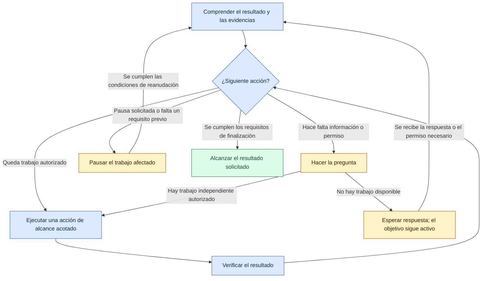

# Lusona Skills

[English](README.md) | [Español](README.es.md) | [Deutsch](README.de.md) | [简体中文](README.zh-CN.md) | [日本語](README.ja.md)

Lusona ayuda a un agente de IA a completar lo que le pides: comprender la solicitud, actuar y
verificar el resultado. Tú defines el resultado, las restricciones y los permisos. El agente
elige la siguiente acción útil a partir de las evidencias disponibles, continúa el trabajo
autorizado y pregunta cuando necesita información o permiso de tu parte.

Para Claude Code, Codex, [Cursor](INSTALL.md#cursor) y los [agentes de programación de Xcode 27](INSTALL.md#xcode) · Versión del código fuente de esta copia de trabajo: **1.1.1**

> [!WARNING]
> No instales Lusona con Vercel Skills (`npx skills@latest`); usa la [instalación como plugin nativo](#installation).

Por qué creamos Lusona Skills: [When the workflow became another job](https://blog.lusona.com/blog/when-the-workflow-became-another-job/) (en inglés).

Este README describe el código fuente de esta copia de trabajo. La instalación desde GitHub
utiliza el código guardado en commits y enviado al repositorio remoto; los cambios locales
no constituyen una versión publicada.

<a id="index"></a>
## Índice

- [Empezar por un resultado](#start-with-an-outcome)
- [Elegir un comando](#choose-a-command)
- [Instalación](#installation)
- [Cómo continúa el trabajo](#how-the-work-continues)
- [Preguntas y evidencias](#questions-and-evidence)
- [Recuperación y reanudación](#recovery-and-resumption)
- [Resultados y traspasos](#results-and-handoffs)
- [Referencias](#reference)
- [Contribuir](#contributing)
- [Licencia](#license)
- [Desarrollo](#development)

<a id="start-with-an-outcome"></a>
## Empezar por un resultado

Si ya tienes claro el cambio, usa `/lusona:implement` en Claude Code o selecciona `implement` en Codex.
Incluye tu política de desarrollo guiado por pruebas (TDD) en la solicitud:

> Haz que las invitaciones caduquen a los siete días. Conserva las invitaciones ya aceptadas.
> El trabajo estará terminado cuando se rechacen las invitaciones de más de siete días,
> las invitaciones aceptadas permanezcan intactas y pase la batería de pruebas. Usa TDD
> dirigido (`targeted`) para el límite de caducidad. Verifica en local; no despliegues.
> Pregunta si una decisión con consecuencias importantes bloquea el cambio.

Indica el resultado que buscas, los criterios de finalización y qué puede hacer el agente. Este
se encarga de la planificación necesaria y continúa con los pasos autorizados sin que tengas
que dar otro comando. Recibes el resultado, las evidencias de la verificación y las decisiones
o limitaciones pendientes.

Indica qué política de TDD quieres seguir en la solicitud o mediante una preferencia permanente:

- `none`: la verificación sigue siendo obligatoria, sin exigir que las pruebas se escriban primero.
- `targeted`: escribe primero las pruebas de los comportamientos indicados.
- `strict`: escribe primero las pruebas de cada comportamiento verificable que cambie.

Guarda una preferencia permanente en `docs/lusona/README.md` del proyecto o en las instrucciones
del agente (`CLAUDE.md` o `AGENTS.md`), por ejemplo, `TDD: targeted for changed behavior`.
Sin una selección expresa, el agente puede inspeccionar y planificar, pero pregunta antes de implementar.

Otros puntos de partida:

> **explore:** Ayúdame a comparar los enlaces de invitación y las invitaciones solo por correo.
> Explica las consecuencias para nuestro equipo de soporte antes de que elijamos. Mantén esta
> conversación en el chat; no guardes archivos.

> **investigate:** Averigua por qué las invitaciones caducadas siguen funcionando en esta
> reproducción del problema. Ejecuta experimentos que distingan entre las posibles causas
> e informa de las evidencias obtenidas. No cambies el comportamiento del código de producción.

> **implement, solo planificación:** Propón un enfoque para la caducidad de las invitaciones
> y su verificación. No edites la implementación ni las dependencias.

> **status:** Evalúa el trabajo sobre invitaciones a partir de los registros actuales y el
> árbol de trabajo. Dime qué queda pendiente y cuál es la siguiente acción de alcance acotado.

Las conversaciones, especificaciones, planes, decisiones de arquitectura y revisiones no
conceden permiso para implementar. Una solicitud clara de implementación o refactorización
permite avanzar sin un comando `specify` aparte una vez definidos el alcance y la política de
TDD, y cumplidos los requisitos previos.

<a id="choose-a-command"></a>
## Elegir un comando

Elige el comando que se ajuste a tu solicitud. El agente conserva las decisiones aceptadas
y recurre a otras habilidades según haga falta, dentro de los permisos que le has dado.
No hay una secuencia obligatoria.

En Claude Code, ejecuta `/lusona:<command>`. En Codex, selecciona la habilidad de Lusona en la
interfaz de habilidades. En Xcode, escribe `/` en una conversación con el agente y selecciona
la habilidad instalada. [Instala Lusona](#installation) antes de usar estos comandos.

| Comando | Para qué sirve |
| --- | --- |
| [explore](plugins/lusona/skills/explore/SKILL.md) | Comprender el tema, explorar posibilidades y definir preferencias mediante el diálogo |
| [status](plugins/lusona/skills/status/SKILL.md) | Evaluar el progreso, todo el trabajo pendiente conocido y la siguiente acción |
| [frame-product](plugins/lusona/skills/frame-product/SKILL.md) | Definir usuarios, problema, resultados deseados y límites del producto |
| [map-capabilities](plugins/lusona/skills/map-capabilities/SKILL.md) | Organizar las capacidades, sus dependencias y el orden de entrega |
| [specify](plugins/lusona/skills/specify/SKILL.md) | Acordar el comportamiento, las restricciones, los criterios de aceptación y la política de TDD de un cambio |
| [architect](plugins/lusona/skills/architect/SKILL.md) | Tomar decisiones importantes sobre diseño, contratos y responsabilidades |
| [investigate](plugins/lusona/skills/investigate/SKILL.md) | Determinar causas, hechos o viabilidad mediante evidencias y experimentos |
| [implement](plugins/lusona/skills/implement/SKILL.md) | Planificar y completar cambios de comportamiento o correcciones de errores autorizados |
| [review](plugins/lusona/skills/review/SKILL.md) | Examinar un diff concreto para detectar defectos y aspectos sin verificar |
| [refactor](plugins/lusona/skills/refactor/SKILL.md) | Mejorar la estructura del código existente sin alterar su comportamiento ni su compatibilidad |
| [batch](plugins/lusona/skills/batch/SKILL.md) | Coordinar varios resultados seleccionados con autorización expresa para trabajar sin supervisión |

Usa **investigate** para determinar qué ocurre y por qué; usa **architect** para definir límites
técnicos y valorar las ventajas e inconvenientes de decisiones importantes. Usa **refactor**
para un problema estructural concreto cuando el comportamiento deba mantenerse, e **implement** para cambiar
comportamientos o corregir defectos. Las decisiones de diseño habituales se resuelven dentro
de la implementación o la refactorización.

<a id="installation"></a>
## Instalación

Elige la aplicación que utilizas. Instala desde el repositorio público
[lusona/ai-skills](https://github.com/lusona/ai-skills) por HTTPS; no necesitas credenciales
de GitHub para descargarlo.

<a id="claude-code"></a>
### Claude Code

```bash
claude plugin marketplace add https://github.com/lusona/ai-skills.git
claude plugin install lusona@lusona-ai-skills --scope user
```

<a id="codex"></a>
### Codex

```bash
codex plugin marketplace add https://github.com/lusona/ai-skills.git
codex plugin add lusona@lusona-ai-skills
```

<a id="xcode"></a>
### Cursor

Abre **Customize > From GitHub Repository**, introduce `https://github.com/lusona/ai-skills` e instala **Lusona Skills**. Los [pasos para Cursor](INSTALL.md#cursor) enlazan la documentación actual de Cursor e indican qué se ha probado.

### Xcode

En Xcode 27, abre **Settings > Intelligence > Agents > Plug-ins > Add Plug-in**.
Elige **Add from URL**, introduce `https://github.com/lusona/ai-skills` y selecciona las
habilidades de Lusona que quieras instalar. Consulta los [pasos de instalación en Xcode](INSTALL.md#xcode)
para conocer la configuración, las importaciones locales y los detalles de versión.

Tras instalar, inicia una sesión nueva en tu proyecto. Para instalar desde una copia de trabajo
local, usar paquetes portátiles, actualizar o desinstalar, consulta la
[guía de instalación](INSTALL.md). Elige una sola fuente del catálogo: copia de
trabajo local o GitHub.

<a id="how-the-work-continues"></a>
## Cómo continúa el trabajo

El agente revisa el resultado solicitado, las decisiones aceptadas, las evidencias disponibles y
los criterios aún por cumplir; elige una acción de alcance acotado, actúa dentro de sus permisos y
comprueba el resultado. Repite este ciclo mientras quede trabajo útil autorizado. Las
habilidades definen las responsabilidades y aportan conocimientos especializados durante todo el ciclo.



El gráfico resume el [ciclo de trabajo compartido](plugins/lusona/README.md#work-loop).
Sus límites se aplican al trabajo afectado; el trabajo independiente autorizado puede
continuar mientras otra parte espera.

- **Continuar:** Ejecutar la siguiente acción útil autorizada. Una recomendación o una
  indicación para continuar no sustituye el trabajo que el agente actual puede realizar.
- **Preguntar y esperar:** Pedir la decisión o el permiso que falta mediante una herramienta
  nativa de preguntas permitida o un texto breve. Continuar el trabajo independiente; cuando
  no quede ninguno, terminar el turno y esperar la respuesta. Mientras espera una respuesta, el objetivo sigue activo.
  El silencio no equivale a una decisión ni a un permiso.
- **Pausar:** Detener el trabajo afectado cuando solicitas una pausa, falta información o una
  capacidad necesaria, faltan permisos o se alcanza un límite de correcciones. Indicar las
  condiciones exactas para reanudarlo. Si solicitas una pausa, el agente espera a que pidas
  reanudar el trabajo. Las demás pausas terminan cuando se dispone del requisito previo, las
  evidencias o los permisos indicados. Guardar un punto de control no basta para cumplir
  estas condiciones.
- **Completar:** Terminar todo el trabajo autorizado, cumplir los criterios de aceptación y
  realizar las comprobaciones obligatorias, la revisión independiente requerida y cualquier
  aceptación por parte de una persona o entrega exigida. Que pasen las pruebas no basta para
  dar el trabajo por terminado. Una comprobación obligatoria fallida o sin ejecutar impide afirmar que ha terminado.

Preguntar y pausar pueden coincidir: el agente puede pedir lo que necesita para reanudar
el trabajo en pausa. En ambos casos, indica qué necesita y continúa cualquier trabajo
independiente autorizado.

Tú controlas el alcance y las decisiones con consecuencias importantes. El agente resuelve
los detalles habituales dentro de tus restricciones y pregunta antes de cambiar resultados
aceptados o tomar medidas destructivas fuera de sus permisos. Las reglas del usuario o del
repositorio pueden exigir revisión independiente; también es obligatoria para límites de
seguridad, datos persistentes, contratos compartidos o cambios realizados por varios
participantes de forma coordinada.

El agente ajusta su enfoque a medida que obtiene evidencias, sin cambiar el alcance ni los criterios
aceptados. Si las correcciones dejan de producir avances, informa de las evidencias y de las
condiciones para continuar. Los límites de corrección determinan cuándo debe pedir tu decisión;
los lotes usan un presupuesto de reparación acordado. Consulta las
[reglas de corrección](plugins/lusona/README.md#work-loop).

El agente principal coordina las preguntas, el reparto de tareas, la integración y la verificación.
Delega en especialistas con perfiles y modelos adecuados las tareas de producto e ingeniería
que requieren trabajo de fondo; puede encargarse de las conversaciones de exploración y las
consultas de estado. Si la delegación está prohibida o no está disponible, puede continuar el
trabajo autorizado por su cuenta. La
revisión independiente obligatoria sigue necesitando otro revisor. Consulta
[delegación](plugins/lusona/references/delegation.md) para conocer las responsabilidades y los traspasos.

<a id="questions-and-evidence"></a>
## Preguntas y evidencias

El agente adapta las preguntas, explicaciones, ejemplos y experimentos a los conocimientos que
muestras en la conversación. Responde primero a las preguntas directas, reutiliza las respuestas ya
acordadas y pregunta por las dudas que puedan tener consecuencias importantes. Tu experiencia
determina el detalle de las explicaciones, pero se mantienen los requisitos para aportar
evidencias y tomar decisiones.

Durante la exploración, el agente usa escenarios concretos y compara ventajas e inconvenientes
para ayudarte a comprender tus opciones sin exigirte una decisión. Continúa mientras otro
intercambio pueda mejorar tu comprensión o cambiar la siguiente acción. Durante la investigación,
realiza más experimentos cuando puedan distinguir entre posibles causas. Si la falta de evidencias
bloquea el avance, el agente identifica lo que necesita.

Por ejemplo, un mantenedor con experiencia que ya ha indicado las restricciones de
compatibilidad no necesita repetirlas. Si desconoces una opción de migración, el agente te
explica sus consecuencias antes de pedirte una preferencia. Consulta las
[conversaciones para aclarar la intención](plugins/lusona/references/interviews.md).

<a id="recovery-and-resumption"></a>
## Recuperación y reanudación

El trabajo autorizado incluye registros locales mínimos de recuperación cuando hagan falta
para reanudar el trabajo con seguridad o coordinar responsabilidades, respetando los permisos
de escritura y tus restricciones. El agente no guarda archivos de conversaciones cuyo contexto
no necesite conservar. En los demás casos, actualiza el registro del trabajo o usa unas notas o un registro
de cambio con la información mínima necesaria. Guarda los hechos nuevos o modificados en
puntos clave del trabajo y antes de un traspaso.

Un registro de recuperación conserva el resultado solicitado, dónde se establecieron los permisos
y la política de TDD, las decisiones aceptadas, las evidencias útiles, las preguntas pendientes
importantes, las responsabilidades, el recuento de correcciones cuando corresponda y la
siguiente acción. La exploración puede conservar decisiones y preguntas sin especificación ni
cola de trabajo. `implement` y `refactor` pueden crear un registro de cambio cuando haga falta;
ninguno exige un comando `specify` aparte. Guardar un registro de recuperación no incorpora
trabajo a una cola.

Las restricciones de solo lectura, las prohibiciones de guardar y las limitaciones del lugar
de almacenamiento tienen prioridad. Si no puede guardar o tiene prohibido hacerlo, el agente
deja la información de traspaso en la conversación y explica las limitaciones para recuperar
el contexto. Una interrupción repentina puede impedir crear un punto de control. Al reanudar, el agente comprueba los registros que se conserven y las evidencias del
árbol de trabajo; después pregunta solo por los hechos importantes o los permisos que no
pueda recuperar. Consulta [registros y conservación](plugins/lusona/references/retention.md).

Para continuar en otra sesión, puedes usar una instrucción como esta:

> Continúa investigando la caducidad de las invitaciones a partir del registro de ese
> trabajo. Reproduce el caso conservado en la compilación proporcionada antes de proponer una
> corrección. Mantén el alcance de diagnóstico registrado; los cambios en el código de
> producción siguen sin autorización.

Esta instrucción permite un traspaso real. El agente actual continúa el trabajo que puede
realizar dentro de sus permisos.

<a id="results-and-handoffs"></a>
## Resultados y traspasos

Lusona está probando un formato común para evaluaciones detalladas y traspasos:
**Resultado**, **Evidencias** y **Siguiente acción**. Acompaña el resultado con **✅ Completado**,
**🔄 En curso**, **❓ Necesita información** o **⏸ En pausa**, con texto que explique el estado.
Si una pregunta o una solicitud de aprobación bloquea el avance, empieza por ella.
El diálogo habitual, las preguntas y las actualizaciones breves mantienen un tono natural.

Ejemplo ilustrativo de traspaso; no demuestra que se haya realizado el trabajo:

> **✅ Completado · Resultado:** Diagnóstico completo; la reproducción confirma que la
> comprobación de caducidad usa una marca de tiempo incorrecta. La corrección en el código de
> producción sigue sin autorización.
>
> **Evidencias:** El caso guardado y la comprobación específica dan el mismo resultado. Falta probar el
> comportamiento en las distintas plataformas.
>
> **Siguiente acción:** Puedes autorizar la corrección de la marca de tiempo y seleccionar su
> política de TDD; entonces el agente podrá implementar y verificar esa corrección de alcance acotado.

En un traspaso, la siguiente acción identifica quién la realizará, qué información necesita y
qué permisos quedan pendientes. Al finalizar, puede ser **Ninguna para esta solicitud**.

El formato que solicites y las restricciones de la aplicación tienen prioridad. Este formato
está en fase de prueba; aún no se ha comprobado su comportamiento en las
distintas aplicaciones. Consulta [revisión y comunicación](plugins/lusona/README.md#review-and-communication)
para conocer los detalles de formato.

<a id="reference"></a>
## Referencias

- [Instalación y desinstalación](INSTALL.md)
- [Contrato del flujo de trabajo y ciclo de trabajo](plugins/lusona/README.md#work-loop)
- [Selección de habilidades y terminología](plugins/lusona/references/workflow-guide.md)
- [Política de TDD y secuencia de trabajo](plugins/lusona/references/tdd.md)
- [Ejecución de lotes y recuperación](plugins/lusona/references/batch-execution.md)
- [Registros y conservación](plugins/lusona/references/retention.md)
- [Cierre y reapertura](plugins/lusona/references/closeout.md)
- [Delegación y asignación de modelos](plugins/lusona/references/delegation.md)

<a id="contributing"></a>
## Contribuir

Consulta [CONTRIBUTING.md](CONTRIBUTING.md) para conocer el alcance de las contribuciones, las
comprobaciones locales y las pull requests. Usa los
[formularios de errores y solicitudes de funciones](https://github.com/lusona/ai-skills/issues/new/choose)
para informar de problemas o proponer mejoras. El equipo `@lusona/core` se encarga de la revisión
del repositorio.

<a id="license"></a>
## Licencia

Las habilidades, plantillas, documentación y scripts están disponibles bajo la [licencia MIT](LICENSE).

<a id="development"></a>
## Desarrollo

Los archivos originales del flujo de trabajo están en `plugins/lusona/`. Cada proyecto que
utiliza el plugin guarda sus propios datos en `docs/lusona/`; la plantilla de una cola vacía
está en `templates/work.md`.

Los asistentes para crear registros del plugin usan Bash o PowerShell; consulta los [requisitos de ejecución](INSTALL.md#requirements). Python 3 sigue siendo necesario para crear paquetes y ejecutar las evaluaciones en Python, pero no para el uso habitual del plugin.

```bash
claude plugin validate plugins/lusona
claude plugin validate .claude-plugin/marketplace.json
python3 scripts/package.py
```

El generador de paquetes comprueba la identidad y versión de los manifiestos nativos, los
enlaces, las rutas del catálogo y la selección de archivos. Escribe en `tmp/lusona-package/`
dentro del repositorio; usa `--output tmp/<new-directory>` para generar otro paquete. Los tres
manifiestos deben usar la misma versión. La instalación desde GitHub utiliza el código
guardado en commits y enviado al repositorio remoto; puedes usar una copia de trabajo
local antes de publicar. Ni la instalación ni la creación de paquetes inicializan los
registros del proyecto.

Reducir el tamaño del código fuente no demuestra que se consuman menos tokens ni que disminuya
la latencia; para ello hacen falta mediciones que incluyan al coordinador y a todos los agentes
de trabajo.
