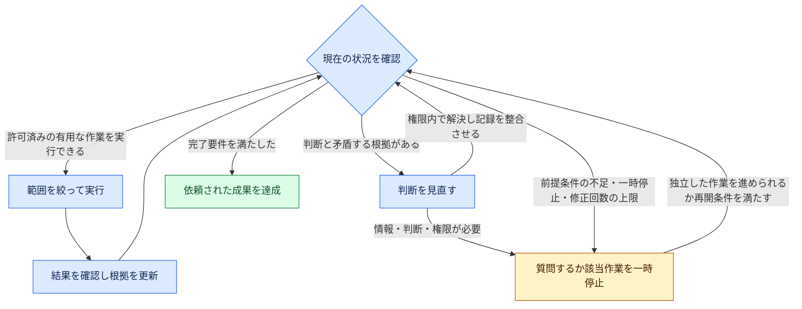

# Lusona Skills

[English](README.md) | [Español](README.es.md) | [Deutsch](README.de.md) | [简体中文](README.zh-CN.md) | [日本語](README.ja.md)

Lusona は、コーディングエージェントのスキルに共通の作業ループを設けています。

- **選び、実行し、確かめる。この流れを繰り返します。** 目指す成果と現在の根拠から次の作業を選びます。
  必要に応じて、探索、調査、設計、実装、レビューに立ち戻ります。スキルに決まった実行順序はありません。
- **新たな事実に応じて判断を見直します。** 過去の判断と矛盾する根拠が得られたら、合意した権限の範囲で
  その判断を見直します。関連する記録も更新し、その後の作業が新しい判断に従うようにします。
- **許可された範囲で作業を続けます。** 通常の細かな判断はエージェントが行い、許可を何度も求めずに
  作業を進めます。既存の権限を超える判断が必要になったときに質問します。
- **完了条件を満たしたことを確認します。** 合意した範囲の作業、必須の確認とレビュー、必要な受け入れや
  納品をすべて終えます。完了できない場合は、残っている作業を報告します。

Claude Code、Codex、[Cursor](INSTALL.md#cursor)、[Xcode 27 のコーディングエージェント](INSTALL.md#xcode)、[Google Antigravity App・CLI・IDE](INSTALL.md#antigravity)に対応 · チェックアウトしたソースのバージョン：**1.5.0**

> [!WARNING]
> Lusona のインストールには Vercel Skills（`npx skills@latest`）を使わず、[ホスト標準のプラグイン機能](#installation)を使ってください。

Lusona Skills を開発した背景：[When the workflow became another job](https://blog.lusona.com/blog/when-the-workflow-became-another-job/)（英語）。

この README は、チェックアウトしたソースの内容を説明しています。GitHub からのインストールには、
コミットしてプッシュしたソースを使います。ローカルの変更だけでは、公開リリースにはなりません。

<a id="index"></a>
## 目次

- [どこから始めるか](#where-to-start)
- [コマンドを選ぶ](#choose-a-command)
- [インストール](#installation)
- [作業の進め方](#how-the-work-continues)
- [質問と根拠](#questions-and-evidence)
- [復旧と再開](#recovery-and-resumption)
- [結果の報告と引き継ぎ](#results-and-handoffs)
- [参考資料](#reference)
- [貢献](#contributing)
- [ライセンス](#license)
- [開発](#development)

<a id="where-to-start"></a>
## どこから始めるか

プロジェクトに参加するとき、作業を再開するとき、何に取り組むべきかを考えるときは、**status** から始めます。
利用できる記録と根拠から状況を把握し、残っている作業を説明して、次の作業を提案します。
Lusona の記録がまだないプロジェクトでも使えます。状況確認の依頼は、新たな実装を許可するものではありません。

新しいアイデアについては、**explore** で可能性とトレードオフを検討し、**frame-product** で利用者、課題、
プロダクトの方向性を定めます。方向性が明確になってきたら、**map-capabilities** で必要な機能と適切な提供順序を
整理します。**specify** と **architect** で変更に必要な動作や設計上の判断を固め、**implement** で
許可された変更の実装と検証を進めます。

これはよくある進め方であり、必須の工程ではありません。現在の必要に合う作業区分から始め、解決済みの問いは
飛ばし、根拠に応じてどの区分にも立ち戻れます。仕様を定める前に調査することも、実装の途中で調査が必要に
なることもあります。レビューで設計を見直す理由が見つかる場合もあります。

| 作業区分 | スキルと役割 |
| --- | --- |
| 状況を把握する | [status](plugins/lusona/skills/status/SKILL.md)：進捗、残作業、次に取り組むべき作業を確認する |
| 方向性を定める | [explore](plugins/lusona/skills/explore/SKILL.md)：可能性とトレードオフを検討する<br/>[frame-product](plugins/lusona/skills/frame-product/SKILL.md)：利用者、成果、範囲を定める<br />[map-capabilities](plugins/lusona/skills/map-capabilities/SKILL.md)：機能の充足状況、依存関係、提供順序を整理する |
| 変更内容を定義する | [specify](plugins/lusona/skills/specify/SKILL.md)：動作、受け入れ基準、TDD 方針に合意する |
| 実装して評価する | [implement](plugins/lusona/skills/implement/SKILL.md)：動作変更や修正を計画し、完了まで進める<br />[review](plugins/lusona/skills/review/SKILL.md)：差分を確認し、不具合や検証の不足を指摘する<br />[refactor](plugins/lusona/skills/refactor/SKILL.md)：動作を保ちながら構造を改善する |
| 根拠を得る | [investigate](plugins/lusona/skills/investigate/SKILL.md)：原因や実現可能性を確かめる<br />[measure](plugins/lusona/skills/measure/SKILL.md)：規模、品質、コスト、変化を測定する<br />[experiment](plugins/lusona/skills/experiment/SKILL.md)：施策や代替案を検証する |
| 選択した作業を調整する | [batch](plugins/lusona/skills/batch/SKILL.md)：無人で作業を進める明示的な許可のもとで、選択した複数の成果に向けた作業を調整する |

通常の設計判断は、実装やリファクタリングの中で行います。実装やリファクタリングを明確に依頼し、範囲、
テスト駆動開発（TDD）の方針、前提条件が定まっていれば、別途 `specify` コマンドを実行せずに進められます。

<a id="choose-a-command"></a>
## コマンドを選ぶ

現在の必要に合うスキルを呼び出してください。エージェントは、与えられた権限の範囲で必要に応じてほかの
スキルも使います。スキルを切り替えるたびに指示する必要はありません。

Claude Code では `/lusona:<command>` を実行します。Codex ではスキル選択画面から Lusona のスキルを選びます。
Cursor では Agent チャットで `/` を入力し、スキルを選びます。Xcode ではエージェントとの会話で `/` を入力し、
インストール済みのスキルを選びます。Antigravity App/CLI では `/<skill-name>` を使います。
スタンドアロン IDE では **Customizations** を確認し、依頼の中で Lusona のスキル名を指定します。
コマンドを使う前に、[Lusona をインストール](#installation)してください。

解決したい問いや目指す成果と、エージェントに与える権限の範囲を伝えてください。たとえば、次のように依頼できます。

> **status:** 現在の記録と作業ツリーから、このプロジェクトの状況を確認してください。
> 残っている作業を示し、どこから始めるべきか提案してください。

> **explore:** 招待リンクと、メールだけで行う招待を比較してください。選択する前に、
> サポートチームへの影響を説明してください。この対話はチャット内にとどめ、ファイルに保存しないでください。

> **implement:** 招待の有効期限を 7 日間にしてください。受諾済みの招待は変更しないでください。
> 完了条件：7 日を過ぎた招待を拒否し、受諾済みの招待には影響を与えず、テストスイートが通ること。
> 有効期限の境界条件には targeted TDD を適用してください。ローカルで検証し、デプロイはしないでください。

計画だけが必要な場合は、実装コードや依存関係を変更せず、進め方と検証計画を提案するよう `implement` に
依頼してください。対話、仕様書、計画、アーキテクチャ上の判断、レビューは、実装の許可にはなりません。

実装やリファクタリングの前に、依頼ごとの指定または共通の設定として、TDD 方針を明示的に選んでください。

- `none`：テストを先に書く必要はありませんが、検証は必要です。
- `targeted`：指定した動作では、テストを先に書きます。
- `strict`：変更する動作のうち、テスト可能なものすべてについて、テストを先に書きます。

共通の設定は、プロジェクトの `docs/lusona/README.md` またはエージェントへの指示
（`CLAUDE.md` や `AGENTS.md`）に記載します。例：`TDD: targeted for changed behavior`。
明示的な選択がない場合、エージェントは確認と計画まで進め、実装前に質問します。

<a id="installation"></a>
## インストール

使用するアプリを選んでください。公開リポジトリ [lusona/ai-skills](https://github.com/lusona/ai-skills)
から HTTPS でインストールします。ダウンロードに GitHub の認証情報は不要です。

<a id="antigravity"></a>
### Antigravity

GitHub から直接インストールします。

```bash
agy plugin install https://github.com/lusona/ai-skills.git
```

この URL はリポジトリルートのマニフェストから Lusona をインストールします。
App とスタンドアロン IDE では、この CLI によるグローバルインストール後に **Customizations** を確認します。
App/CLI では `/status` を実行し、IDE では Lusona の `status` スキルを使うよう依頼します。
[Antigravity の手順](INSTALL.md#antigravity)に、ローカルチェックアウト、ポータブルパッケージ、
更新、削除、検証の範囲を記載しています。GitHub からのインストールは Linux の CLI 1.4.12 で確認済みです。
App/IDE の対話動作は未検証です。

<a id="claude-code"></a>
### Claude Code

```bash
claude plugin marketplace add https://github.com/lusona/ai-skills.git
claude plugin install lusona@lusona-ai-skills --scope user
```

<a id="codex"></a>
### Codex

```bash
codex plugin marketplace add https://github.com/lusona/ai-skills.git
codex plugin add lusona@lusona-ai-skills
```

<a id="cursor"></a>
### Cursor

**Customize > From GitHub Repository** を開き、`https://github.com/lusona/ai-skills` を入力して、
プロジェクトまたはユーザー用に **Lusona Skills** をインストールします。Agent チャットで `/` を入力すると、
Lusona のスキルを探せます。[Cursor のインストール手順](INSTALL.md#cursor)に、最新の公式ドキュメントへのリンクとテスト状況を記載しています。

<a id="xcode"></a>
### Xcode

Xcode 27 で **Settings > Intelligence > Agents > Plug-ins > Add Plug-in** を開きます。
**Add from URL** を選び、`https://github.com/lusona/ai-skills` を入力して、
インストールする Lusona のスキルを選んでください。設定、ローカルからのインポート、
バージョンの詳細は、[Xcode のインストール手順](INSTALL.md#xcode)を参照してください。

インストール後は、プロジェクトで新しいセッションを開始してください。ローカルチェックアウトからの
インストール、配布用パッケージ、更新、削除については、[インストールガイド](INSTALL.md)を参照してください。
カタログの取得元は、ローカルチェックアウトか GitHub のどちらか一つを選びます。

<a id="how-the-work-continues"></a>
## 作業の進め方

どの作業区分でも、同じ流れを繰り返します。現在の問いと根拠に応じて、次の作業は対話、実験、コードの変更、
レビューなどになります。順序に制約がある場合は、依存関係、共有状態、利用者の明示的な選択、
選択済みの TDD 方針に従います。

計画は実装の一部であり、作業の進展に応じて見直します。小さく明確な変更では、目指す成果と確認方法があれば
進められます。依存関係、不確実性、調整、復旧への対応には、明示的な計画が必要になることがあります。
実行を許可せずに、計画だけを依頼することもできます。



この図は、[共通の作業ループ](plugins/lusona/README.md#work-loop)を示しており、スキルの実行順序を
表すものではありません。待機や一時停止は該当する作業に適用します。独立した作業は、既存の権限の範囲で
続けられます。このループでは、次の四つの条件に従います。

- **継続：** 許可された有用な作業が残っている限り、次のスキルの呼び出しを利用者に求めずに作業を続けます。
- **質問：** 判断や許可が不足している場合に質問します。回答を待つ間も、独立して進められる許可済みの作業を
  続けます。返答がないことを、回答や許可とはみなしません。
- **一時停止：** 利用者の依頼、前提条件の不足、修正回数の上限によって、該当する作業を止めます。
  再開に必要な条件を示します。利用者が一時停止を求めた場合は、利用者の再開指示が必要です。
- **完了：** 許可された範囲の作業をすべて終え、必須の確認とレビュー、必要な受け入れや納品を済ませた場合に
  限り、完了とします。必須の確認が失敗した場合や未実行の場合は、完了にできません。

合意済みの判断と矛盾する根拠が得られたら、エージェントは矛盾点を示し、既存の権限内で判断を見直します。
変更が権限を超える場合は、利用者に質問します。関連する記録と担当への指示を整合させ、以前の判断理由のうち
役立つものを残したうえで、新たな合意に従って作業を続けます。古い記録を理由に、撤回済みの判断へ戻すことはありません。

失敗を繰り返す場合は、[修正回数の上限](plugins/lusona/references/corrections.md)に従います。
バッチでは、合意した修正作業の上限に従います。上限に達して該当する作業を止めた場合は、根拠と再開条件を報告します。

メインエージェントは質問、担当割り当て、統合、検証を調整し、本格的なプロダクト開発やエンジニアリングの作業を
専門エージェントに委任します。探索や状況確認の対話は、メインエージェントが担当してもかまいません。
利用者やリポジトリの規則が求める場合に加え、セキュリティ境界、永続データ、共有インターフェースなどの契約、
複数の担当者による共同編集に関わる場合には、独立したレビューが必要です。委任が利用できない場合や禁止されている
場合は、許可された作業を単独で進められます。ただし、必須の独立レビューには別のレビュアーが必要です。
[委任](plugins/lusona/references/delegation.md)を参照してください。

<a id="questions-and-evidence"></a>
## 質問と根拠

エージェントは、作業中の未解決の判断に応じて質問します。回答済みの内容を再利用し、調べればわかる事実は確認し、
意図や影響の大きいトレードオフを利用者に尋ねます。選択肢は必要な詳しさで説明します。探索は、意思決定に至らなくても、
理解が深まれば終えることができます。[意図を確認する対話](plugins/lusona/references/interviews.md)を参照してください。

調査、測定、実験は、どの作業区分でも判断の材料になります。追加の作業は、許可された範囲と適用される作業量や資源の
上限の中で、有用な問いに答えるものでなければなりません。調査結果では、根拠、仮定、不確実な点を区別します。
後続作業の提案は、その実装を許可するものではありません。

選択に役立つ場合は、図や視覚的な比較案を使います。採用されたビジュアル資料は `docs/lusona/visuals/` に保存し、
必ず満たすべき要件を実装とレビューで確認します。[ビジュアル](plugins/lusona/references/visuals.md)を参照してください。

重要な測定や実験の記録は、利用先プロジェクトの `docs/lusona/evidence/` に保存します。
仕様書、ノート、履歴は、根拠とする実行記録へ正確にリンクします。既存の記録は元の場所に残します。

<a id="recovery-and-resumption"></a>
## 復旧と再開

エージェントは、小さな作業でも、重要な判断、調査結果、検証の根拠を、別途保存を求められなくてもプロジェクトの
記録に残します。できる限り既存の記録を更新します。通常の対話や短い状況報告にはファイルは不要です。
読み取り専用、保存禁止、保存先の制約を優先します。

記録には、目指す成果、権限、TDD 方針、現在の判断、有用な根拠、未解決の問い、次の作業を残します。
必要に応じて、担当範囲と修正回数も記録します。影響の大きいアーキテクチャ上の判断には ADR が必要です。
仕様書を使う場合は `docs/lusona/work.md` で追跡します。仕様書を使わない作業では、ノートだけでもかまいません。
キューの状態は進捗を示すものであり、次に実行するスキルを指定したり、実行を許可したりするものではありません。
[記録と保持](plugins/lusona/references/retention.md)と[キューの規則](plugins/lusona/references/queue.md)を参照してください。

再開時には、残っている記録と作業ツリーを照合し、そこから復元できない重要な情報だけを尋ねます。
既存の許可は引き継がれます。残作業の把握には **status** を使うか、続ける作業を指定してください。

> 保存済みの調査結果に基づき、招待の有効期限の調査を続けてください。記録された再現手順を現在のビルドで
> 確認してください。本番コードの動作は変更しないでください。

突然の中断では、保存できないことがあります。記録を保存できない場合は、復旧上の制限を報告し、
調査結果を会話内で提示します。

<a id="results-and-handoffs"></a>
## 結果の報告と引き継ぎ

詳しい報告には、結果、その根拠、次の作業を示します。完了した作業と、進行中、入力待ち、一時停止中の作業を
区別します。完了は、許可された依頼の範囲に対するものです。診断を終えても、不具合を修正したことにはなりません。

次は引き継ぎの例です。実際に作業したことを示すものではありません。

> **✅ 完了 · 結果：** 診断が完了しました。問題を再現した結果、有効期限の確認に誤ったタイムスタンプを
> 使っていることがわかりました。本番コードの修正は、まだ許可されていません。
>
> **根拠：** 記録済みのケースと、対象を絞った確認で結果が一致しました。複数プラットフォームでの動作は未検証です。
>
> **次の作業：** 利用者がタイムスタンプの修正を許可し、TDD 方針を選択します。
> その後、エージェントがその範囲に絞って修正と検証を行えます。

作業が残っている場合は、次の作業の担当者、必要な情報、まだ得られていない権限を明示します。
通常の対話には報告用の構成は不要です。例に示した形式は試用段階であり、利用者が指定した形式と使用するアプリの
制約を優先します。各アプリでの動作はまだ確認できていません。
[レビューとコミュニケーション](plugins/lusona/README.md#review-and-communication)を参照してください。

<a id="reference"></a>
## 参考資料

- [インストールと削除](INSTALL.md)
- [プライバシーポリシー](PRIVACY.md)
- [利用規約](TERMS.md)
- [ワークフローの契約と作業ループ](plugins/lusona/README.md#work-loop)
- [スキルの選択と用語](plugins/lusona/references/workflow-guide.md)
- [TDD 方針と実行順序](plugins/lusona/references/tdd.md)
- [バッチ実行と復旧](plugins/lusona/references/batch-execution.md)
- [記録と保持](plugins/lusona/references/retention.md)
- [完了処理と再オープン](plugins/lusona/references/closeout.md)
- [委任とモデルの割り当て](plugins/lusona/references/delegation.md)

<a id="contributing"></a>
## 貢献

貢献できる内容、ローカルでの確認方法、プルリクエストについては、[CONTRIBUTING.md](CONTRIBUTING.md)を参照してください。
問題の報告や改善の提案には、[不具合・機能リクエストのフォーム](https://github.com/lusona/ai-skills/issues/new/choose)を使ってください。
リポジトリのレビューは `@lusona/core` チームが担当します。

<a id="license"></a>
## ライセンス

スキル、テンプレート、ドキュメント、スクリプトは、[MIT License](LICENSE)のもとで利用できます。

<a id="development"></a>
## 開発

ワークフローの正式なソースは `plugins/lusona/` にあります。利用先プロジェクトのデータは、
そのプロジェクトの `docs/lusona/` に置きます。空のキュー構造は `templates/work.md` にあります。

プラグインの記録作成ヘルパーは Bash または PowerShell を使います。[実行環境の要件](INSTALL.md#requirements)を参照してください。パッケージ作成と Python による評価には引き続き Python 3 が必要ですが、通常のプラグイン利用には不要です。

```bash
claude plugin validate plugins/lusona
claude plugin validate .claude-plugin/marketplace.json
python3 scripts/package.py
```

パッケージ作成ツールは、ホスト標準のマニフェストの識別情報とバージョン、リンク、カタログのパス、
収録ファイルを確認します。出力先はリポジトリ内の `tmp/lusona-package/` です。
別の場所にビルドするには、`--output tmp/<new-directory>` を指定します。すべてのネイティブマニフェストは、同じバージョンを使う必要があります。
GitHub からのインストールには、コミットしてプッシュしたソースを使います。公開前でも、ローカルチェックアウトは利用できます。
インストールやパッケージ作成によって、プロジェクトの記録を初期化することはありません。

ソースのサイズを減らしても、トークン使用量や待ち時間が減ったとは限りません。
確認するには、調整役とすべての作業担当を含めて測定する必要があります。
