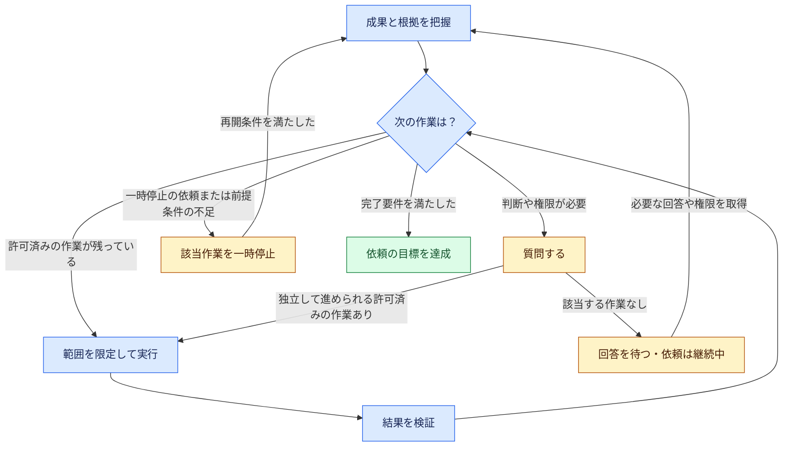

# Lusona AI Skills

[English](README.md) | [Español](README.es.md) | [Deutsch](README.de.md) | [简体中文](README.zh-CN.md) | [日本語](README.ja.md)

Lusona は、AI エージェントが依頼を理解し、作業を進め、結果を検証するまでを支援するスキル集です。
目指す成果、制約、権限は利用者が定めます。エージェントは根拠に基づいて次に取り組むべき作業を選び、
許可された作業を続け、利用者の判断や許可が必要な場合に質問します。

Claude Code、Codex、[Cursor](plugins/lusona/INSTALL.md#cursor)、[Xcode 27 のコーディングエージェント](plugins/lusona/INSTALL.md#xcode)に対応 · チェックアウトしたソースのバージョン：**1.1.0**

> [!WARNING]
> Lusona のインストールには Vercel Skills（`npx skills@latest`）を使わず、[ホスト標準のプラグイン機能](#installation)を使ってください。

Lusona AI Skills を開発した背景：[When the workflow became another job](https://blog.lusona.com/blog/when-the-workflow-became-another-job/)（英語）。

この README は、チェックアウトしたソースの内容を説明しています。GitHub からのインストールには、
コミットしてプッシュしたソースを使います。ローカルの変更だけでは、公開リリースにはなりません。

<a id="index"></a>
## 目次

- [目指す成果から始める](#start-with-an-outcome)
- [コマンドを選ぶ](#choose-a-command)
- [インストール](#installation)
- [作業の進め方](#how-the-work-continues)
- [質問と根拠](#questions-and-evidence)
- [復旧と再開](#recovery-and-resumption)
- [結果の報告と引き継ぎ](#results-and-handoffs)
- [参考資料](#reference)
- [貢献](#contributing)
- [ライセンス](#license)
- [開発](#development)

<a id="start-with-an-outcome"></a>
## 目指す成果から始める

変更内容が決まっている場合は、Claude Code で `/lusona:implement` を使うか、Codex で `implement` を選びます。
依頼には、テスト駆動開発（TDD）の方針も含めてください。

> 招待の有効期限を 7 日間にしてください。受諾済みの招待は変更しないでください。
> 完了条件：7 日を過ぎた招待を拒否し、受諾済みの招待には影響を与えず、テストスイートが通ること。
> 有効期限の境界条件には targeted TDD を適用してください。
> ローカルで検証し、デプロイはしないでください。重要な判断が必要で作業を進められない場合は質問してください。

目指す成果、完了条件、エージェントに与える権限の範囲を伝えてください。エージェントは必要な計画を立て、
追加のコマンドを待たずに、許可された作業を進めます。結果と検証の根拠に加え、
未解決の判断事項や制限を報告します。

TDD 方針は、依頼ごとに指定するか、共通の設定として明示してください。

- `none`：テストを先に書く必要はありませんが、検証は必要です。
- `targeted`：指定した動作では、テストを先に書きます。
- `strict`：変更する動作のうち、テスト可能なものすべてについて、テストを先に書きます。

共通の設定は、プロジェクトの `docs/lusona/README.md` またはエージェントへの指示
（`CLAUDE.md` や `AGENTS.md`）に記載します。例：`TDD: targeted for changed behavior`。
明示的な選択がない場合、エージェントは確認と計画まで進め、実装前に質問します。

ほかにも、次のような依頼から始められます。

> **explore:** 招待リンクと、メールだけで行う招待を比較してください。選択する前に、
> サポートチームへの影響を説明してください。この対話はチャット内にとどめ、ファイルに保存しないでください。

> **investigate:** この再現ケースで、期限切れの招待を使えてしまう原因を調べてください。
> 原因の候補を切り分ける実験を行い、根拠を報告してください。プロダクションの動作は変更しないでください。

> **implement、計画のみ:** 招待の有効期限と、その検証方法について進め方を提案してください。
> 実装コードや依存関係は変更しないでください。

> **status:** 現在の記録と作業ツリーから、招待に関する作業の状況を確認してください。
> 残っている作業と、次に取り組む作業を範囲を絞って示してください。

対話、仕様の策定、計画、アーキテクチャ上の判断、レビューを依頼しても、実装まで許可したことにはなりません。
実装やリファクタリングを明確に依頼し、範囲、TDD 方針、前提条件が定まっていれば、
別途 `specify` コマンドを実行せずに進められます。

<a id="choose-a-command"></a>
## コマンドを選ぶ

依頼に合うコマンドを選んでください。エージェントは合意済みの判断を引き継ぎ、
与えられた権限の範囲で、必要に応じてほかのスキルも使います。
決まった実行順序はありません。

Claude Code では `/lusona:<command>` を実行します。Codex ではスキル選択画面から Lusona のスキルを選びます。
Xcode ではエージェントとの会話で `/` を入力し、インストール済みのスキルを選びます。
コマンドを使う前に、[Lusona をインストール](#installation)してください。

| コマンド | 用途 |
| --- | --- |
| [explore](plugins/lusona/skills/explore/SKILL.md) | 対話を通じて理解を深め、可能性や希望を探る |
| [status](plugins/lusona/skills/status/SKILL.md) | 現在の進捗、把握している残作業すべて、次の作業を確認する |
| [frame-product](plugins/lusona/skills/frame-product/SKILL.md) | 利用者、課題、目指す成果、プロダクトの範囲を定める |
| [map-capabilities](plugins/lusona/skills/map-capabilities/SKILL.md) | 機能、依存関係、提供順序を整理する |
| [specify](plugins/lusona/skills/specify/SKILL.md) | 一つの変更について、動作、制約、受け入れ基準、TDD 方針に合意する |
| [architect](plugins/lusona/skills/architect/SKILL.md) | 影響の大きい設計、契約、責任範囲の判断を行う |
| [investigate](plugins/lusona/skills/investigate/SKILL.md) | 根拠と実験によって、原因、事実、実現可能性を確かめる |
| [implement](plugins/lusona/skills/implement/SKILL.md) | 許可された動作変更や不具合修正を計画し、実装を完了する |
| [review](plugins/lusona/skills/review/SKILL.md) | 実際の差分を確認し、不具合や検証の不足を指摘する |
| [refactor](plugins/lusona/skills/refactor/SKILL.md) | 動作と互換性を保ちながら、既存コードの構造を改善する |
| [batch](plugins/lusona/skills/batch/SKILL.md) | 無人で作業を進める明示的な許可のもとで、選択した複数の成果に向けた作業を調整する |

何が起きているか、その理由は何かを確かめるには **investigate** を使います。影響の大きい技術的な境界や
トレードオフを決めるには **architect** を使います。動作を変えずに具体的な構造の問題を解消する場合は
**refactor**、動作を変更したり不具合を修正したりする場合は **implement** を使ってください。
日常的な設計判断は、実装やリファクタリングの中で行います。

<a id="installation"></a>
## インストール

使用するアプリを選んでください。公開リポジトリ [lusona/ai-skills](https://github.com/lusona/ai-skills)
から HTTPS でインストールします。ダウンロードに GitHub の認証情報は不要です。

<a id="claude-code"></a>
### Claude Code

```bash
claude plugin marketplace add https://github.com/lusona/ai-skills.git
claude plugin install lusona@lusona-ai-skills --scope user
```

<a id="codex"></a>
### Codex

```bash
codex plugin marketplace add https://github.com/lusona/ai-skills.git
codex plugin add lusona@lusona-ai-skills
```

<a id="xcode"></a>
### Cursor

**Customize > From GitHub Repository** を開き、`https://github.com/lusona/ai-skills` を入力して **lusona** をインストールします。[Cursor のインストール手順](plugins/lusona/INSTALL.md#cursor)に、最新の公式ドキュメントへのリンクとテスト状況を記載しています。

### Xcode

Xcode 27 で **Settings > Intelligence > Agents > Plug-ins > Add Plug-in** を開きます。
**Add from URL** を選び、`https://github.com/lusona/ai-skills` を入力して、
インストールする Lusona のスキルを選んでください。設定、ローカルからのインポート、
バージョンの詳細は、[Xcode のインストール手順](plugins/lusona/INSTALL.md#xcode)を参照してください。

インストール後は、プロジェクトで新しいセッションを開始してください。ローカルチェックアウトからの
インストール、配布用パッケージ、更新、削除については、[インストールガイド](plugins/lusona/INSTALL.md)を参照してください。
カタログの取得元は、ローカルチェックアウトか GitHub のどちらか一つを選びます。

<a id="how-the-work-continues"></a>
## 作業の進め方

エージェントは目指す成果、合意済みの判断、これまでに得られた根拠、未達成の基準を確認し、範囲を絞って次の作業を選びます。
権限の範囲で実行して結果を確かめ、許可の範囲内で成果につながる作業が残っている限り、この流れを繰り返します。
各スキルには、この過程で担う役割と専門知識が用意されています。



この図は、[共通の作業ループ](plugins/lusona/README.md#work-loop)の概要です。各制約は該当する作業に適用します。
ある作業が待機中でも、独立して進められる許可済みの作業は継続できます。

- **継続：** 次に取り組むべき作業を、権限の範囲で実行します。現在のエージェントが実行できる作業を、
  推奨事項の提示や続行を促すメッセージだけで済ませることはありません。
- **質問して回答を待つ：** 不足している判断や権限について、使用が許可されたホスト標準の質問ツール、
  または簡潔な文章で尋ねます。独立して進められる作業を続け、それがなくなったら回答を待ちます。
  回答待ちの間も依頼は継続中です。返答がないことを、判断や許可とはみなしません。
- **一時停止：** 利用者が一時停止を求めた場合、必要な情報や機能を利用できない場合、権限がない場合、
  または修正回数の上限に達した場合に、該当する作業を止めます。再開条件を明示します。
  利用者が一時停止を求めた場合、エージェントは利用者の再開指示を待ちます。それ以外の一時停止は、
  明示した前提条件、根拠、権限がそろえば解除できます。チェックポイントを保存しただけでは、
  これらの条件を満たしません。
- **完了：** 許可された範囲の作業をすべて終え、受け入れ基準を満たし、必須の確認と、求められている独立したレビューを実施します。
  人による承認や納品が求められている場合は、それらも完了します。テストが通っただけでは完了とはしません。
  必須の確認が失敗した場合や未実行の場合、完了とは報告できません。

質問と一時停止は重なることがあります。エージェントは、停止中の作業を再開するために必要なことを尋ねる場合があります。
どちらの場合も、必要なものを明示し、独立して進められる許可済みの作業を続けます。

範囲と影響の大きい判断は利用者が決めます。エージェントは制約の範囲で通常の細かな判断を行い、
合意済みの成果を変更する前や、権限を超える破壊的な操作を行う前に質問します。
利用者やリポジトリの規則が求める場合に加え、セキュリティ境界、永続データ、共有インターフェースなどの契約、
複数の担当者による共同編集に関わる場合には、独立したレビューが必要です。

エージェントは合意済みの範囲と基準を保ち、根拠を集めながら進め方を見直します。
修正しても進展しなくなった場合は、根拠と続行に必要な条件を報告します。修正回数の上限によって、
利用者の判断を求めるタイミングが決まります。バッチでは、合意した修正作業の上限に従います。
[修正の規則](plugins/lusona/README.md#work-loop)を参照してください。

メインエージェントは、質問、担当割り当て、統合、検証を調整します。本格的なプロダクト開発や
エンジニアリングの作業は、それぞれの役割とモデルが適した専門エージェントに委任します。探索や状況確認の対話は、
メインエージェントが担当してもかまいません。委任が禁止されている場合や利用できない場合は、
許可された作業を単独で進められます。ただし、必須の独立レビューには別のレビュアーが必要です。
担当範囲と引き継ぎについては、[委任](plugins/lusona/references/delegation.md)を参照してください。

<a id="questions-and-evidence"></a>
## 質問と根拠

エージェントは、利用者の理解度に合わせて質問、説明、例、実験を調整します。直接の質問にまず答え、
すでに得た回答を踏まえ、重要な不明点を尋ねます。専門知識に応じて説明の詳しさを変えますが、
根拠や判断に関する要件は変わりません。

探索では、エージェントは具体的な状況や選択肢ごとの利点と欠点を示し、結論を求めずに理解を深める手助けをします。
追加の対話によって理解が深まったり、次の作業が変わったりする余地がある間は、対話を続けます。
調査では、原因の候補を切り分けられる場合に追加の実験を行います。
根拠の不足で進めない場合は、何が必要かを示します。

たとえば、経験のある保守担当者が互換性の制約を伝えていれば、同じ内容を尋ね直す必要はありません。
移行方法に詳しくない読者には、希望を尋ねる前に、それぞれの選択の影響を説明します。
[意図を確認する対話](plugins/lusona/references/interviews.md)も参照してください。

<a id="recovery-and-resumption"></a>
## 復旧と再開

安全な再開や担当間の調整に必要な場合は、許可された作業の一環として、最小限の記録をローカルに残します。
書き込みが許可された範囲と利用者の制約に従います。文脈を残す必要のない対話では、ファイルを保存しません。
記録が必要な場合は、その作業の既存の記録を更新するか、用途に合う最小限のメモや変更記録を使います。
作業の区切りや引き継ぎの前に、新たに判明した事実や変更点を保存します。

再開用の記録には、目指す成果、権限と TDD 方針の根拠、合意済みの判断、有用な根拠、重要な未解決事項、
担当範囲、該当する場合は修正回数、次の作業を残します。探索では、仕様書やキューを作らずに判断や質問を
記録できます。`implement` と `refactor` は、必要に応じて変更記録を作成できます。
どちらも、別途 `specify` コマンドを実行する必要はありません。再開用の記録を保存しても、キューに作業を登録したことにはなりません。

読み取り専用、保存禁止、保存先の制約を優先します。保存が禁止されている場合や保存できない場合は、
会話内で引き継ぎ情報を提示し、作業の再開にあたっての制限を伝えます。突然の中断では、チェックポイントを残せないことがあります。
再開時には、残っている記録と作業ツリーの状態を確認し、そこから確認できない重要な事実や権限だけを尋ねます。
[記録と保持](plugins/lusona/references/retention.md)を参照してください。

別のセッションへの続行指示には、たとえば次のように書けます。

> この作業の記録に基づき、招待の有効期限の調査を続けてください。修正を提案する前に、
> 提供済みのビルドで記録されたケースを再現してください。記録済みの診断範囲を維持し、
> プロダクションの変更は引き続き行わないでください。

この指示は、別のセッションへの引き継ぎに使えます。現在のエージェントは、自分の権限内で実行できる作業を続けます。

<a id="results-and-handoffs"></a>
## 結果の報告と引き継ぎ

Lusona では、詳しい評価の報告や引き継ぎに、**結果**、**根拠**、**次の作業**という共通形式を試用しています。
結果には **✅ 完了**、**🔄 進行中**、**❓ 入力待ち**、**⏸ 一時停止中**のいずれかを添え、
言葉でも状態を伝えます。作業を進めるために回答や承認が必要なら、その質問や承認依頼を先に示します。
通常の対話、質問、短い進捗報告では、自然な表現を使います。

次は引き継ぎの例です。実際に作業したことを示すものではありません。

> **✅ 完了 · 結果：** 診断が完了しました。問題を再現した結果、有効期限の確認に誤ったタイムスタンプを
> 使っていることがわかりました。プロダクションの修正は、まだ許可されていません。
>
> **根拠：** 記録済みのケースと、対象を絞った確認で結果が一致しました。複数プラットフォームでの動作は未検証です。
>
> **次の作業：** 利用者がタイムスタンプの修正を許可し、TDD 方針を選択します。
> その後、エージェントがその範囲に絞って修正と検証を行えます。

引き継ぎでは、次の作業の担当者、必要な情報、まだ得られていない権限を明示します。
完了時には、**この依頼に関する次の作業はありません**と記載できます。

利用者が指定した形式と使用するアプリの制約を優先します。この表示形式は試用段階で、各アプリでの動作はまだ確認できていません。
書式の詳細は、[レビューとコミュニケーション](plugins/lusona/README.md#review-and-communication)を参照してください。

<a id="reference"></a>
## 参考資料

- [インストールと削除](plugins/lusona/INSTALL.md)
- [ワークフローの契約と作業ループ](plugins/lusona/README.md#work-loop)
- [スキルの選択と用語](plugins/lusona/references/workflow-guide.md)
- [TDD 方針と実行順序](plugins/lusona/references/tdd.md)
- [バッチ実行と復旧](plugins/lusona/references/batch-execution.md)
- [記録と保持](plugins/lusona/references/retention.md)
- [完了処理と再オープン](plugins/lusona/references/closeout.md)
- [委任とモデルの割り当て](plugins/lusona/references/delegation.md)

<a id="contributing"></a>
## 貢献

貢献できる内容、ローカルでの確認方法、プルリクエストについては、[CONTRIBUTING.md](CONTRIBUTING.md)を参照してください。
問題の報告や改善の提案には、[不具合・機能リクエストのフォーム](https://github.com/lusona/ai-skills/issues/new/choose)を使ってください。
リポジトリのレビューは `@lusona/core` チームが担当します。

<a id="license"></a>
## ライセンス

スキル、テンプレート、ドキュメント、スクリプトは、[MIT License](LICENSE)のもとで利用できます。

<a id="development"></a>
## 開発

ワークフローの正式なソースは `plugins/lusona/` にあります。利用先プロジェクトのデータは、
そのプロジェクトの `docs/lusona/` に置きます。空のキュー構造は `templates/work.md` にあります。

プラグインの記録作成ヘルパーは Bash または PowerShell を使います。[実行環境の要件](plugins/lusona/INSTALL.md#requirements)を参照してください。パッケージ作成と Python による評価には引き続き Python 3 が必要ですが、通常のプラグイン利用には不要です。

```bash
claude plugin validate plugins/lusona
claude plugin validate .claude-plugin/marketplace.json
python3 scripts/package.py
```

パッケージ作成ツールは、ホスト標準のマニフェストの識別情報とバージョン、リンク、カタログのパス、
収録ファイルを確認します。出力先はリポジトリ内の `tmp/lusona-package/` です。
別の場所にビルドするには、`--output tmp/<new-directory>` を指定します。三つのマニフェストは、同じバージョンを使う必要があります。
GitHub からのインストールには、コミットしてプッシュしたソースを使います。公開前でも、ローカルチェックアウトは利用できます。
インストールやパッケージ作成によって、プロジェクトの記録を初期化することはありません。

ソースのサイズを減らしても、トークン使用量や待ち時間が減ったとは限りません。
確認するには、調整役とすべての作業担当を含めて測定する必要があります。
