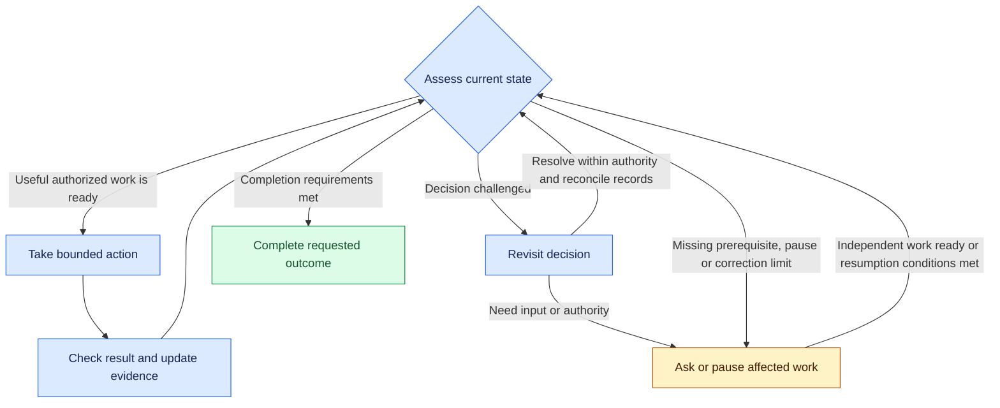

# Lusona Skills

[English](README.md) | [Español](README.es.md) | [Deutsch](README.de.md) | [简体中文](README.zh-CN.md) | [日本語](README.ja.md)

Lusona organizes coding-agent skills around a shared work loop:

- **Choose, act, check, repeat.** Choose the next action from the outcome and current
  evidence. Revisit exploration, investigation, design, implementation, or review as needed.
  There is no fixed skill sequence.
- **Revise decisions as you learn.** When evidence challenges an earlier decision, revisit
  it within the agreed authority. Update affected records so subsequent work follows the
  revised decision.
- **Continue within authorization.** Resolve routine choices and keep working without
  repeated approval. Ask when a decision exceeds existing authority.
- **Verify completion.** Complete the agreed scope, required checks and review, and any
  required acceptance or delivery. Report what remains when completion is blocked.

For Claude Code, Codex, [Cursor](INSTALL.md#cursor), [Xcode 27 coding agents](INSTALL.md#xcode), and [Google Antigravity App, CLI, and IDE](INSTALL.md#antigravity) · Checked-out source version **2.0.1**

> [!WARNING]
> Do not install Lusona using Vercel Skills (`npx skills@latest`); use the [native plugin installation](#installation).

Read why we built Lusona Skills: [Why we built Lusona Skills](https://blog.lusona.com/blog/why-we-built-lusona-skills/).

This README describes the source in this checkout. GitHub installation uses committed,
pushed sources; local changes do not establish a published release.

## Index

- [Where to start](#where-to-start)
- [Choose a command](#choose-a-command)
- [Installation](#installation)
- [How the work continues](#how-the-work-continues)
- [Questions and evidence](#questions-and-evidence)
- [Recovery and resumption](#recovery-and-resumption)
- [Results and handoffs](#results-and-handoffs)
- [Reference](#reference)
- [Contributing](#contributing)
- [License](#license)
- [Development](#development)

## Where to start

Start with **status** when joining a project, resuming work, or deciding what needs attention.
It assesses the available records and evidence, explains what remains, and recommends a next
action. It also works when the project has no Lusona records yet. Asking for status does
not authorize new implementation work.

For a new idea, **explore** helps examine possibilities and tradeoffs; **frame-product** helps
establish the users, problem, and product direction. As that direction becomes clearer,
**map-capabilities** identifies what the product needs to support and useful delivery order.
**specify** clarifies behavior and acceptance criteria; **architect** resolves consequential
technical decisions about boundaries, contracts, and ownership. **design** focuses on UI
mockups, screen flows, and diagrams; you can request it directly without another stage first.
**implement** carries an authorized change through execution and verification.

These are common ways work develops, not required stages. Start with the group that fits the
current need, skip settled questions, and return to any group when evidence calls for it.
Investigation can precede a specification or interrupt implementation; review can reveal a
reason to revisit a design.

| Action group | Skills and responsibilities |
| --- | --- |
| Orient | [status](plugins/lusona/skills/status/SKILL.md): assess progress, remaining work, and the next useful action |
| Develop direction | [explore](plugins/lusona/skills/explore/SKILL.md): examine possibilities and tradeoffs<br/>[frame-product](plugins/lusona/skills/frame-product/SKILL.md): establish users, outcomes, and boundaries<br />[map-capabilities](plugins/lusona/skills/map-capabilities/SKILL.md): map coverage, dependencies, and delivery order |
| Define a change | [specify](plugins/lusona/skills/specify/SKILL.md): agree on behavior, acceptance criteria, and TDD policy<br />[architect](plugins/lusona/skills/architect/SKILL.md): resolve consequential technical decisions about boundaries, contracts, and ownership |
| Design visually | [design](plugins/lusona/skills/design/SKILL.md): create UI mockups, screen flows, and diagrams |
| Build and assess | [implement](plugins/lusona/skills/implement/SKILL.md): plan and deliver a behavior change or fix<br />[review](plugins/lusona/skills/review/SKILL.md): inspect a diff for defects and verification gaps<br />[refactor](plugins/lusona/skills/refactor/SKILL.md): improve structure while preserving behavior |
| Establish evidence | [investigate](plugins/lusona/skills/investigate/SKILL.md): establish causes or feasibility<br />[measure](plugins/lusona/skills/measure/SKILL.md): establish magnitude, quality, cost, or change<br />[experiment](plugins/lusona/skills/experiment/SKILL.md): test an intervention or alternatives |
| Coordinate selected work | [batch](plugins/lusona/skills/batch/SKILL.md): coordinate several selected outcomes under explicit unattended-work authority |

The full catalog of personas, outputs, and routing lives in the
[workflow guide](plugins/lusona/references/workflow-guide.md).
Routine design choices stay within implementation or refactoring. A clear implementation or
refactoring request can proceed without a separate `specify` command once its scope,
test-driven development (TDD) policy, and prerequisites are settled.

## Choose a command

Invoke the skill that fits your current need. The agent uses other skills as needed within
the authority you grant; you do not need to direct each transition.

In Claude Code, invoke `/lusona:<command>`. In Codex, select the Lusona skill from the
skill UI. In Cursor, type `/` in Agent chat and select the skill. In Xcode, type `/` in an
agent conversation and select the installed skill. In Antigravity App/CLI, use `/<skill-name>`;
in the standalone IDE, inspect **Customizations** and name the Lusona skill in your request.
[Install Lusona](#installation) before using these commands.

Name the question or outcome and the limits of the agent's authority. For example:

> **status:** Assess this project from the available records and working tree. Tell me what
> remains and recommend where to start.

> **explore:** Help me compare invitation links and email-only invitations. Explain the
> consequences for our support team before we choose. Keep this discussion in chat; do not save files.

> **design:** Compare two invitation flows using our existing screens, navigation, and copy.
> Show the steps and the expired-invitation state, and explain each option’s tradeoff.
> Keep this to visual design; do not implement the UI.

> **implement:** Add invitation expiry after seven days. Preserve existing accepted invitations.
> Done means: invitations older than seven days are rejected, accepted invitations are unchanged,
> and the test suite passes. Use targeted TDD for the expiry boundary. Verify locally; do not deploy.

For planning only, ask `implement` for an approach and verification plan without editing
implementation or dependencies. Discussion, specifications, plans, architecture decisions,
and review do not grant implementation authority.

Before implementation or refactoring, choose TDD explicitly in the request or through a
standing preference:

- `none`: verification remains required, without test-first sequencing.
- `targeted`: use test-first sequencing for named behaviors.
- `strict`: use test-first sequencing for every changed testable behavior.

Put a standing preference in the project's `docs/lusona/README.md` or agent instructions
(`CLAUDE.md` or `AGENTS.md`), for example `TDD: targeted for validation and persistence boundaries`. Without an
explicit selection, the agent can inspect and plan, then asks before implementation.

## Installation

Choose your host. Install from the public [lusona/ai-skills](https://github.com/lusona/ai-skills)
repository over HTTPS; no GitHub credentials are required to download it.

### Antigravity

Install directly from GitHub:

```bash
agy plugin install https://github.com/lusona/ai-skills.git
```

The URL installs Lusona from the repository-root manifest.
For App and standalone IDE use, inspect **Customizations** after this global CLI install.
In App/CLI chat, invoke `/status`; in the IDE, ask to use Lusona's `status` skill.
The [Antigravity installation guide](INSTALL.md#antigravity) covers local checkouts,
portable packages, updates, removal, and verification limits. GitHub installation was
checked with CLI 1.4.12 on Linux; App/IDE interactive behavior remains untested.

### Claude Code

```bash
claude plugin marketplace add https://github.com/lusona/ai-skills.git
claude plugin install lusona@lusona-ai-skills --scope user
```

### Codex

```bash
codex plugin marketplace add https://github.com/lusona/ai-skills.git
codex plugin add lusona@lusona-ai-skills
```

### Cursor

Open **Customize > From GitHub Repository**, enter `https://github.com/lusona/ai-skills`,
then install **Lusona Skills** for your project or user. In Agent chat, type `/` to find
Lusona's skills. See the [Cursor installation steps](INSTALL.md#cursor)
for links to Cursor's current documentation and testing status.

### Xcode

In Xcode 27, open **Settings > Intelligence > Agents > Plug-ins > Add Plug-in**.
Choose **Add from URL**, enter `https://github.com/lusona/ai-skills`, and select
Lusona's skills to install. See the [Xcode installation steps](INSTALL.md#xcode)
for setup, local imports, and version details.

Start a new session in your project after installation. For local checkout installation,
portable packages, updates, and removal, see the [installation guide](INSTALL.md).
Choose one catalog source: local checkout or GitHub.

## How the work continues

The same loop applies to every action group. The next action might be a discussion,
an experiment, a code change, or a review, depending on the current question and evidence.
Dependencies, shared state, explicit user choices, and the selected TDD policy still
determine ordering where required.

Planning belongs to implementation and adapts as the work develops. Small, clear changes
need an outcome and checks; dependencies, uncertainty, coordination, or recovery may require
an explicit plan. You can also request a plan without authorizing execution.



The graph shows the [shared work loop](plugins/lusona/README.md#work-loop), not a sequence
of skills. Waiting and pausing apply to the affected work; independent work can continue
within its existing authority. The loop has four boundaries:

- **Continue** while useful authorized work remains, without asking you to invoke the next skill.
- **Ask** when a decision or permission is missing. Continue independent authorized work while
  waiting; silence does not supply an answer or permission.
- **Pause** affected work on your request, a missing prerequisite, or a correction limit.
  State what is needed to resume. A user-requested pause requires you to resume the work.
- **Complete** only when the whole authorized scope, required checks and review, and required
  acceptance or delivery are satisfied. Failed or unrun required checks prevent completion.

When evidence challenges an accepted decision, the agent identifies the conflict and revisits
it within existing authority, asking you when a revision exceeds that authority. It reconciles
affected records and assignments, preserves useful prior rationale, and continues from the
revised agreement. Stale records must not reinstate superseded decisions.

Repeated failures are subject to [correction limits](plugins/lusona/references/corrections.md);
batches use an agreed repair budget. The agent reports the evidence and resumption conditions
when a limit stops affected work.

The main agent coordinates questions, assignments, integration, and verification, delegating
substantive product and engineering work to specialists. Exploration and status dialogue can
remain local. Independent review is required by user/repository rules and for security boundaries,
persistent data, shared contracts, or coordinated writers. If delegation is unavailable or
prohibited, authorized work can proceed locally, but required independent review still needs
another reviewer. See [delegation](plugins/lusona/references/delegation.md).

## Questions and evidence

Questions follow the unresolved decisions in the work. The agent reuses settled answers,
checks discoverable facts, and asks you about intent and consequential tradeoffs. It explains
options at the depth you need; exploration can end with better understanding rather than a
decision. See [intent interviews](plugins/lusona/references/interviews.md).

Investigation, measurement, and experiments can inform any action group. Further work must
answer a useful question within the authorized scope and applicable budget. Findings distinguish
evidence, assumptions, and uncertainty; a proposed follow-up does not authorize its implementation.

Visual work is available in several skills: **explore** compares visual alternatives to help
you choose a direction; **specify** uses visuals to clarify behavior and acceptance criteria;
**architect** uses technical diagrams to clarify boundaries, contracts, and ownership. Use
**design** for focused UI mockups, screen flows, or diagrams, including an already settled design.

UI drafts open in the browser for inspection; when opening is unavailable, the agent reports
the absolute HTML path. Diagrams and diagram alternatives use fenced Mermaid in a reply or
Markdown file. After you accept a draft or choose an option, the agent retains the reference under
`docs/lusona/visuals/` and links it from the owning spec, ADR, or notes, subject to write and
no-save restrictions. UI capture uses available tools; if capture is unavailable, the HTML
is retained and missing images are reported.

The reference distinguishes binding requirements from illustrative details. **implement**
reports each binding item’s status, and **review** checks each as met, unmet, or unchecked.
For UI references with retained images, review compares screenshots when rendering and capture
tools are available; otherwise it checks code or markup and reports the visual comparison as
unrun. See
[visuals](plugins/lusona/references/visuals.md).

Material measurements and experiments live in the consuming project’s `docs/lusona/evidence/`.
Specs, notes, and history link the exact runs they rely on; existing records stay in place.

## Recovery and resumption

The agent saves substantive decisions, findings, and verification evidence in project records
before a handoff or completion. A spec and queue row are recorded whenever the workflow calls
for a spec, you request one or ask for tracking, a spec already exists, or the change touches a
security boundary, persistent data, a shared contract, or coordinated writers; size does not
decide this. Other direct work without a spec uses notes. Ordinary dialogue and brief status need no file.
Read-only, no-save, and destination restrictions take precedence.

Records retain the outcome, authority, TDD policy, current decisions, useful evidence, unresolved
questions, and next action, plus ownership and correction counts where needed. Consequential
architecture decisions require ADRs. A spec requires tracking in `docs/lusona/work.md`; work
without a spec may use notes alone. Queue states describe progress, not which skill must run next,
and do not authorize execution. See [records and retention](plugins/lusona/references/retention.md)
and [queue rules](plugins/lusona/references/queue.md).

On resumption, the agent checks surviving records against the working tree and asks only for
material information it cannot recover. Existing authorization carries forward. Use **status**
to assess what remains, or name the work to continue:

> Continue investigating invitation expiry from the saved findings. Check the retained
> reproduction against the current build. Do not change production behavior.

An abrupt interruption can prevent saving. When records cannot be saved, the agent reports
the recovery limitation and provides the findings in the conversation.

## Results and handoffs

Substantive reports state the result, supporting evidence, and any next action. They distinguish
completed work from work in progress, missing input, and paused work. Completion refers to the
authorized request: completing a diagnosis does not mean the defect is fixed.

Illustrative handoff, not evidence of work performed:

> **✅ Complete · Result:** Diagnosis complete; the reproduction confirms the expiry check
> uses the wrong timestamp. The production fix remains unauthorized.
>
> **Evidence:** The retained case and focused check agree. Cross-platform behavior remains untested.
>
> | Next action | Owner | Needs | Authority |
> |---|---|---|---|
> | Authorize the timestamp correction | You | TDD policy | Implementation unauthorized |
>
> > Implement the timestamp correction with targeted TDD.

When work remains, the one-row table names the bounded action, its owner, required inputs, and
remaining or missing authority; the quoted line below it is a prompt you can send as your next
message. Every command identifies a useful next step or explicitly states that none is warranted,
with a brief reason. A completed assessment can still recommend a follow-up without authorizing it.
Use **Next action:** `None for this request` only when no useful follow-up remains.
Ordinary conversation needs no report structure; substantive exploration still proposes a focused
question or action and saves reusable conclusions under the retention rules. The illustrated format
is the standing default; your requested format and host constraints take precedence. See [review and communication](plugins/lusona/README.md#review-and-communication).

## Reference

- [Changelog](CHANGELOG.md)
- [Installation and removal](INSTALL.md)
- [Privacy policy](PRIVACY.md)
- [Terms of use](TERMS.md)
- [Workflow contract and work loop](plugins/lusona/README.md#work-loop)
- [Skill selection and terminology](plugins/lusona/references/workflow-guide.md)
- [TDD policy and sequencing](plugins/lusona/references/tdd.md)
- [Batch execution and recovery](plugins/lusona/references/batch-execution.md)
- [Records and retention](plugins/lusona/references/retention.md)
- [Closeout and reopening](plugins/lusona/references/closeout.md)
- [Delegation](plugins/lusona/references/delegation.md)
- [Model routing](plugins/lusona/references/model-routing.md)

## Contributing

See [CONTRIBUTING.md](CONTRIBUTING.md) for contribution scope, local checks, and pull
requests. Use the [bug and feature request forms](https://github.com/lusona/ai-skills/issues/new/choose)
to report problems or propose improvements. The `@lusona/core` team owns repository review.

## License

Skills, templates, documentation, and scripts are available under the [MIT License](LICENSE).

## Development

Canonical workflow sources live in `plugins/lusona/`. Consuming-project data belongs under that
project's `docs/lusona/`; the empty queue structure is `templates/work.md`.

Plugin record helpers use Bash or PowerShell; see [runtime requirements](INSTALL.md#requirements). Python 3 remains a development requirement for packaging and Python evaluations, not for ordinary plugin use.

```bash
claude plugin validate plugins/lusona
claude plugin validate .claude-plugin/marketplace.json
python3 scripts/package.py
```

The package builder checks native manifest identity/version, links, catalog paths, and
file selection. It writes to repository-local `tmp/lusona-package/`; use
`--output tmp/<new-directory>` for another build. All native manifests must use the same version.
Installation from GitHub uses committed and pushed sources; a local checkout can be used
before publication. Neither installation nor packaging initializes project records.

Source-size reductions do not establish token or latency savings; those require measurements
across the coordinator and all workers.
