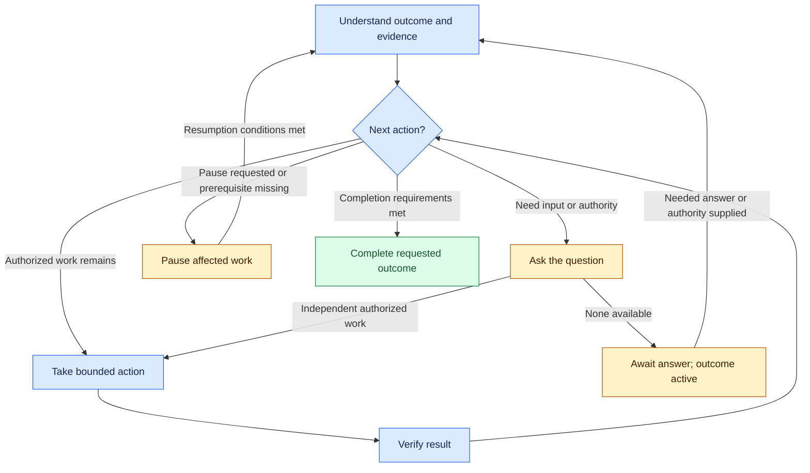

# Lusona Skills

[English](README.md) | [Español](README.es.md) | [Deutsch](README.de.md) | [简体中文](README.zh-CN.md) | [日本語](README.ja.md)

Lusona helps an AI agent carry a requested outcome through understanding, action, and
verification. You set the outcome, constraints, and authority. The agent chooses the next
useful action from the evidence, continues authorized work, and asks when it needs your
input or permission.

For Claude Code, Codex, [Cursor](INSTALL.md#cursor), and [Xcode 27 coding agents](INSTALL.md#xcode) · Checked-out source version **1.3.0**

> [!WARNING]
> Do not install Lusona using Vercel Skills (`npx skills@latest`); use the [native plugin installation](#installation).

Read why we built Lusona Skills: [When the workflow became another job](https://blog.lusona.com/blog/when-the-workflow-became-another-job/).

This README describes the source in this checkout. GitHub installation uses committed,
pushed sources; local changes do not establish a published release.

## Index

- [Start with an outcome](#start-with-an-outcome)
- [Choose a command](#choose-a-command)
- [Installation](#installation)
- [How the work continues](#how-the-work-continues)
- [Questions and evidence](#questions-and-evidence)
- [Recovery and resumption](#recovery-and-resumption)
- [Results and handoffs](#results-and-handoffs)
- [Reference](#reference)
- [Contributing](#contributing)
- [License](#license)
- [Development](#development)

## Start with an outcome

For a defined change, use `/lusona:implement` in Claude Code or select `implement` in Codex.
Include your test-driven development (TDD) policy in the request:

> Add invitation expiry after seven days. Preserve existing accepted invitations.
> Done means: invitations older than seven days are rejected, accepted invitations are
> unchanged, and the test suite passes. Use targeted TDD for the expiry boundary.
> Verify locally; do not deploy. Ask if a consequential decision blocks the change.

Give the outcome, what done means, and the limits of the agent's authority. The agent handles
necessary planning and continues through the authorized steps without another command.
You receive the result, verification evidence, and unresolved decisions or limitations.

Choose TDD explicitly in the request or through a standing preference:

- `none`: verification remains required, without test-first sequencing.
- `targeted`: use test-first sequencing for named behaviors.
- `strict`: use test-first sequencing for every changed testable behavior.

Put a standing preference in the project's `docs/lusona/README.md` or agent instructions
(`CLAUDE.md` or `AGENTS.md`), for example `TDD: targeted for changed behavior`. Without an
explicit selection, the agent can inspect and plan, then asks before implementation.

Other starting points:

> **explore:** Help me compare invitation links and email-only invitations. Explain the
> consequences for our support team before we choose. Keep this discussion in chat; do not save files.

> **investigate:** Find why expired invitations still work in this reproduction. Run experiments
> that distinguish between possible causes and report the evidence. Do not change production behavior.

> **implement, plan only:** Propose an approach for invitation expiry and its verification.
> Do not edit implementation or dependencies.

> **status:** Assess the invitation work from the current records and working tree. Tell me
> what remains and the next bounded action.

Discussion, specifications, plans, architecture decisions, and review do not grant implementation
authority. A clear implementation or refactoring request can proceed without a separate
`specify` command once its scope, TDD policy, and prerequisites are settled.

## Choose a command

Choose the command that fits your request. The agent carries accepted decisions forward
and uses other skills as needed within the authority you grant. There is no required sequence.

In Claude Code, invoke `/lusona:<command>`. In Codex, select the Lusona skill from the
skill UI. In Cursor, type `/` in Agent chat and select the skill. In Xcode, type `/` in an agent conversation and select the installed skill.
[Install Lusona](#installation) before using these commands.

| Command | Use it to |
| --- | --- |
| [explore](plugins/lusona/skills/explore/SKILL.md) | Develop understanding, possibilities, and preferences through discussion |
| [status](plugins/lusona/skills/status/SKILL.md) | Assess current progress, all known remaining work, and the next action |
| [frame-product](plugins/lusona/skills/frame-product/SKILL.md) | Establish users, the problem, desired outcomes, and product boundaries |
| [map-capabilities](plugins/lusona/skills/map-capabilities/SKILL.md) | Map capabilities, dependencies, and delivery order |
| [specify](plugins/lusona/skills/specify/SKILL.md) | Agree on one change's behavior, constraints, acceptance criteria, and TDD policy |
| [architect](plugins/lusona/skills/architect/SKILL.md) | Resolve consequential design, contract, and ownership decisions |
| [investigate](plugins/lusona/skills/investigate/SKILL.md) | Establish causes, facts, or feasibility through evidence and experiments |
| [measure](plugins/lusona/skills/measure/SKILL.md) | Establish magnitude, quality, cost, or change to inform a decision |
| [experiment](plugins/lusona/skills/experiment/SKILL.md) | Test an intervention or alternatives against stated criteria |
| [implement](plugins/lusona/skills/implement/SKILL.md) | Plan and deliver an authorized behavior change or bug fix |
| [review](plugins/lusona/skills/review/SKILL.md) | Assess an actual diff for defects and verification gaps |
| [refactor](plugins/lusona/skills/refactor/SKILL.md) | Improve existing code's structure while preserving behavior and compatibility |
| [batch](plugins/lusona/skills/batch/SKILL.md) | Coordinate several selected outcomes under explicit unattended-work authority |

Use **measure** to establish how much, **experiment** to test an intervention or alternatives,
and **investigate** to establish causes or technical feasibility; use **architect** to decide consequential
technical boundaries and tradeoffs. Use **refactor** for a concrete structural problem with
stable behavior, and **implement** for changed behavior or a defect correction. Routine design
choices stay within implementation or refactoring.

Material measurements and experiments live in the consuming project’s `docs/lusona/evidence/`.
Specs, notes, and history link the exact runs they rely on; existing records stay in place.
These capabilities can arise naturally within authorized work without an explicit command.

## Installation

Choose your host. Install from the public [lusona/ai-skills](https://github.com/lusona/ai-skills)
repository over HTTPS; no GitHub credentials are required to download it.

### Claude Code

```bash
claude plugin marketplace add https://github.com/lusona/ai-skills.git
claude plugin install lusona@lusona-ai-skills --scope user
```

### Codex

```bash
codex plugin marketplace add https://github.com/lusona/ai-skills.git
codex plugin add lusona@lusona-ai-skills
```

### Cursor

Open **Customize > From GitHub Repository**, enter `https://github.com/lusona/ai-skills`,
then install **Lusona Skills** for your project or user. In Agent chat, type `/` to find
Lusona's skills. See the [Cursor installation steps](INSTALL.md#cursor)
for links to Cursor's current documentation and testing status.

### Xcode

In Xcode 27, open **Settings > Intelligence > Agents > Plug-ins > Add Plug-in**.
Choose **Add from URL**, enter `https://github.com/lusona/ai-skills`, and select
Lusona's skills to install. See the [Xcode installation steps](INSTALL.md#xcode)
for setup, local imports, and version details.

Start a new session in your project after installation. For local checkout installation,
portable packages, updates, and removal, see the [installation guide](INSTALL.md).
Choose one catalog source: local checkout or GitHub.

## How the work continues

The agent reads the outcome, accepted decisions, current evidence, and remaining criteria;
chooses a bounded action; acts within authority; and checks the result. It repeats this loop
while useful authorized work remains. Skills supply responsibilities and domain expertise
throughout the loop.



The graph summarizes the [shared work loop](plugins/lusona/README.md#work-loop). Its boundaries apply
to the affected work; independent authorized work can continue while another part waits.

- **Continue:** Run the next useful authorized action. A recommendation or continuation prompt
  does not replace work the current agent can perform.
- **Ask and await:** Ask for the missing decision or authority, using a permitted native question
  tool or concise text. Continue independent work; yield when none remains. Awaiting an answer
  leaves the outcome active. Silence supplies no decision or permission.
- **Pause:** Stop affected work when you request a pause, a necessary input or capability is
  unavailable, authority is missing, or a correction limit applies. State the exact resumption
  conditions. If you request a pause, the agent waits for you to resume the work. Other pauses
  end when the stated prerequisite, evidence, or authority is available. Saving a checkpoint
  does not satisfy these conditions.
- **Complete:** Finish the whole authorized scope, acceptance criteria, required checks, required
  independent review, and any required human acceptance or delivery. Passing tests alone does
  not establish completion. A failed or unrun required check prevents a completion claim.

Asking and pausing can overlap: the agent may ask for what it needs to resume paused work.
In either case, it states what it needs and continues any independent authorized work.

You control scope and consequential decisions. The agent settles routine details within your
constraints and asks before changing accepted outcomes or taking destructive action beyond
its authority. Independent review is required by user/repository rules and for security
boundaries, persistent data, shared contracts, or several coordinated writers.

The agent revises its approach as it gathers evidence, while preserving accepted scope and
criteria. If corrections stop producing progress, it reports the evidence and the conditions
for continuing. Correction limits determine when it must ask for your decision; batches use
an agreed repair budget. See the [correction rules](plugins/lusona/README.md#work-loop).

The main agent coordinates questions, assignments, integration, and verification. It delegates
substantive product and engineering work to specialists with appropriate personas and models;
exploration and status dialogue can remain with the main agent. If delegation is prohibited or
unavailable, authorized work can proceed locally. Required independent review still needs another
reviewer. See [delegation](plugins/lusona/references/delegation.md) for ownership and handoffs.

## Questions and evidence

The agent adapts questions, explanations, examples, and experiments to your demonstrated
understanding. It answers direct questions first, reuses settled answers, and asks about
consequential uncertainty. Your expertise changes explanation depth, while evidence and decision
requirements still apply.

During exploration, the agent uses concrete scenarios and tradeoffs to help you understand
your options without requiring a decision. It continues while another exchange could improve
your understanding or change the next action. During investigation, it runs further experiments
when they could distinguish between possible causes. If missing evidence blocks progress,
the agent identifies what it needs.

For example, an experienced maintainer who has supplied compatibility constraints need not
repeat them. A reader unfamiliar with a migration choice gets an explanation of its consequences
before the agent asks for a preference. See [intent interviews](plugins/lusona/references/interviews.md).

The agent adds diagrams when they clarify a decision. When a concept, architecture, or UI choice is easier to judge visually, it offers
2-4 lettered options. The chosen visual is saved under `docs/lusona/visuals/` with a binding list
that implementation and review check; see [visuals](plugins/lusona/references/visuals.md).

## Recovery and resumption

Authorized work includes minimal local recovery records when safe resumption or ownership
coordination needs them, within permitted writes and your restrictions. The agent saves no file
for a conversation that needs no retained context. Otherwise, it updates the existing record
for the work or uses the smallest suitable notes or change record. It saves changed facts at
meaningful boundaries and before a handoff.

A recovery record retains the outcome, authority and TDD source, accepted decisions, useful
evidence, material open questions, ownership, correction counts when applicable, and the next
action. Exploration can retain decisions and questions without a spec or queue. `implement` and
`refactor` can create a change record when needed; neither requires a separate `specify` command.
Saving a recovery record does not enroll work in a queue.

Read-only, no-save, and destination restrictions take precedence. If saving is prohibited or
unavailable, the agent supplies a conversational handoff and states the recovery limitation.
An abrupt interruption may prevent a checkpoint. On resumption, the agent checks surviving
records and working-tree evidence, then asks only for material facts or authority it cannot
recover. See [records and retention](plugins/lusona/references/retention.md).

For another session, a usable continuation directive could be:

> Continue investigating invitation expiry from the owning record. Reproduce the retained
> case on the supplied build before proposing a correction. Preserve the recorded diagnostic
> scope; production changes remain unauthorized.

Such a directive supports an actual handoff. The current agent continues work it can perform
within its authority.

## Results and handoffs

Lusona is trying a shared format for substantive assessments and handoffs: **Result**,
**Evidence**, and **Next action**. Pair the result with **✅ Complete**, **🔄 In progress**,
**❓ Needs input**, or **⏸ Paused**, using words to preserve the meaning. Lead with a blocking
question or request for approval when needed. Ordinary dialogue, questions, and brief updates
stay natural.

Illustrative handoff, not evidence of work performed:

> **✅ Complete · Result:** Diagnosis complete; the reproduction confirms the expiry check
> uses the wrong timestamp. The production fix remains unauthorized.
>
> **Evidence:** The retained case and focused check agree. Cross-platform behavior remains untested.
>
> **Next action:** You can authorize the timestamp correction and select its TDD policy;
> the agent can then implement and verify that bounded fix.

At a handoff, the next action identifies who will take it, what inputs they need, and what
authorization remains outstanding. At completion, it can be **None for this request**.

Your requested format and host constraints take precedence. This presentation convention is
a trial; behavior across hosts has not been established. See
[review and communication](plugins/lusona/README.md#review-and-communication) for formatting details.

## Reference

- [Installation and removal](INSTALL.md)
- [Privacy policy](PRIVACY.md)
- [Terms of use](TERMS.md)
- [Workflow contract and work loop](plugins/lusona/README.md#work-loop)
- [Skill selection and terminology](plugins/lusona/references/workflow-guide.md)
- [TDD policy and sequencing](plugins/lusona/references/tdd.md)
- [Batch execution and recovery](plugins/lusona/references/batch-execution.md)
- [Records and retention](plugins/lusona/references/retention.md)
- [Closeout and reopening](plugins/lusona/references/closeout.md)
- [Delegation and model routing](plugins/lusona/references/delegation.md)

## Contributing

See [CONTRIBUTING.md](CONTRIBUTING.md) for contribution scope, local checks, and pull
requests. Use the [bug and feature request forms](https://github.com/lusona/ai-skills/issues/new/choose)
to report problems or propose improvements. The `@lusona/core` team owns repository review.

## License

Skills, templates, documentation, and scripts are available under the [MIT License](LICENSE).

## Development

Canonical workflow sources live in `plugins/lusona/`. Consuming-project data belongs under that
project's `docs/lusona/`; the empty queue structure is `templates/work.md`.

Plugin record helpers use Bash or PowerShell; see [runtime requirements](INSTALL.md#requirements). Python 3 remains a development requirement for packaging and Python evaluations, not for ordinary plugin use.

```bash
claude plugin validate plugins/lusona
claude plugin validate .claude-plugin/marketplace.json
python3 scripts/package.py
```

The package builder checks native manifest identity/version, links, catalog paths, and
file selection. It writes to repository-local `tmp/lusona-package/`; use
`--output tmp/<new-directory>` for another build. All three manifests must use the same version.
Installation from GitHub uses committed and pushed sources; a local checkout can be used
before publication. Neither installation nor packaging initializes project records.

Source-size reductions do not establish token or latency savings; those require measurements
across the coordinator and all workers.
