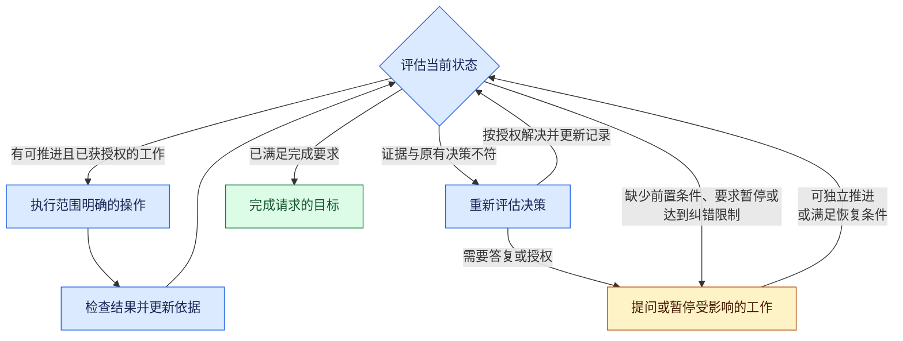

<a id="lusona-ai-skills"></a>
# Lusona Skills

[English](README.md) | [Español](README.es.md) | [Deutsch](README.de.md) | [简体中文](README.zh-CN.md) | [日本語](README.ja.md)

Lusona 的编程智能体技能围绕同一套工作循环协同运作：

- **选择、执行、检查，再继续。** 根据目标和现有依据选择下一步。按需重新讨论方案、调查问题、调整设计、实现或审查，无须按固定顺序使用技能。
- **根据新发现修订决策。** 当证据与先前的决定不符时，在约定的授权范围内重新评估。同步更新相关记录，让后续工作以修订后的决定为准。
- **在授权范围内持续推进。** 自行处理常规选择，继续工作，无须反复请求批准。决定超出现有授权时，再向你询问。
- **验证后再确认完成。** 完成约定范围内的工作、必要的检查和审查，以及要求的验收或交付。无法完成时，明确说明剩余工作。

适用于 Claude Code、Codex、[Cursor](INSTALL.md#cursor)、[Xcode 27 编程智能体](INSTALL.md#xcode) 和 [Google Antigravity App、CLI 与 IDE](INSTALL.md#antigravity) · 当前工作副本的源码版本：**2.0.0**

> [!WARNING]
> 请勿通过 Vercel Skills（`npx skills@latest`）安装 Lusona；请使用[原生插件安装方式](#installation)。

了解我们为什么开发 Lusona Skills：[Why we built Lusona Skills](https://blog.lusona.com/blog/why-we-built-lusona-skills/)（英文）。

本 README 介绍当前工作副本中的源码。通过 GitHub 安装时使用的是已提交并推送的源码；本地修改不代表已发布版本。

<a id="index"></a>
## 目录

- [从哪里开始](#where-to-start)
- [选择命令](#choose-a-command)
- [安装](#installation)
- [工作如何推进](#how-the-work-continues)
- [提问与证据](#questions-and-evidence)
- [恢复与继续工作](#recovery-and-resumption)
- [结果与交接](#results-and-handoffs)
- [参考资料](#reference)
- [参与贡献](#contributing)
- [许可证](#license)
- [开发](#development)

<a id="where-to-start"></a>
## 从哪里开始

刚接手项目、恢复工作，或不确定该先处理什么时，可以从 **status** 开始。它会查看现有记录和依据，说明剩余工作，并建议下一步。项目尚无 Lusona 记录时也可以使用。请求查看状态并不等于授权新的实现工作。

对于新想法，**explore** 帮助你比较可能的方案与取舍；**frame-product** 帮助明确用户、问题和产品方向。方向逐渐清晰后，**map-capabilities** 梳理产品需要具备的能力和合理的交付顺序。**specify** 明确行为和验收标准；**architect** 解决涉及边界、契约和职责归属的重要技术决策。**design** 专注于界面设计稿、界面流程和图示，可以直接请求，无须先完成其他阶段。**implement** 负责执行并验证已获授权的变更。

这些是工作通常的推进方式，并非必须依次完成的阶段。从当前需要的工作类别入手，跳过已经解决的问题，并在证据表明有必要时重新处理之前的问题。调查可以先于规格说明，也可以在实现过程中展开；审查也可能发现需要重新考虑设计的原因。

| 工作类别 | 技能及职责 |
| --- | --- |
| 了解现状 | [status](plugins/lusona/skills/status/SKILL.md)：评估进展、剩余工作及下一项有意义的行动 |
| 明确方向 | [explore](plugins/lusona/skills/explore/SKILL.md)：比较可能的方案与取舍<br />[frame-product](plugins/lusona/skills/frame-product/SKILL.md)：明确用户、目标和边界<br />[map-capabilities](plugins/lusona/skills/map-capabilities/SKILL.md)：梳理能力覆盖、依赖关系和交付顺序 |
| 定义变更 | [specify](plugins/lusona/skills/specify/SKILL.md)：就行为、验收标准和 TDD 策略达成一致<br />[architect](plugins/lusona/skills/architect/SKILL.md)：解决涉及边界、契约和职责归属的重要技术决策 |
| 视觉设计 | [design](plugins/lusona/skills/design/SKILL.md)：创建界面设计稿、界面流程和图示 |
| 实现与评估 | [implement](plugins/lusona/skills/implement/SKILL.md)：规划并交付行为变更或缺陷修复<br />[review](plugins/lusona/skills/review/SKILL.md)：检查实际代码差异，找出缺陷和验证遗漏<br />[refactor](plugins/lusona/skills/refactor/SKILL.md)：在保持行为不变的前提下改善代码结构 |
| 获取依据 | [investigate](plugins/lusona/skills/investigate/SKILL.md)：查明原因或验证可行性<br />[measure](plugins/lusona/skills/measure/SKILL.md)：衡量规模、质量、成本或变化<br />[experiment](plugins/lusona/skills/experiment/SKILL.md)：检验某项措施或备选方案 |
| 协调选定的工作 | [batch](plugins/lusona/skills/batch/SKILL.md)：在获得明确的无人值守执行授权后，协调多个选定目标的相关工作 |

角色、产出和路由规则的完整目录见[工作流指南](plugins/lusona/references/workflow-guide.md)。常规设计选择在实现或重构过程中解决。对于明确的实现或重构请求，只要范围、测试驱动开发（TDD）策略和前置条件已确定，就无须单独执行 `specify` 命令。

<a id="choose-a-command"></a>
## 选择命令

调用适合当前需要的技能。智能体会在你授予的权限范围内按需使用其他技能，无须你指挥每一次切换。

在 Claude Code 中，输入 `/lusona:<command>`。在 Codex 中，从技能界面选择 Lusona 技能。在 Cursor 中，在 Agent 聊天中输入 `/` 并选择技能。在 Xcode 中，在智能体对话里输入 `/`，然后选择已安装的技能。在 Antigravity App/CLI 中使用 `/<skill-name>`；在独立 IDE 中查看 **Customizations**，并在请求中指定 Lusona 技能名称。使用这些命令前，请先[安装 Lusona](#installation)。

说明要解决的问题或达成的目标，以及智能体的授权范围。例如：

> **status：** 根据现有记录和工作区评估这个项目。告诉我还剩哪些工作，并建议从哪里开始。

> **explore：** 帮我比较邀请链接与仅通过电子邮件邀请这两种方式。在做选择前，说明它们对支持团队的影响。只在对话中讨论，不要保存文件。

> **design：** 使用现有页面、导航和文案，比较两种邀请流程。展示各步骤和邀请过期状态，并说明每种方案的取舍。仅进行视觉设计，不要实现界面。

> **implement：** 将邀请的有效期设为七天。保留已接受的邀请。完成标准：拒绝超过七天的邀请，已接受的邀请不受影响，测试套件通过。针对有效期的边界条件采用 targeted TDD。在本地验证，不要部署。

如果只需要计划，请让 `implement` 提出实现和验证方案，不要修改实现代码或依赖。讨论、规格说明、计划、架构决策和审查本身不构成实现授权。

在实现或重构前，请在请求中或长期偏好设置中明确选择 TDD 策略：

- `none`：仍须验证，但不要求先写测试。
- `targeted`：对指定行为先写测试，再实现。
- `strict`：对每项发生变更且可测试的行为，先写测试，再实现。

可将长期偏好写入项目的 `docs/lusona/README.md` 或智能体指令文件（`CLAUDE.md` 或 `AGENTS.md`），例如 `TDD: targeted for validation and persistence boundaries`。如果没有明确选择，智能体可以检查和规划，但会在实现前询问。

<a id="installation"></a>
## 安装

选择你使用的应用。通过 HTTPS 从公开的 [lusona/ai-skills](https://github.com/lusona/ai-skills) 仓库安装；下载无须 GitHub 凭据。

<a id="antigravity"></a>
### Antigravity

直接从 GitHub 安装：

```bash
agy plugin install https://github.com/lusona/ai-skills.git
```

此 URL 通过仓库根目录的清单安装 Lusona。
App 和独立 IDE 用户在通过 CLI 全局安装后，查看 **Customizations**。
在 App/CLI 中执行 `/status`；在 IDE 中要求使用 Lusona 的 `status` 技能。
[Antigravity 安装指南](INSTALL.md#antigravity)涵盖本地工作副本、便携包、更新、移除和验证范围。
GitHub 安装已通过 Linux 上的 CLI 1.4.12 验证；App/IDE 的交互行为尚未测试。

<a id="claude-code"></a>
### Claude Code

```bash
claude plugin marketplace add https://github.com/lusona/ai-skills.git
claude plugin install lusona@lusona-ai-skills --scope user
```

<a id="codex"></a>
### Codex

```bash
codex plugin marketplace add https://github.com/lusona/ai-skills.git
codex plugin add lusona@lusona-ai-skills
```

<a id="cursor"></a>
### Cursor

打开 **Customize > From GitHub Repository**，输入 `https://github.com/lusona/ai-skills`，然后为项目或用户安装 **Lusona Skills**。在 Agent 聊天中输入 `/` 查找 Lusona 技能。[Cursor 安装步骤](INSTALL.md#cursor)包含最新官方文档链接和测试状态。

<a id="xcode"></a>
### Xcode

在 Xcode 27 中，打开 **Settings > Intelligence > Agents > Plug-ins > Add Plug-in**。
选择 **Add from URL**，输入 `https://github.com/lusona/ai-skills`，然后选择要安装的 Lusona 技能。有关设置、本地导入和版本详情，请参阅 [Xcode 安装步骤](INSTALL.md#xcode)。

安装后，在项目中开启新会话。有关从本地工作副本安装、便携安装包、更新和移除的说明，请参阅[安装指南](INSTALL.md)。插件目录请选择单一来源：本地工作副本或 GitHub。

<a id="how-the-work-continues"></a>
## 工作如何推进

所有工作类别都遵循同一套循环。下一步可能是讨论、实验、代码修改或审查，取决于当前问题和已有依据。依赖关系、共享状态、用户的明确要求和选定的 TDD 策略仍可能要求特定的执行顺序。

规划是实现工作的一部分，会随进展调整。简单明确的变更只需确定目标和检查方法；涉及依赖、不确定性、协作或恢复时，可能需要明确的计划。你也可以只要求制定计划，而不授权执行。



图中展示的是[通用工作循环](plugins/lusona/README.md#work-loop)，不是技能的执行顺序。等待和暂停只影响相关工作；其他工作仍可在现有授权范围内独立推进。循环遵循以下四条规则：

- **继续：** 只要还有能推动进展的已授权工作，就继续执行，无须你再调用下一项技能。
- **提问：** 缺少决定或许可时向你询问，等待期间继续可独立推进的已授权工作。没有回复不代表答复或许可。
- **暂停：** 你要求暂停、缺少前置条件或达到纠错限制时，停止受影响的工作，并说明恢复所需的条件。由你要求暂停的工作，须等你明确指示后才能恢复。
- **完成：** 只有授权范围内的全部工作、规定的检查和审查，以及要求的验收或交付均已完成，才能认定完成。规定的检查失败或尚未执行时，不得宣称完成。

当证据与已确认的决定不符时，智能体会指出冲突，并在现有授权范围内重新评估；修订超出授权时向你询问。它会同步更新受影响的记录和任务分工，保留有用的历史决策依据，并按修订后的约定继续工作。过时的记录不得让已被取代的决定重新生效。

反复失败时，须遵守[纠错限制](plugins/lusona/references/corrections.md)；批处理任务使用约定的修复预算。因达到限制而停止某项工作时，智能体会报告依据和恢复条件。

主智能体负责协调提问、分工、集成和验证，并将具体的产品与工程工作委派给专业智能体。探索和状态说明可以由主智能体直接处理。用户或仓库规则要求时，以及工作涉及安全边界、持久化数据、共享契约或多个参与者协同修改时，须进行独立审查。如果无法委派或不允许委派，主智能体可以自行继续已获授权的工作，但规定的独立审查仍须由另一位审查者完成。详见[委派规则](plugins/lusona/references/delegation.md)。

<a id="questions-and-evidence"></a>
## 提问与证据

提问围绕工作中尚未解决的决策展开。智能体会沿用已经确定的答案，核查可查明的事实，并就意图和重要取舍向你询问。它会按你需要的深度解释方案；探索的结果可以是加深理解，不一定要作出决定。详见[意图沟通规则](plugins/lusona/references/interviews.md)。

调查、测量和实验可以为任何类别的工作提供依据。进一步的工作必须在授权范围和适用的预算内回答有意义的问题。结论须区分证据、假设和不确定性；提出后续工作建议并不代表获得实现授权。

多项技能都支持视觉工作：**explore** 比较视觉方案，帮助选择方向；**specify** 用视觉方案明确行为和验收标准；**architect** 用技术图示说明边界、契约和职责归属。需要专门制作界面设计稿、界面流程或图示时，使用 **design**；设计已确定时也可以直接使用。

界面草稿会在浏览器中打开供你查看；如果无法打开，智能体会提供 HTML 文件的绝对路径。图示及其备选方案使用回复或 Markdown 文件中的 Mermaid 代码块。确认草稿或选定方案后，智能体会在写入权限和禁止保存等限制允许的范围内，将参考资料保存在 `docs/lusona/visuals/`，并从所属规格说明、ADR 或笔记链接到该资料。界面截图取决于可用工具；无法截图时，会保留 HTML 并说明缺少哪些图片。

参考资料区分具有约束力的要求和仅供示意的细节。**implement** 报告每项约束要求的状态，**review** 逐项标记为满足、未满足或未检查。对于保留了图片的界面参考，有渲染和截图工具时，审查会比较截图；否则检查代码或标记，并说明尚未进行视觉比较。详见[视觉方案与参考](plugins/lusona/references/visuals.md)。

重要的测量和实验记录保存在使用该插件的项目的 `docs/lusona/evidence/` 中。规格说明、笔记和历史记录须链接到其依据的具体运行记录；已有记录保留在原处。

<a id="recovery-and-resumption"></a>
## 恢复与继续工作

智能体会在交接或完成工作之前，将实质性的决策、工作结论和验证依据保存到项目记录中。只要工作流需要规格说明、你要求编写规格说明或跟踪工作、已存在规格说明，或变更涉及安全边界、持久化数据、共享契约或多个参与者协同修改，就会记录规格说明和队列条目；规模不是判断依据。其他没有规格说明的直接工作使用笔记。普通对话和简短的状态说明无须写入文件。只读、禁止保存和保存位置方面的限制优先适用。

记录保留目标、授权、TDD 策略、当前决策、有用依据、待解决问题和下一步行动，必要时还包括职责分工和纠错轮数。重要的架构决策须有架构决策记录（ADR）。规格说明须在 `docs/lusona/work.md` 中跟踪；没有规格说明的工作可以只使用笔记。队列状态表示进展，不决定下一步必须使用哪个技能，也不构成执行授权。详见[记录保留规则](plugins/lusona/references/retention.md)和[队列规则](plugins/lusona/references/queue.md)。

恢复工作时，智能体会对照工作区检查已有记录，只询问无法还原的重要信息。已有授权继续有效。可以用 **status** 了解剩余工作，也可以直接指定要继续的任务：

> 根据已保存的调查结果，继续调查邀请过期问题。用当前构建版本验证保留的复现案例。不要修改生产代码的行为。

突然中断可能导致来不及保存。无法保存记录时，智能体会说明对恢复工作的影响，并在对话中提供工作结论。

<a id="results-and-handoffs"></a>
## 结果与交接

正式的工作报告说明结果、支撑结果的依据，以及需要继续执行的行动，并区分已完成、进行中、等待信息和已暂停的工作。完成状态针对已获授权的请求：完成诊断不等于修复了缺陷。

以下是交接示例，不代表已经执行了这些工作：

> **✅ 已完成 · 结果：** 诊断已完成；复现结果确认，有效期检查使用了错误的时间戳。尚未获准修复生产代码。
>
> **证据：** 已记录的案例与针对性检查的结果一致。尚未验证跨平台行为。
>
> | 下一步行动 | 负责人 | 所需 | 授权 |
> |---|---|---|---|
> | 授权修正时间戳 | 你 | TDD 策略 | 实现尚未获授权 |
>
> > 以 `targeted` TDD 实现时间戳修正。

尚有工作未完成时，这张单行表格须写明范围明确的行动、负责人、所需信息，以及尚余或缺少的授权；表格下方引用的那一行是你可以直接作为下一条消息发送的提示。每个命令都须指出有用的下一步，或明确说明没有必要继续，并简述原因。评估完成后仍可建议后续工作，但建议不构成执行授权。只有没有有用的后续行动时，才使用 **下一步行动：** `None for this request`。普通对话无须采用报告格式；有实质内容的探索仍须提出具体问题或行动，并按记录保留规则保存可复用的结论。示例中的格式是固定的默认格式；你指定的格式和所用应用的限制优先适用。详见[审查与沟通规则](plugins/lusona/README.md#review-and-communication)。

<a id="reference"></a>
## 参考资料

- [更新日志（英文）](CHANGELOG.md)
- [安装与移除](INSTALL.md)
- [隐私政策](PRIVACY.md)
- [使用条款](TERMS.md)
- [工作流规则与工作循环](plugins/lusona/README.md#work-loop)
- [技能选择与术语](plugins/lusona/references/workflow-guide.md)
- [TDD 策略与执行顺序](plugins/lusona/references/tdd.md)
- [批处理执行与恢复](plugins/lusona/references/batch-execution.md)
- [记录与保留](plugins/lusona/references/retention.md)
- [收尾与重新开启](plugins/lusona/references/closeout.md)
- [委派](plugins/lusona/references/delegation.md)
- [模型路由](plugins/lusona/references/model-routing.md)

<a id="contributing"></a>
## 参与贡献

有关贡献范围、本地检查和拉取请求，请参阅 [CONTRIBUTING.md](CONTRIBUTING.md)。如需报告问题或提出改进建议，请使用[缺陷和功能请求表单](https://github.com/lusona/ai-skills/issues/new/choose)。`@lusona/core` 团队负责仓库审查。

<a id="license"></a>
## 许可证

技能、模板、文档和脚本采用 [MIT 许可证](LICENSE)。

<a id="development"></a>
## 开发

工作流的正式源文件位于 `plugins/lusona/`。使用该插件的项目应将自身数据放在该项目的 `docs/lusona/` 下；空队列结构见 `templates/work.md`。

插件的记录创建脚本使用 Bash 或 PowerShell，详见[运行环境要求](INSTALL.md#requirements)。构建软件包和运行 Python 评估仍需 Python 3，日常使用插件则不需要。

```bash
claude plugin validate plugins/lusona
claude plugin validate .claude-plugin/marketplace.json
python3 scripts/package.py
```

打包工具会检查原生插件清单的标识与版本、链接、插件目录路径和打包文件范围，并将输出写入仓库内的 `tmp/lusona-package/`。如需输出到其他位置，使用 `--output tmp/<new-directory>`。所有原生清单必须使用相同版本。通过 GitHub 安装时使用已提交并推送的源码；发布前可使用本地工作副本。安装和打包都不会初始化项目记录。

源码体积缩小不代表 token 用量或延迟下降；要确认这些收益，需要把协调智能体和所有执行智能体都纳入测量。
