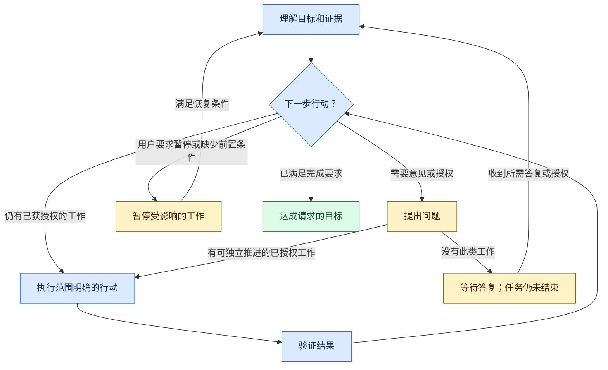

<a id="lusona-ai-skills"></a>
# Lusona AI Skills

[English](README.md) | [Español](README.es.md) | [Deutsch](README.de.md) | [简体中文](README.zh-CN.md) | [日本語](README.ja.md)

Lusona 帮助 AI 智能体理解你的需求、执行工作并验证结果，达成你设定的目标。你确定目标、约束和授权范围。智能体根据已有证据决定下一步，继续完成授权范围内的工作，并在需要你的意见或许可时提问。

适用于 Claude Code、Codex 和 [Xcode 27 编程智能体](plugins/lusona/INSTALL.md#xcode) · 当前工作副本的源码版本：**1.1.0**

> [!WARNING]
> 请勿通过 Vercel Skills（`npx skills@latest`）安装 Lusona；请使用[原生插件安装方式](#installation)。

了解我们为什么开发 Lusona AI Skills：[When the workflow became another job](https://blog.lusona.com/blog/when-the-workflow-became-another-job/)（英文）。

本 README 介绍当前工作副本中的源码。通过 GitHub 安装时使用的是已提交并推送的源码；本地修改不代表已发布版本。

<a id="index"></a>
## 目录

- [从目标开始](#start-with-an-outcome)
- [选择命令](#choose-a-command)
- [安装](#installation)
- [工作如何推进](#how-the-work-continues)
- [提问与证据](#questions-and-evidence)
- [恢复与继续工作](#recovery-and-resumption)
- [结果与交接](#results-and-handoffs)
- [参考资料](#reference)
- [参与贡献](#contributing)
- [许可证](#license)
- [开发](#development)

<a id="start-with-an-outcome"></a>
## 从目标开始

如果变更内容已经明确，在 Claude Code 中使用 `/lusona:implement`，或在 Codex 中选择 `implement`。请在请求中说明测试驱动开发（TDD）策略：

> 将邀请的有效期设为七天。保留已接受的邀请。
> 完成标准：拒绝超过七天的邀请，已接受的邀请不受影响，测试套件通过。
> 针对有效期的边界条件采用 targeted TDD。
> 在本地验证，不要部署。如果某项重要决定未定，导致无法继续，请向我提问。

说明目标、完成标准和智能体的授权范围。智能体会做好必要的规划，继续执行已获授权的步骤，无须你再输入命令。它会报告结果、验证依据，以及待定事项或尚存的限制。

请在请求中或长期使用的偏好设置中明确选择 TDD 策略：

- `none`：仍须验证，但不要求先写测试。
- `targeted`：对指定行为先写测试，再实现。
- `strict`：对每项发生变更且可测试的行为，先写测试，再实现。

可将长期偏好写入项目的 `docs/lusona/README.md` 或智能体指令文件（`CLAUDE.md` 或 `AGENTS.md`），例如 `TDD: targeted for changed behavior`。如果没有明确选择，智能体可以检查和规划，但会在实现前询问。

也可以从以下请求开始：

> **explore：** 帮我比较邀请链接与仅通过电子邮件邀请这两种方式。在做选择前，说明它们对支持团队的影响。只在对话中讨论，不要保存文件。

> **investigate：** 查明这个复现案例中已过期的邀请为何仍然有效。通过实验区分可能的原因，并报告证据。不要修改生产代码的行为。

> **implement，仅规划：** 提出邀请有效期功能的实现和验证方案。不要修改实现代码或依赖。

> **status：** 根据现有记录和工作区评估邀请相关工作的进展。告诉我还剩哪些工作，以及下一项范围明确的行动。

讨论、规格说明、计划、架构决策和审查本身不代表你已授权实施。明确提出实现或重构请求后，只要范围、TDD 策略和前置条件已确定，智能体便可继续工作，无须单独执行 `specify` 命令。

<a id="choose-a-command"></a>
## 选择命令

选择适合当前请求的命令。智能体会沿用已确认的决定，并在你授予的权限范围内按需使用其他技能。无须遵循固定顺序。

在 Claude Code 中，输入 `/lusona:<command>`。在 Codex 中，从技能界面选择 Lusona 技能。在 Xcode 中，在智能体对话里输入 `/`，然后选择已安装的技能。使用这些命令前，请先[安装 Lusona](#installation)。

| 命令 | 用途 |
| --- | --- |
| [explore](plugins/lusona/skills/explore/SKILL.md) | 通过讨论加深理解、探索可能的方案并明确偏好 |
| [status](plugins/lusona/skills/status/SKILL.md) | 评估当前进展、所有已知的剩余工作及下一步行动 |
| [frame-product](plugins/lusona/skills/frame-product/SKILL.md) | 明确用户、问题、预期结果和产品边界 |
| [map-capabilities](plugins/lusona/skills/map-capabilities/SKILL.md) | 梳理能力、依赖关系和交付顺序 |
| [specify](plugins/lusona/skills/specify/SKILL.md) | 就一项变更的行为、约束、验收标准和 TDD 策略达成一致 |
| [architect](plugins/lusona/skills/architect/SKILL.md) | 确定影响重大的设计、契约和责任归属 |
| [investigate](plugins/lusona/skills/investigate/SKILL.md) | 通过证据和实验查明原因、事实或可行性 |
| [implement](plugins/lusona/skills/implement/SKILL.md) | 规划并交付已获授权的行为变更或缺陷修复 |
| [review](plugins/lusona/skills/review/SKILL.md) | 检查实际代码差异（diff），找出缺陷和验证遗漏 |
| [refactor](plugins/lusona/skills/refactor/SKILL.md) | 在保持行为和兼容性的前提下改善现有代码结构 |
| [batch](plugins/lusona/skills/batch/SKILL.md) | 获得明确的无人值守工作授权后，协调多个选定目标的实现 |

用 **investigate** 查明发生了什么以及原因；用 **architect** 决定影响重大的技术边界与取舍。行为保持不变、需要解决具体结构问题时，用 **refactor**；需要改变行为或修复缺陷时，用 **implement**。常规设计选择在实现或重构过程中解决。

<a id="installation"></a>
## 安装

选择你使用的应用。通过 HTTPS 从公开的 [lusona/ai-skills](https://github.com/lusona/ai-skills) 仓库安装；下载无须 GitHub 凭据。

<a id="claude-code"></a>
### Claude Code

```bash
claude plugin marketplace add https://github.com/lusona/ai-skills.git
claude plugin install lusona@lusona-ai-skills --scope user
```

<a id="codex"></a>
### Codex

```bash
codex plugin marketplace add https://github.com/lusona/ai-skills.git
codex plugin add lusona@lusona-ai-skills
```

<a id="xcode"></a>
### Xcode

在 Xcode 27 中，打开 **Settings > Intelligence > Agents > Plug-ins > Add Plug-in**。
选择 **Add from URL**，输入 `https://github.com/lusona/ai-skills`，然后选择要安装的 Lusona 技能。有关设置、本地导入和版本详情，请参阅 [Xcode 安装步骤](plugins/lusona/INSTALL.md#xcode)。

安装后，在项目中开启新会话。有关从本地工作副本安装、便携安装包、更新和移除的说明，请参阅[安装指南](plugins/lusona/INSTALL.md)。插件目录只使用一个来源：本地工作副本或 GitHub。

<a id="how-the-work-continues"></a>
## 工作如何推进

智能体先查看目标、已确认的决定、现有证据和尚未满足的标准，再选择一项范围明确的工作，在授权范围内执行并检查结果。只要还有能推动进展的已授权工作，智能体就会重复这个过程。各项技能为整个过程提供职责指引和专业知识。



该图概括了[通用工作循环](plugins/lusona/README.md#work-loop)。其中的限制只针对受影响的工作；一部分工作需要等待时，其他已获授权且不依赖它的工作仍可继续。

- **继续：** 执行下一项能推动进展的已授权工作。当前智能体能够完成的工作，不能只给出建议或提示用户另行继续。
- **提问并等待：** 使用获准的内置提问工具或简短文字，询问尚未确定的决定或请求所需授权。继续处理不受影响的工作；没有此类工作时，结束当前轮次并等待答复。等待期间，任务仍未结束。没有回复不代表已作出决定或给予许可。
- **暂停：** 当你要求暂停、缺少必要的信息或功能、缺少授权，或达到纠错限制时，停止受影响的工作，并说明恢复所需的具体条件。如果你要求暂停，智能体会等待你指示恢复工作。其他情况下，只有在所说明的前置条件、证据或授权齐备后才能恢复工作。仅保存检查点并不能满足这些条件。
- **完成：** 完成授权范围内的全部工作，满足验收标准，执行规定的检查和独立审查，并完成要求的人工验收或交付。仅通过测试不足以认定任务完成。规定的检查失败或尚未执行时，不得宣称完成。

提问和暂停可能同时发生：智能体可能需要向你询问，才能恢复已暂停的工作。无论哪种情况，它都会说明需要什么，并继续可独立推进的已授权工作。

你确定工作范围，并作出重要决定。智能体在约束内处理常规细节；在改变已确认的目标，或执行超出授权范围的破坏性操作前，智能体会询问。用户或仓库规则要求时，以及工作涉及安全边界、持久化数据、共享契约或多个参与者协同修改时，须进行独立审查。

智能体会随着证据的积累调整方案，同时保持已确认的范围和标准。如果纠错不再带来进展，它会报告证据和继续工作所需的条件。纠错限制决定何时必须请你作出决定；批处理任务使用约定的修复预算。详见[纠错规则](plugins/lusona/README.md#work-loop)。

主智能体负责协调提问、分工、集成和验证。具体的产品与工程工作会委派给配置了合适角色和模型的专业智能体；探索方案和了解进展的对话可以由主智能体负责。如果不允许委派或无法委派，主智能体可以自行继续已获授权的工作。规定的独立审查仍须由另一位审查者完成。职责分工和交接规则见[委派](plugins/lusona/references/delegation.md)。

<a id="questions-and-evidence"></a>
## 提问与证据

智能体会根据你在交流中表现出的理解程度，调整问题、解释、示例和实验。它会先回答直接问题，沿用已经确定的答案，并就影响重大的不确定事项提问。它会根据你的专业经验调整解释的深度，但不会因此降低对证据和决策的要求。

探索时，智能体会通过具体情景和利弊分析帮助你理解选项，而不要求你作出决定。只要进一步交流有助于增进理解或改变下一步行动，它就会继续讨论。调查时，如果进一步实验能够区分可能的原因，它就会继续实验。如果缺少证据阻碍进展，它会说明需要什么。

例如，有经验的维护者已经提供兼容性约束，就无须重复说明。如果你不熟悉某种迁移方案，智能体会先解释它的影响，再询问你的偏好。详见[意图访谈](plugins/lusona/references/interviews.md)。

<a id="recovery-and-resumption"></a>
## 恢复与继续工作

如果安全恢复工作或协调职责分工需要保留记录，智能体可以在已获授权的工作中保存必要的本地恢复记录，同时遵守写入权限和你的限制。无须保留上下文的对话不会保存为文件。需要记录时，智能体会更新已有的工作记录，或使用简明且足以支持后续工作的笔记或变更记录。它会在任务的重要节点和交接前记录发生变化的事实。

恢复记录保留目标、授权和 TDD 策略的来源、已确认的决定、有用证据、重要的待解决问题、职责分工、适用时的纠错轮数，以及下一步行动。探索阶段可以只保留决定和问题，无须规格说明或队列。`implement` 和 `refactor` 可以按需创建变更记录，两者都不要求单独执行 `specify` 命令。保存恢复记录不会将工作加入队列。

智能体会优先遵守只读、禁止保存和保存位置方面的限制。如果禁止保存或无法保存，智能体会在对话中提供交接内容，并说明恢复方面的限制。突然中断可能导致来不及保存检查点。恢复工作时，智能体会检查保留的记录和工作区中的证据，只询问无法从中还原的重要事实或授权。详见[记录与保留](plugins/lusona/references/retention.md)。

在另一个会话中，可以这样要求继续工作：

> 根据此任务的记录，继续调查邀请过期问题。在提出修正方案前，先用已提供的构建版本复现保留的案例。保持记录中的诊断范围；仍未授权修改生产代码。

这类指令用于会话间的任务交接。当前智能体仍会继续完成授权范围内自己能够执行的工作。

<a id="results-and-handoffs"></a>
## 结果与交接

Lusona 正在试用统一的格式来报告评估结论和交接工作：**结果**、**证据**和**下一步行动**。结果须配上 **✅ 已完成**、**🔄 进行中**、**❓ 等待答复**或 **⏸ 已暂停**，用文字和图标共同说明状态。如果必须先得到答复或授权才能继续，就先提出问题或授权请求。日常对话、提问和简短的进展说明仍使用自然的表达。

以下是交接示例，不代表已经执行了这些工作：

> **✅ 已完成 · 结果：** 诊断已完成；复现结果确认，有效期检查使用了错误的时间戳。尚未获准修复生产代码。
>
> **证据：** 已记录的案例与针对性检查的结果一致。尚未验证跨平台行为。
>
> **下一步行动：** 你可以授权修正时间戳，并选择 TDD 策略；随后智能体即可实现并验证这项范围明确的修复。

交接时，下一步行动须明确由谁执行、需要哪些信息，以及仍需获得哪些授权。完成时，可以写为**本次请求无后续工作**。

应优先遵守你指定的格式和所用应用的限制。这种报告格式仍在试用，尚未验证它在不同应用中的表现。格式详情见[审查与沟通](plugins/lusona/README.md#review-and-communication)。

<a id="reference"></a>
## 参考资料

- [安装与移除](plugins/lusona/INSTALL.md)
- [工作流契约与工作循环](plugins/lusona/README.md#work-loop)
- [技能选择与术语](plugins/lusona/references/workflow-guide.md)
- [TDD 策略与执行顺序](plugins/lusona/references/tdd.md)
- [批处理执行与恢复](plugins/lusona/references/batch-execution.md)
- [记录与保留](plugins/lusona/references/retention.md)
- [收尾与重新开启](plugins/lusona/references/closeout.md)
- [委派与模型路由](plugins/lusona/references/delegation.md)

<a id="contributing"></a>
## 参与贡献

有关贡献范围、本地检查和拉取请求，请参阅 [CONTRIBUTING.md](CONTRIBUTING.md)。如需报告问题或提出改进建议，请使用[缺陷和功能请求表单](https://github.com/lusona/ai-skills/issues/new/choose)。`@lusona/core` 团队负责仓库审查。

<a id="license"></a>
## 许可证

技能、模板、文档和脚本采用 [MIT 许可证](LICENSE)。

<a id="development"></a>
## 开发

工作流的正式源文件位于 `plugins/lusona/`。使用该插件的项目应将自身数据放在该项目的 `docs/lusona/` 下；空队列结构见 `templates/work.md`。

```bash
claude plugin validate plugins/lusona
claude plugin validate .claude-plugin/marketplace.json
python3 scripts/package.py
```

打包工具会检查原生插件清单的标识与版本、链接、插件目录路径和打包文件范围，并将输出写入仓库内的 `tmp/lusona-package/`。如需输出到其他位置，使用 `--output tmp/<new-directory>`。两个清单必须使用相同版本。通过 GitHub 安装时使用已提交并推送的源码；发布前可使用本地工作副本。安装和打包都不会初始化项目记录。

源码体积缩小不代表 token 用量或延迟下降；要确认这些收益，需要把协调智能体和所有执行智能体都纳入测量。
