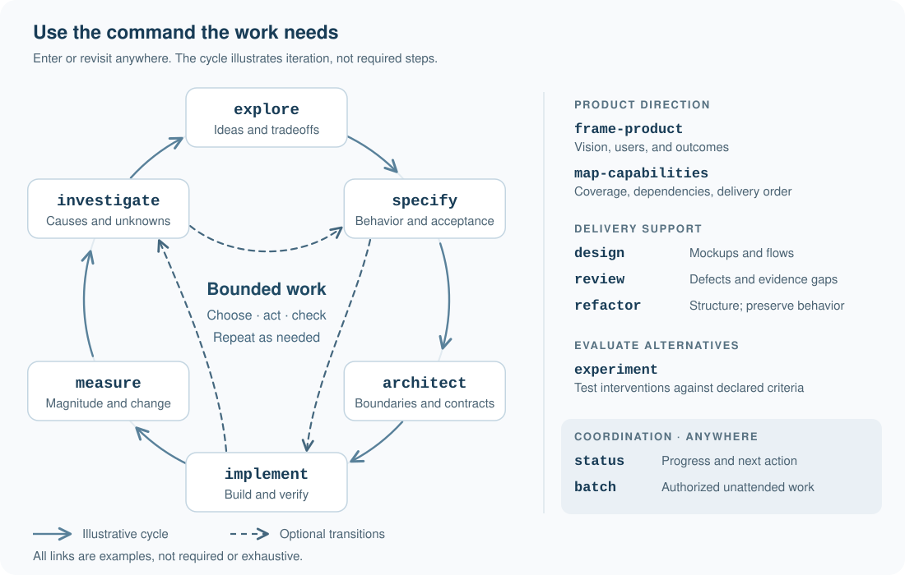

# How Lusona work proceeds

[Back to the README](../README.md) · [Usage and skill choices](usage.md) · [Installation](../INSTALL.md)

This guide explains scope, testing, evidence, and saved work for readers who need the details.
The linked canonical references define the workflow; this guide summarizes them for plugin users.
No tutorial or fixed sequence is required before starting a task.

[Scope and testing](#scope-and-testing) · [Evidence](#evidence) · [Records and resumption](#records-and-resumption) · [Revising decisions](#revising-decisions) · [Task replies](#task-replies) · [Principles](#principles) · [Further reading](#further-reading)

## Scope and testing

Specs, plans, architecture records, queue states, discussions, and read-only reviews do not
authorize implementation. Selecting one task does not authorize the rest of its change.
The agent asks before destructive actions or changes to accepted outcomes, contracts,
TDD level, or consequential commitments.
Status requests neither grant nor remove execution authority.

Authorized implementation and refactoring include local commits, subject to your instructions
and repository limits. Pushing and publishing require authority too. **batch** requires explicit
authorization for a fixed selection of queue items; see its [coordination rules](../plugins/lusona/skills/batch/SKILL.md)
for concurrency and repair limits.

> [!IMPORTANT]
> Implementation requires an explicitly selected TDD level. There is no default.

| TDD level | Requirement |
| --- | --- |
| `none` | No test-first requirement; agreed verification and repository checks still apply |
| `targeted` | Test first for named behaviors |
| `strict` | Test first for every new or changed testable behavior |

Select it in your request or as a standing preference in `docs/lusona/README.md`, `CLAUDE.md`,
or `AGENTS.md`. Until you select a level, the agent only defines and plans, then asks with a
recommendation. It records the level and source and asks before revising an infeasible level.
See [TDD and verification](../plugins/lusona/references/tdd.md).

Within authorized scope, the agent continues bounded work without another command. When a
decision is needed, it uses the host's native question tool when available, recommends an
answer, and pauses only affected work. Silence and preselected options are not consent.

## Evidence

The agent claims behavior only from observed checks and names failed or unrun checks.
Completion requires the authorized outcome, its criteria, passing required checks, and any
required human acceptance. Passing tests do not establish human acceptance.

The coordinator delegates specialist work, integrates it, and verifies the result. Some work
stays with the coordinator; when delegation is prohibited or unavailable, it works locally and
reports the limitation. Independent review is required by user or repository rules, and for
changes affecting security boundaries, persistent data, shared contracts, or multiple coordinated
writers. Local work cannot satisfy independent review. See [delegation and model routing](../plugins/lusona/references/delegation.md).

Repeated failures have [correction limits](../plugins/lusona/references/corrections.md).
Measurements and experiments need bounded scope, resources, and appropriate authority; evidence
used for decisions is saved under `docs/lusona/evidence/`. See [evidence and studies](../plugins/lusona/references/evidence.md).
When a choice depends on layout, structure, flow, or appearance, the agent offers visual options
and retains your chosen reference for implementation and review; see [visual references](../plugins/lusona/references/visuals.md).

## Records and resumption

The agent saves decisions, agreements, findings, evidence, and other substantive outputs that
later work depends on under the project's `docs/lusona/`. Status updates and explanations that
later work does not depend on need no record. If saving is prohibited, the agent reports what
was not saved. Without setup, skills create the records their work needs.

Specs go in `specs/`, architecture decisions in `adr/`, and direct changes without a spec in
`notes/`. Product work uses `product.md`; batch work uses `batches/`. The work queue is `work.md`.
A spec and queue row are required when the skill produces a spec, you request one or tracking,
a spec already exists, or the change needs independent review because of what it affects.
Queue states do not authorize work. See [record locations](../plugins/lusona/references/files.md)
and [queue rules](../plugins/lusona/references/queue.md).

A current handoff preserves the objective, accepted decisions, authority, TDD level, evidence,
uncertainty, and next action. Authorization carries across handoffs. On resumption, the agent
checks surviving records and the working tree; earlier-version records remain valid. See
[retention and handoff](../plugins/lusona/references/retention.md).

Use **status** to assess what remains, or name the saved work. For an investigation,
replace the bracketed field with the actual findings path before sending. This example
uses Claude Code syntax; see [host invocation](usage.md#host-invocation) for other applications.

```text
/lusona:investigate
Continue the investigation from [path to saved findings]. Check the retained reproduction
against the current build. Do not change production behavior.
```

## Revising decisions

When new input contradicts an accepted decision, the agent states the conflict and revisits it
with you before dependent work continues. Unaffected authorized work can continue. A revision
keeps the prior decision and rationale, records the date and source of your answer, and updates
affected records. A stale record cannot reinstate a superseded choice. Revisiting a decision
does not authorize implementation. See [decisions and revisions](../plugins/lusona/references/revisions.md).

A follow-up changes the current objective while preserving progress. It replaces the objective
only when you explicitly cancel or replace it, or request an incompatible one.

## Task replies

Task replies report **Result:** and status, **Evidence:**, and one next action with its owner,
prerequisites, and authority. They add consequential decisions and open issues when applicable.
Statuses are **✅ Complete**, **🔄 In progress**, **❓ Needs input**, or **⏸ Paused**; they describe
the reply, not a queue state. A blocking question comes first. If no action remains, the reply
says so and explains why. See [reply format and examples](../plugins/lusona/references/completion.md).

## Principles



Choose the next bounded action, act, check, and refine. Any skill can follow any other.
Each pass compares the result with the intended outcome, separates facts from assumptions,
and carries accepted decisions, authority, testing requirements, and uncertainty forward.

All skills follow [eight principles, P1-P8](../plugins/lusona/references/workflow-guide.md#loop-principles):
non-sequential work, refinement, prior decisions as inputs, recorded invalidation, evidence over
assertion, user authority, continued bounded work, and a next action in every task reply.

## Further reading

- [Canonical workflow guide: routing, responsibilities, and terminology](../plugins/lusona/references/workflow-guide.md)
- [Closeout and reopening](../plugins/lusona/references/closeout.md)
- [Intent interviews](../plugins/lusona/references/interviews.md)
- [Plugin catalog: skills, references, and templates](../plugins/lusona/README.md)

For installation, updates, removal, and older project records, see [INSTALL.md](../INSTALL.md).
